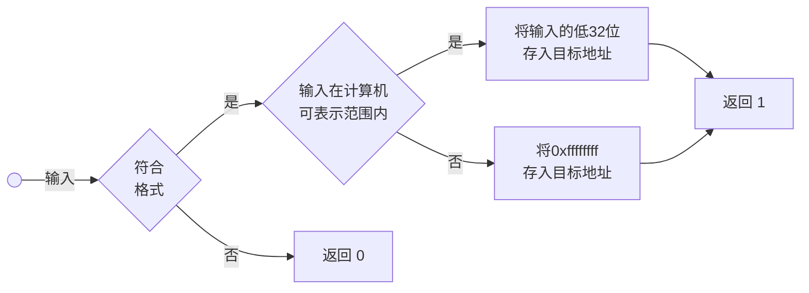

# 问题起源

猜数字游戏是一个非常经典的入门编程小游戏：程序会随机生成一个固定范围内的数字（比如 1-100），玩家需要不断输入数字进行猜测，程序会根据玩家输入的数字给出 “太大了” 或 “太小了” 的提示，直到玩家猜对为止。

这个游戏是编程初学者的必练项目，因为它能非常直观地帮我们练习条件语句和循环语句，是掌握基础编程逻辑的绝佳案例。

```c
#include <stdio.h>
#include <stdlib.h>

int main() {
  // 生成 1~100 之间的随机数
  int number = rand() % 100 + 1;
  int guess;
  
  puts("猜数字游戏（1-100）");
  
  for (;;) {
    printf("请输入你的猜测: ");
    scanf("%d", &guess);
    
    if (guess > number) {
      puts("太大了！");
    } else if (guess < number) {
      puts("太小了！");
    } else {
      puts("恭喜你，猜对了！");
      break;
    }
  }
  
  return 0;
}
```
编译运行效果如下：
```bash
$ ./main
猜数字游戏（1-100）
请输入你的猜测: 83
太小了！
请输入你的猜测: 85
太大了！
请输入你的猜测: 84
恭喜你，猜对了！
$
```
可以看到，输入`83`，`84`，`85`时，程序行为符合预期。但如果输入`2147483648`（超过`int`类型的最大值 ），程序的输出是这样：
```bash
$ ./main
猜数字游戏（1-100）
请输入你的猜测: 2147483648
太小了！
请输入你的猜测: 
```
这就不符合预期了，数字2147483648应大于1~100中的任何数，程序不应该输出`"太小了！"`。更糟的是，如果我们的输入不是数字，例如字符串`hello`，程序的行为会是这样：
```bash
$ ./main
猜数字游戏（1-100）
请输入你的猜测: hello
太大了！
请输入你的猜测: 太大了！
请输入你的猜测: 太大了！
请输入你的猜测: 太大了！
请输入你的猜测: 太大了！
请输入你的猜测: 太大了！
请输入你的猜测: 太大了！
...
```
程序输出`"太大了！"`后不再尝试读取用户的下一次猜测，而是循环输出`"请输入你的猜测: 太大了！"`。这些不符合逻辑的现象出现的原因都是什么呢？又该如何改进程序，使其能对上述输入作出正确的处理呢？

# 实验探究
为了解决上述问题，我们必须更深入地了解`scanf`函数。`scanf`函数的函数声明如下：
```c
int scanf(const char *format, ...);
```
其中，`format`参数是格式字符串，在我们的示例中是`"%d"`；`...`表示可变数量参数，表明读取数据应存放的地址，在我们的示例中是`&guess`。同时`scanf`函数有返回值，返回值类型为`int`。

为了更好地使用`scanf`函数，我们探究`scanf`函数读取的数据和返回值与实际输入的关系。为此，我们设计测试程序如下：
```c
#include <stdio.h>

int main() {
  int num = 42;
  printf("input: ");
  int rv = scanf("0x%x", &num);
  printf(" rv = %d\n", rv);
  printf("num = %d\n", num);
  return 0;
}
```
编译运行效果如下：
```bash
$ ./main
input: 0x80000000
 rv = 1
num = -2147483648
```
对于不同的输入，程序会输出`scanf`函数读取的数据和返回值。为了便于观察，我们使用`"%x"`参数以输入16进制格式。在本实验中，该参数不会影响我们的结论。使用更多的输入，在64位机器上进行实验，并将结果总结成表格如下

|序号|输入|rv|num|num的机器数|
|:--:|---:|:--:|---:|:---|
|1|`0x1`|`1`|`1`|`0x00000001`|
|2|`0x80000000`|`1`|`-2147483648`|`0x80000000`|
|3|`0xffffffff`|`1`|`-1`|`0xffffffff`|
|4|`0x100000000`|`1`|`0`|`0x00000000`|
|5|`0x100000001`|`1`|`1`|`0x00000001`|
|6|`0xfffffffffffffffe`|`1`|`-2`|`0xfffffffe`|
|7|`0xffffffffffffffff`|`1`|`-1`|`0xffffffff`|
|8|`0x10000000000000000`|`1`|`-1`|`0xffffffff`|
|9|`hello`|`0`|`42`|`0x0000002a`|

可以看到，当我们的输入不符合`"0x%x"`格式时，`scanf`将返回`0`，`num`为初始值（测试9）；当我们的输入符合格式，但超过64位计算机可表示的范围时，`scanf`将返回`1`，且`num`为`-1`（测试8）；当我们的输入在64位计算机可表示的范围内时，由于`num`是32位变量，`scanf`函数会将输入的低32位存入`num`中（测试1-7）。

`scanf`函数处理32位整型格式的流程图如下。



# 原因分析

现在，我们能够解释猜数字程序中的问题了。

当输入为`2147483648`时，`scanf`将读取`2147483648`的低32位，即`0x80000000`，并存入`guess`中；在32位有符号整型下，`0x80000000`是`-2147483648`的补码，故变量`guess`的值为`-2147483648`；由于-2147483648小于1-100中的任何数，故程序输出`"太小了！"`。

当输入为`hello`时，`scanf`无法读取`hello`，故会将`hello`保留在输入缓冲区中并返回`0`；下一轮循环调用`scanf`时，由于`hello`仍在输入缓冲区中，`scanf`将再次读取失败并返回，而不会等待用户的下一次输入。

# 解决方案

我们先解决第二种情形，即输入不符合格式的情形。解决方案是利用`scanf`的返回值，当检测到`scanf`返回`0`时，利用`while`循环将输入缓冲区清空，并提示用户重新输入。代码如下：
```c
#include <stdio.h>
#include <stdlib.h>

int main() {
  int number = rand() % 100 + 1;
  int guess;
  
  puts("猜数字游戏（1-100）");
  
  for (;;) {
    printf("请输入你的猜测: ");
    
    if (scanf("%d", &guess) == 0) {
      char c;
      while ((c = getchar()) != EOF && c != '\n');
      puts("输入有误，请重新输入！");
      continue;
    }
    
    if (guess > number) {
      puts("太大了！");
    } else if (guess < number) {
      puts("太小了！");
    } else {
      puts("恭喜你，猜对了！");
      break;
    }
  }
  
  return 0;
}
```
编译运行效果如下：
```bash
$ ./main
猜数字游戏（1-100）
请输入你的猜测: hello
输入有误，请重新输入！
请输入你的猜测: 84
恭喜你，猜对了！
$
```
可以看到程序成功读取用户的下一次猜测，并作出正确判断。

对于第一种情形，`scanf`返回值与合法情形相同，故无法通过返回值检测。

当输入超过64位计算机可表示的范围时，`guess`的机器数一定为全`1`，而合理的猜测范围为1-100，故我们可以通过判断`guess`的机器数是否为全`1`来检测这种情况。

当输入超过32位有符号整型表示的范围时，`guess`的值可能会落在合法区间内，故无法通过`guess`的值来检测该种情形。解决方法是将`guess`的类型改为64位整型，从而彻底规避这种情形出现。

综上，最终代码如下：
```c
#include <stdio.h>
#include <stdlib.h>

int main() {
  long number = rand() % 100 + 1;
  long guess;
  
  puts("猜数字游戏（1-100）");
  
  for (;;) {
    printf("请输入你的猜测: ");
    
    if (scanf("%ld", &guess) == 0) {
      char c;
      while ((c = getchar()) != EOF && c != '\n');
      puts("输入有误，请重新输入！");
      continue;
    }
    
    if (guess < 1 || guess > 100) {
      puts("请输入1-100内的整数！");
      continue;
    }
    
    if (guess > number) {
      puts("太大了！");
    } else if (guess < number) {
      puts("太小了！");
    } else {
      puts("恭喜你，猜对了！");
      break;
    }
  }
  
  return 0;
}
```
编译运行效果如下：
```bash
$ ./main
猜数字游戏（1-100）
请输入你的猜测: 2147483648 
请输入1-100内的整数！
请输入你的猜测: 99999999999999999999        
请输入1-100内的整数！
```
符合预期。

# 结语

本文明确了`scanf`在`%d`格式下的行为，并对整数溢出和格式错误两个问题给出了解决方案。对异常输入的正确处理是构建健壮系统的关键，而能够发现并正确处理异常输入，需要我们足够了解我们所使用的编程语言乃至计算机的底层机制。通过设计合理的测试并进行实验，我们能够加深对编程语言与计算机的了解，从而更好地使用它们。
