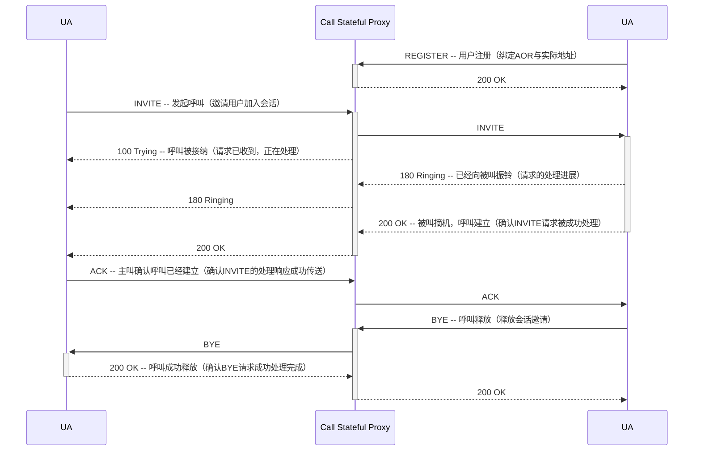
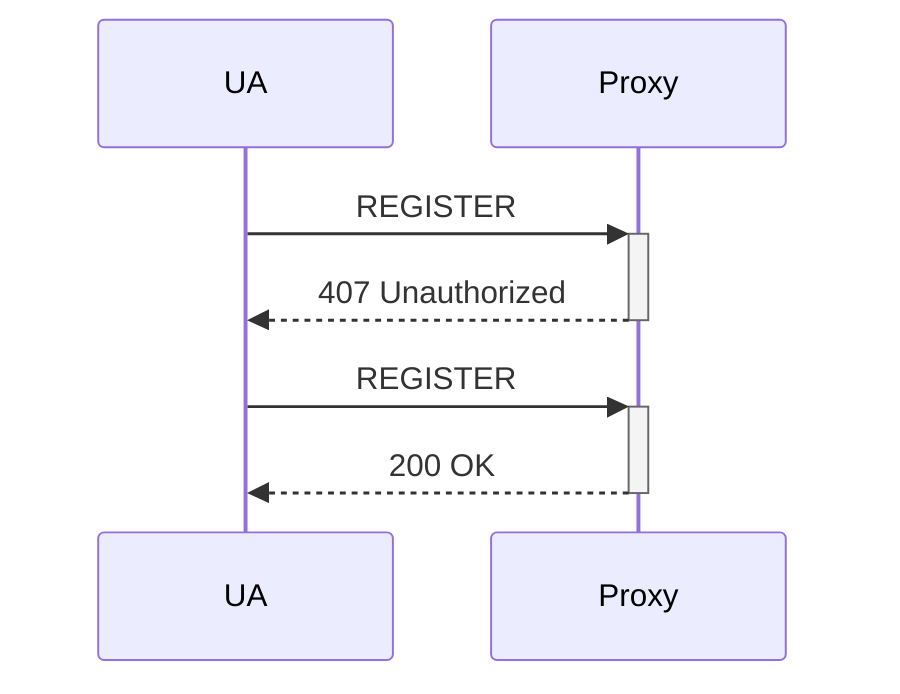
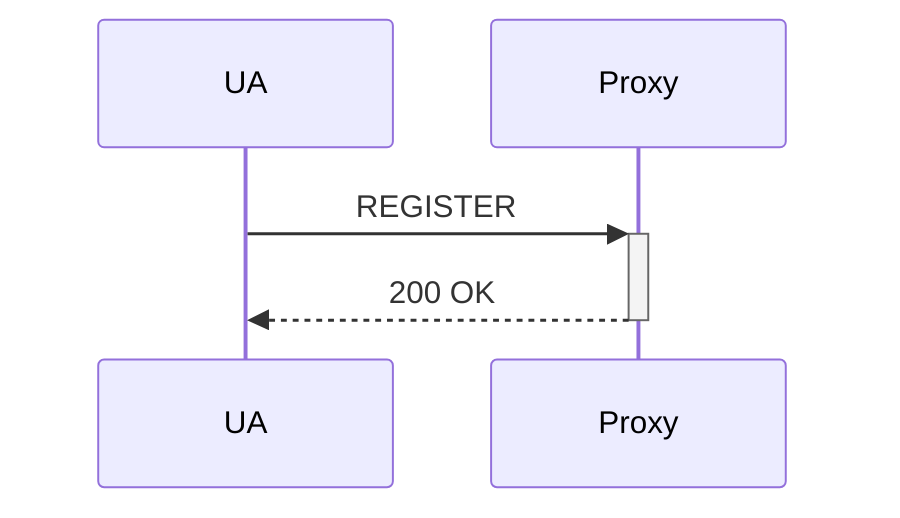
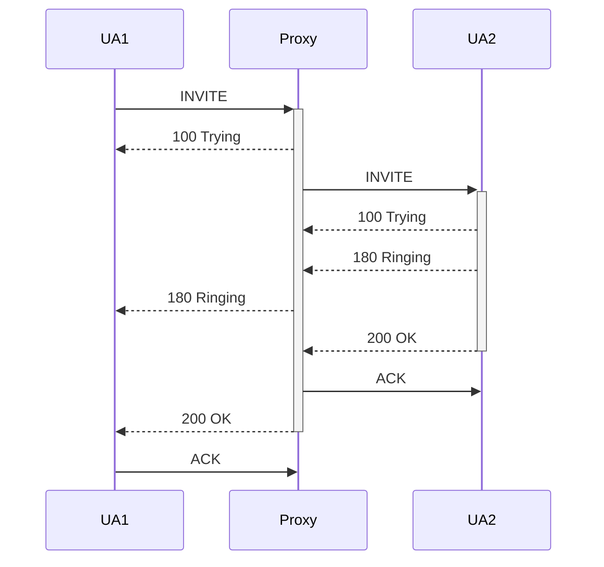
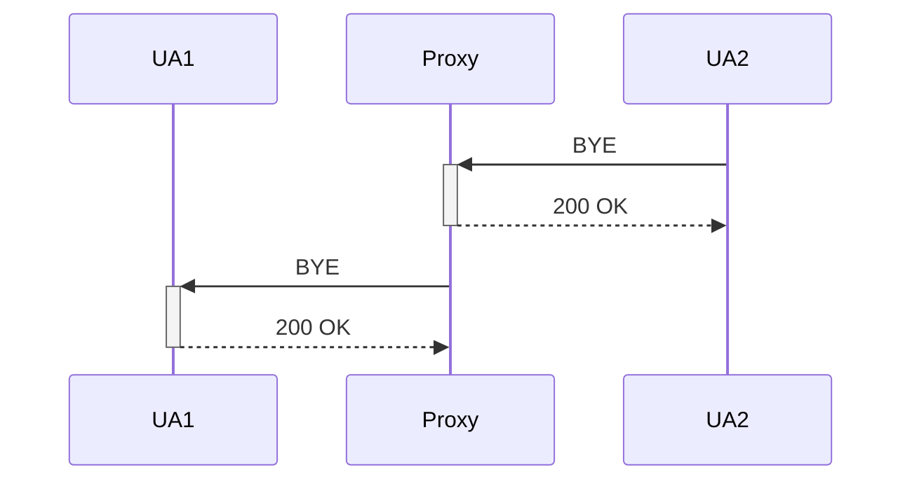
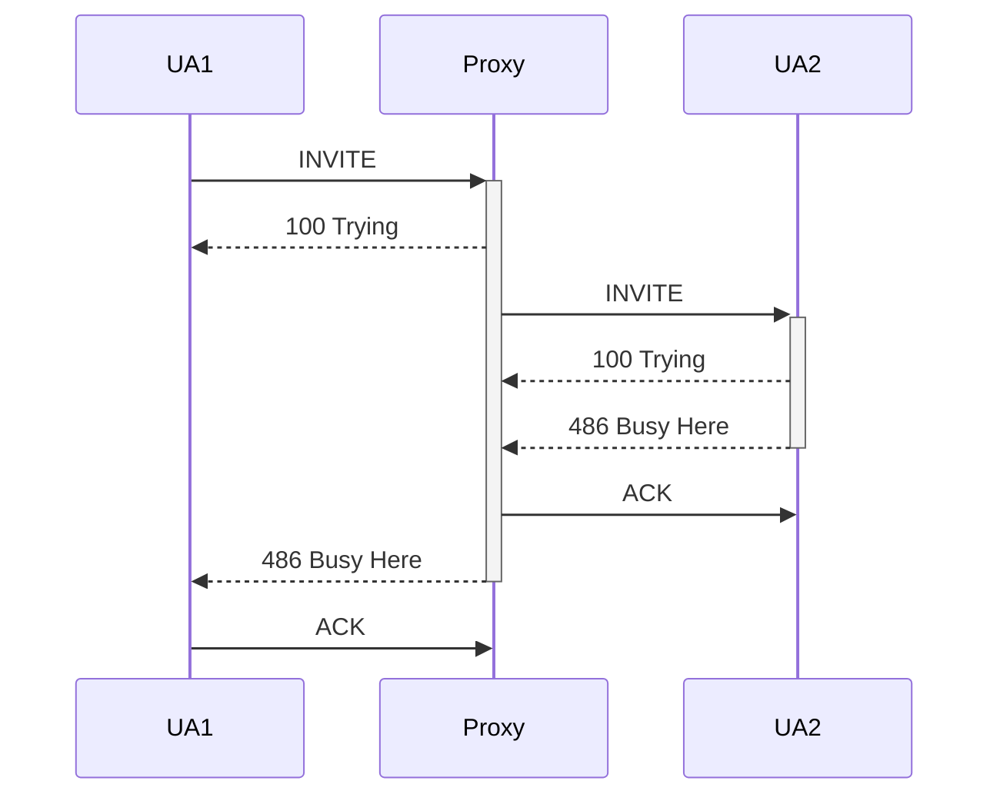
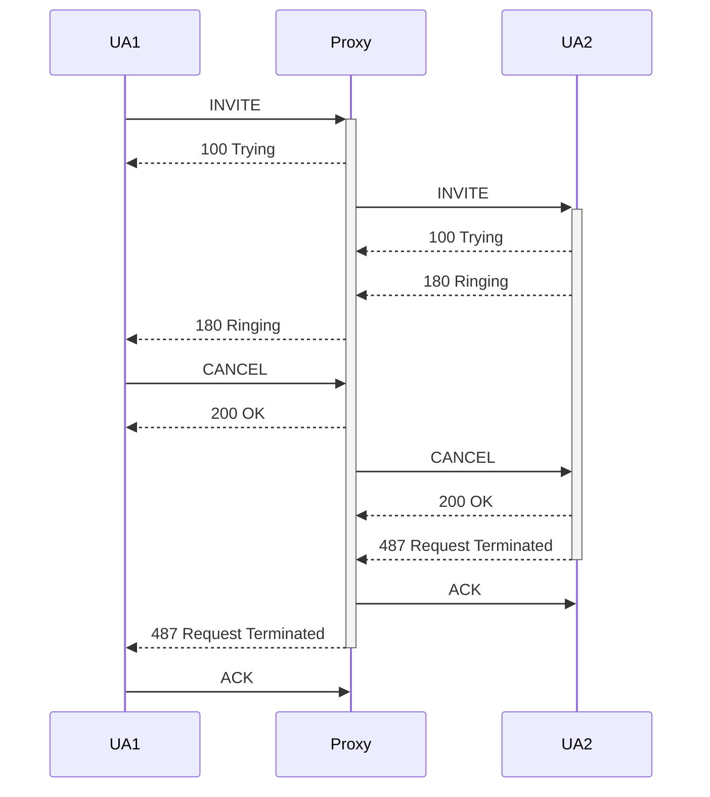
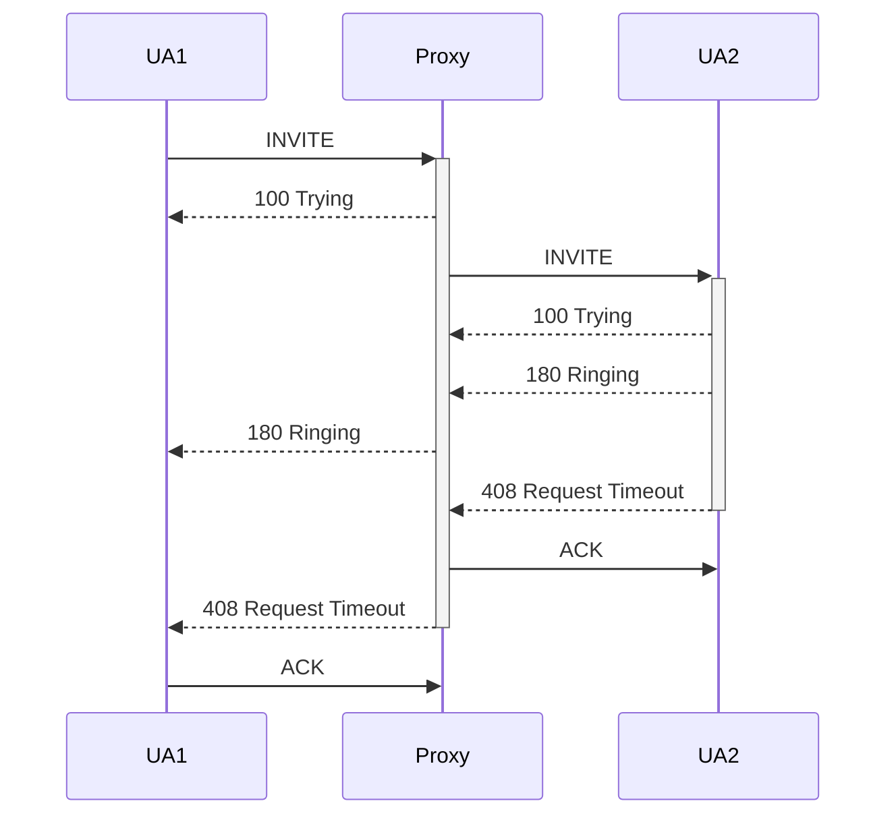
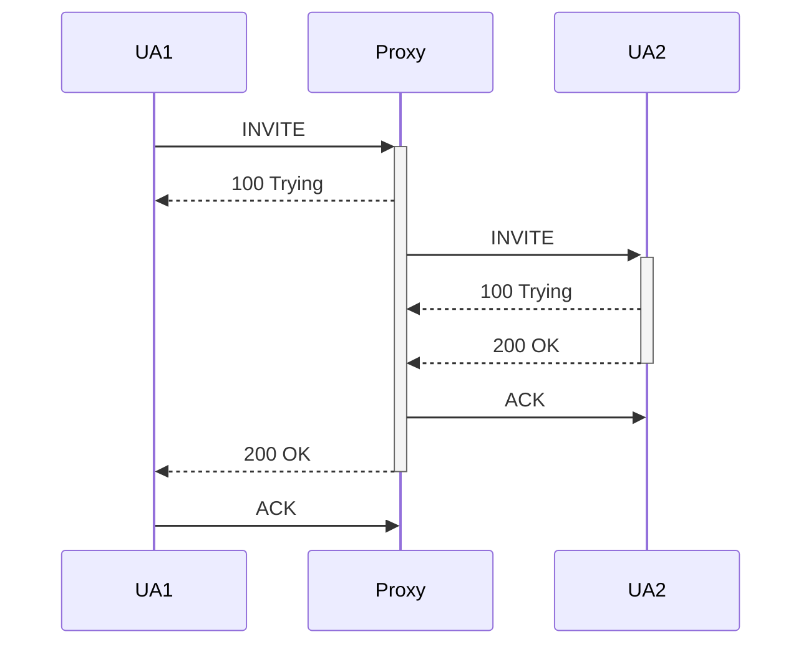
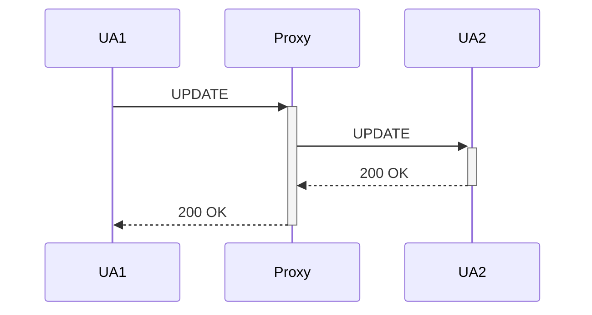

## 交换概论

### 交换与通信网

无交换的多点间电话通信

- 需全互连方式两两相连
  - 若终端数为$N$，则线对数为$C_N^2=\frac{N(N-1)}{2}$
- 每个终端需配置一个多路选择开关
- 增加第$N+1$个终端操作复杂
  - 增加$N$对线路
  - 更换所有多路选择开关


交换：在通信网上，负责在通信源点和目的点之间建立通信通道，并传送通信信息的机制。

通信网的三要素

- 交换设备
- 传输设备
  - 用户线
  - 中继线
- 终端设备


通信网的分层结构

- 应用层
- 业务层
- 传送层

- 支撑网


通信的基本问题

- 编码：用什么信息格式传递给对方
- 寻址：如何找到对方
- 信息传递的额外要求
  - 网络结构
  - **带宽**
  - **复用**
  - **连接方式**
  - 安全
  - 服务质量


通信的三对基本概念

- 信息传送
  - 面向连接工作方式：连接建立、信息传送、连接释放
    - 物理连接
    - 逻辑连接
  - 无连接工作方式：边选路（寻址），边传递信息
- 时分复用
  - 同步时分复用
    - 位置化信道：依据信号在时间轴上的位置来区别每一路信号（逻辑信道），无信息传送时也占用信道
    - 子信道信息流速率恒定，每帧一个定长数据
  - 统计（异步）时分复用
    - 标志化信道：标志码标识哪路信息，与时间位置无关
    - 分组长度可变或固定，分组头起定界作用
    - 统计复用提高信道利用率
- 带宽分配
  - 固定带宽分配
  - 动态带宽分配

### 交换方式

#### 电路交换

电路交换特点

- 面向连接的工作方式（物理连接）
- 同步时分复用（固定带宽分配）
- 无差错控制机制
- 对通信信息不作处理（透明传输）
- 流量控制基于呼叫损失制


适合实时、恒定速率的话音业务，例如电话通信网（Public Switched Telephone Network，PSTN）

#### 多速率电路交换

将几个基本信道速率捆绑起来，构成一个速率更高的信道，即确定基本信道速率，按需形成其它速率，且其它速率是基本速率的**整数倍** 

问题一：确定基本速率

- 太低：难以实现高速业务
- 太高：低速业务造成带宽浪费


问题二：保证时隙顺序完整性

特点：软件实现，控制软件复杂

应用：ISDN多速率承载业务

#### 分组交换

典型应用：公用电报网的电报自动交换

分组头：选路信息及其它控制信息

分组大小：可变长、长度（兼顾时延和开销）

分组交换两种方式

- 虚电路（Virtual Circuit，VC）
  - 面向连接的工作方式，逻辑连接
  - 应用：Packet Switched Public Data Network，PSPDN
- 数据报（Datagram，DG）
  - 路由选择和数据转发同时进行
  - 典型应用：IP网络


分组交换特点

- 面向连接方式（逻辑连接）和无连接方式
- 统计时分复用（动态分配带宽）
- 有差错控制机制
- 对通信信息作处理
- 流量控制基于呼叫延迟制

|            | 虚电路             | 数据报                     |
| ---------- | ------------------ | -------------------------- |
| 分组头     | 简单（逻辑信道号） | 复杂（详细的选路信息）     |
| 选路       | 基于虚连接表       | 每个分组独立选路，选路复杂 |
| 分组顺序   | 不会失序           | 失序现象                   |
| 故障敏感性 | 敏感               | 不敏感（可靠性高）         |
| 应用       | 连续数据流         | 询问/相应                  |

适合可靠性要求高、可变速率的数据业务，例如数据通信网

#### 帧中继

帧中继协议简化的前提

- 高度可靠的光纤系统，无需链路层复杂的流量控制和差错控制功能
- 终端系统日益智能化，具备以端到端方式进行差错控制的能力


典型应用：LAN互联

|              | CTM                  | PTM                                                  |
| ------------ | -------------------- | ---------------------------------------------------- |
| 信息损伤     | 时间透明性           | 语义透明性                                           |
| 支持多种业务 |                      | 灵活性高，可实现多速率交换，允许多种业务共享网络资源 |
| 设备复杂性   | 需要复杂路由选择算法 | 需要复杂队列管理机制                                 |

#### ATM交换（Asynchronous Transfer Mode）

ATM交换特点

- 以分组传送模式为基础并融合了电路传送模式高速化的优点

  - 固定长度的信元
    - 短信元可以减少交换节点内部的缓冲器容量以及排队时延和时延抖动
    - 信元的长度固定，可用硬件实现交换，有利于简化交换控制和缓冲器管理

  - 面向连接的工作方式

  - 异步时分复用

    - 有一个表明属于哪路逻辑信道的标记(VPI/VCI)

    - 通过标记来区分每一个逻辑信道

  - 动态分配带宽

- 简化了分组通信中的协议，并由硬件对简化的协议进行处理，交换节点不再对信息进行流量控制和差错控制，极大提高了网络传输处理能力

### 交换系统

交换系统基本结构

- 信息传送子系统
  - 交换网络
  - 接口
    - 用户侧接口
    - 网络侧接口
- 控制子系统
  - 控制系统

  交换系统基本技术

- 互连技术
  - 交换网络的拓扑结构
  - 选路策略
  - 控制机理
  - 多播方式
  - 阻塞特性
  - 故障防卫
- 接口技术
  - 用户侧接口
  - 系统侧接口

- 信令或协议技术
  - 信令
    - 信令是呼叫接续过程中所采用的一种“通信语言”，用于协调动作、控制呼叫。这种“通信语言”应该是可相互理解的、相互约定的、以达到协调动作为目的的。
    - 信令是通信网中规范化的控制命令，它是控制交换机产生动作的命令，它的作用是控制通信网中各种通信连接的建立和拆除，并维护通信网的正常运行。
  - 协议
    - 在计算机网络中，为了使计算机或终端之间能够正确地传递信息，必须有一整套关于信息传输顺序、格式和信息内容等的约定，这一整套约定称为协议（protocol）。
    - 一个完整的协议应具有以下5个基本要素
      - 协议所提供的服务
      - 对协议运行环境所进行的假设
      - 用来实现协议的词汇
      - 词汇中每个消息的编码
      - 用来控制消息一致性的过程规则
  - 协议属于信令
- 控制技术
  - 控制系统的结构方式
    - 集中控制
      - 处理机间通信接口简单
      - 单个处理机上的应用软件复杂、庞大、
      - 系统可靠性较低（单机系统）
    - 分散控制
      - 分级分散控制
      - 全分散控制
        - 各处理机处于同一级别
        - 各处理机之间通信接口较复杂
        - 单个处理机上的应用软件相对简单
        -  系统可靠性比较高
        - 系统具有较好的扩充能力
  - 处理机间的通信方式
  - 多处理机结构

## 交换网络

### 交换网络构成

**交换**：在任意的入线和出线之间建立连接

**交换单元**：构成交换网络的最基本的部件

**交换网络**：由若干个**交换单元**按照一定的**拓扑结构**和**控制方式**构成

### 交换单元

#### 交换单元基本概念

$M\times{N}$交换单元

- 入线（$0\dots{M-1}$）
- 出线（$0\dots{N-1}$）
- 控制端
- 状态端


交换单元的分类

- 按入出线的信息传送方向
  - 有向交换单元：当信息经过交换单元时只能从入线进、出线出，具有唯一确定的方向。
  - 无向交换单元：交换单元的每条线即可入也可出。
    - $N$无向交换单元
    - $K\times{L}$无向交换单元（$N=K+L$）
- 按入出线的数量关系
  - 集中型（$M>N$）
  - 扩散型（$M<N$）
  - 连接型（$M=N$）
- 按入出线之间是否共享单一通路
  - 空分交换单元
    - 开关阵列
    - 空间接线器
  - 时分交换单元
    - 共享存储器
    - 共享总线
- 按交换单元所接收的信号
  - 模拟交换单元
  - 数字交换单元

  交换单元的连接特性

- 交换单元连接特性的描述方式
  - 集合描述方式：所有入线序号为集合$T$，出线序号为集合$R$。连接$c=\set{t,R_t}$，$t\in{T}$，$R_t\in{R}$
  - 函数描述方式：$f:t\mapsto{R_t}$，$R_t\in{R}$
    - 排列：$\pmatrix{t_1&t_2&\dots&t_n\\r_1&r_2&\dots&r_n}$，入线排列表达式：$(0,1,2,\dots,N-2,N-1)$
    - 图形：略
    - 二进制函数：$E(x_{n-1}x_{n-2}{\dots}x_1x_0)$
- 常见交换单元的连接方式（定义$\pi_\sigma:T\to{R}$满足$(\pi_\sigma(x))_i=x_{\sigma(i)}$）
  - 直接连接：$I(x_{n-1}x_{n-2}{\cdots}x_1x_0)=x_{n-1}x_{n-2}{\cdots}x_1x_0$
  - 交叉连接：$E(x_{n-1}x_{n-2}{\cdots}x_1x_0)=x_{n-1}x_{n-2}{\cdots}x_1\overline{x_0}$
  - 蝶式连接：$\beta=\pi_{\pmatrix{0&n-1}}$
    - 子蝶式连接：$\beta_{(k)}=\pi_{\pmatrix{0&k}}$
    - 超蝶式连接：$\beta^{(k)}=\pi_{\pmatrix{k&n-k-1}}$
  - 均匀洗牌连接：$\delta=\pi_{\pmatrix{n-1&n-2&\cdots&1&0}}$
    - 子洗牌连接：$\delta_{(k)}=\pi_{\pmatrix{k&k-1&\cdots&1&0}}$
    - 超洗牌连接：$\delta^{(k)}=\pi_{\pmatrix{n-1&n-2&\cdots&n-k&n-k-1}}$
  - 间隔交叉连接：$C_k(x_{n-1}x_{n-2}{\cdots}x_{k+1}{x_k}x_{k-1}{\cdots}x_1x_0)=x_{n-1}x_{n-2}{\cdots}x_{k+1}\overline{x_k}x_{k-1}{\cdots}x_1x_0$


交换单元的性能

- 容量：交换单元所有入线可以同时送入的总的信息量
- 接口：交换单元需要规定自己的信号接口标准，即信号形式、速率及信息流方向
- 功能：点到点、点到多点
- 质量：完成交换动作的速度、任何情况下是否能完成指定连接、信息经过交换单元是否有损伤（时间、语义）

#### 空分交换单元

在交换单元内部，要建立任意入线和任意出线之间的连接，就在每条入线和每条出线之间都各自接上一个开关，所有开关就构成了交换单元内部的开关阵列。

- 开关的位置：入、出线交叉点
- 开关的表示：$K_{ij}$（$i$为入线，$j$为出线）
- 开关的状态：通、断
- 开关的种类：单向、双向


交换单元的开关阵列实现

- $M{\times}N$有向交换单元开关阵列实现，使用有向开关：$M=(1)_{M{\times}N}$
- $N$无向交换单元开关阵列实现，使用无向开关：$M=\pmatrix{0&1&\cdots&1\\&0&\ddots&1\\&&\ddots&\vdots\\&&&0}$
- $N$无向交换单元开关阵列实现，使用有向开关：$M=\pmatrix{0&1&\cdots&1\\1&0&\ddots&1\\\vdots&\ddots&\ddots&\vdots\\1&1&\cdots&0}$
- $K{\times}L$无向交换单元开关阵列实现，使用无向开关：$M=(1)_{K{\times}L}$
- $K{\times}L$无向交换单元开关阵列实现，使用有向开关：$M=\pmatrix{O_{K{\times}K}&(1)_{K{\times}L}\\(1)_{L{\times}K}&O_{L{\times}L}}$


开关阵列的特性

- 容易实现广播功能
- 从入线到出线延迟时间均等
- 控制信号简单
- 交换单元性能依赖于所使用的开关
- 适于构成较小的交换单元（开关数反映实现复杂度和成本高低）


实际的开关阵列

- **继电器**：其构成的交换单元是无向的，可交换模拟和数字信息，干扰和噪声大、动作慢（ms级）、体积大（cm级）
- **模拟电子开关**：一般利用半导体材料制成。如：MC142100、MC145100（$4{\times}4$开关阵列）只能单向传送，且衰耗和时延较大。
- **数字电子开关**：由简单的逻辑门构成，用于数字信号的交换，开关动作极快且无信号损失。


空间交换单元也称为空间接线器（Space Switch），简称为S单元或S接线器

- 构成
  - 交叉点矩阵（开关阵列）
  - 控制存储器（Control Memory，CM）
- 功能
  - 输入输出线之间的空间交换
- 结构特点
  - S接线器所含CM数量等于入（出）线数
  - 每个CM所含有的存储单元个数等于入（出）线上的复用时隙数
  - 每个存储单元为$m$位bit，且满足$N{\le}2^m$，其中$N$为接线器的入（出）线数

- 控制方式：考虑$N{\times}N$交换单元，共$N$个$CM$，每个$CM$有$n$个单元，每个单元对应一个时隙（Time Slot，TS）

  - **输入控制方式**：入线$i$在$TS_j$的出线为$CM_i(j)$，在$TS_j$时须打开开关$K_{i,CM_i(j)}$

  - **输出控制方式**：出线$i$在$TS_j$的入线为$CM_i(j)$，在$TS_j$时须打开开关$K_{CM_i(j),i}$

- 基本特点

  - 只完成空间交换，不进行时隙交换
  - 空间接线器按时分方式工作
  - 输出控制方式易于实现多播

#### 时分交换单元

时分交换单元内部只存在一条唯一的通路，由输入复用线上各子信道分时共享

- 共享存储器型交换单元
  - 考虑$N{\times}N$交换单元，将存储器划分为$N$个区域
    - **输入缓冲方式**：存储器中的$N$个区域与$N$路输入信号一一对应
    - **输出缓冲方式**：存储器中的$N$个区域与$N$路输出信号一一对应
- 共享总线型交换单元
  - 输入部件：接收入线信号，进行相应的格式变换，放在缓冲存储器中，并在分配给该部件的时隙上把收到的信息送到总线上。
  - 输出部件：检测总线上的信号，并把属于自己的信息读入一个缓冲存储器中，进行格式变换，由出线送出，形成出线信号。


时间接线器（T接线器）：共享存储器型交换单元

- 输入线（入复用线）：同步时分复用线
- 输出线（出复用线）：同步时分复用线
- 功能：完成一条同步时分复用线上各个时隙之间的话音信息的交换
- 应用：数字电话交换系统
- 基本结构（设输入复用线上每帧的时隙数为$n$）
  - 话音存储器（Speech Memory，SM)：暂存话音的数字编码信息，单元数为$n$，每个单元至少8 bit，
  - 控制存储器（Control Memory，CM)：单元数为$n$，每个单元$\log_2c$ bit
- 控制方式（设$TS_k$输入的数据需要在$TS_i$被读出）
  - **输出控制方式**：顺序写入，控制读出。置$CM(i)=k$，$TS_k$时，数据暂存在$SM(k)$，$TS_i$时，$SM(CM(i))=SM(k)$处数据被读出
  - **输入控制方式**：控制写入，顺序读出。置$CM(k)=i$，$TS_k$时，数据暂存在$SM(CM(k))=SM(i)$，$TS_i$时，$SM(i)$处数据被读出
- 特性
  - 控制存储器：交换控制表
  - 话音存储器和控制存储器的访问速度应满足一个时隙内各完成一次读写操作
  - T接线器交换信息存在着时延，时延最好的情况是入复用线上第$i$个时隙的信息要交换到出复用线第$i$个时隙，时延最坏的情况是入复用线上第$i$个时隙的信息要交换到出复用线上第$i-1$个时隙

### 交换网络

#### 交换网络基本概念

交换网络：由若干个交换单元按照一定的拓扑结构和控制方式构成的网络。

交换网络的三个基本要素

- 交换单元
- 不同交换单元间的拓扑连接
- 控制方式


交换网络按拓扑连接方式可分为

- **单级交换网络**：由一个或者多个位于同一级的交换单元所构成的交换网络，即需要交换的信息从交换网络入线到交换网络出线只经过一个交换单元，并且当同一级有多个交换单元构成时，不同交换单元的入线与出线之间可建立连接。
- **多级交换网络**：如果一个交换网络中的交换单元可以分为K级，顺序命名为第1,2,...,K级，并且满足：
  - 所有入线都只与第1级交换单元连接
  - 所有第1级交换单元都只与入线和第2级交换单元连接
  - 所有第2级交换单元都只与第1级和第3级交换单元连接
  - 依此类推，所有第K级交换单元都只与第K-1级和出线连接
- 则称这样的交换网络为多级交换网络，或K级交换网络


**阻塞**：从交换网络不同输入端来的信息在交换网络中交换时发生了对同一公共资源争抢的情况，这时在竞争资源中失败的信息就会被阻塞，直到这个公共资源被释放。

阻塞的两种情况：内部竞争、出线竞争

- **严格无阻塞网络**：不管网络处于何种状态，任何时刻都可以在交换网络中建立一个连接，只要这个连接的起点、终点是空闲的，而不会影响网络中已建立起来的连接。
- **可重排无阻塞网络**：不管网络处于何种状态，任何时刻都可以在交换网络中直接或对已有的连接重选路由来建立一个连接，只要这个连接的起点、终点是空闲的，而不会影响网络中已建立起来的连接。
- **广义无阻塞网络**：指一个给定的网络存在着固有的阻塞可能，但又可能存在着一种精巧的选路方法，使得所有的阻塞均可避免，而不必重新安排网络中已建立起来的连接。


- 单通路交换网络
- 多通路交换网络


- 时分交换网络：时分结构的基本特征是所有的输入与输出端口分时共享单一的通信通路，具有时隙交换功能 。
- 空分交换网络：空分结构的基本特征是可以在多对输入端口与输出端口间同时并行地传送信息，具有空间交换的功能。

#### CLOS网络

CLOS网络一般指 $N{\times}N$ 3级CLOS网络，其中，入线被划分为 $r$ 组，每组有 $n$ 条入线，即 $N=r{\times}n$

- 第1级共有 $r$ 个 $n{\times}m$ 交换单元，$r$ 组入线正好分别接入 $r$ 个交换单元
- 第2级共有 $m$ 个 $r{\times}r$ 交换单元，第1级每个交换单元的 $m$ 条输出分别接到第2级中的 $m$ 个交换单元
- 第3级共有 $r$ 个 $m{\times}n$ 交换单元，第2级每个交换单元的 $r$ 条输出分别接到第3级中的 $r$ 个交换单元


CLOS网络严格无阻塞定理：最坏情况下，中间级会有$(n-1){\times}2$个交换单元被占用，因此中间级至少要有$(n-1){\times}2+1=2n-1$个交换单元，即$m{\ge}2n-1$时，可确保严格无阻塞。

3级CLOS可重排无阻塞网络条件：$m{\ge}n$

#### banyan网络

banyan网络基本结构

- L级banyan：任何输入到任何输出之间的通路都经过L级
- 规则banyan：各个交换单元是相同
- 不规则banyan：各个交换单元不相同
- 矩形banyan：每个交换单元的入线数等于出线数


通常将由 $2{\times}2$ 的交换单元构成的矩形banyan网络，简称为banyan网络

banyan网络基本特性

- **树型结构特性**：从banyan的任一输入端口引出的一组通路形成了2分支树，级数越多，分支越多，级数$k=\log_2N$，$N=总入线数/出线数$，即$2^k=N$。
- **自选路由特性**：自选路由，即是给定出线地址，不用外加控制命令，就可选到出线。可以使用对应于出端号的二进制码的选路标签来自动选路。
- **可扩展性（可规律构造）**：banyan的构成具有一定的规律，可以采用有规则的扩展方法将较小容量的banyan扩展成较大规模。方法：已有$N{\times}N$的banyan网络，需构成$2N{\times}2N$的banyan网络，则可用2组 $N{\times}N$，再加上一组$N$个 $2{\times}2$ 交换单元构成。将$N$个 $2{\times}2$ 交换单元的入线作为该网络的入线，将每个 $2{\times}2$ 交换单元的出线分别与第一组的 $N{\times}N$ 和第二组的 $N{\times}N$ 的相连，2组 $N{\times}N$ 的出线即为网络的出线。（第 $n$ 级为 $\beta_{(\log_2N-n)}$ 置换）
- **单通路特性**：banyan的任一入端到任一出端之间，具有1条且仅有一条通路。
- **内部竟争性**：banyan是具有内部竞争的有阻塞网络。


解决内部阻塞的方法

- 使用排序-banyan网络
- 构造多通路
  - 可以通过增加多级交换网络的级数来消除内部阻塞（已有证明，若要完全消除 $N{\times}N$ 的banyan网络的内部阻塞，至少需要 $2\log_2N-1$级）
  - 对应一个输出地址有多条链路
  - 可以增加banyan网的平面树，构成多通道交换网络


batcher-banyan网络：该网络也简称为B-B网，是由batcher排序网和banyan网组成，它成功地避免了banyan网络的内部阻塞，这是目前ATM交换机使用较多的一种网络。batcher排序网是由 $2{\times}2$ 比较器（batcher比较器）构成的。

基于banyan的多通路结构

为了减少或消除banyan的内部阻塞，提高吞吐率，除了构成B-B网络之外，还可以构成基于banyan的各种多通路网络。

- 增长型banyan：每增加1级，每个入端与每个出端之间的通路数就增加1倍
- 扩展型banyan：每个输出地址有 $d$ 条，链路输出地址并非 $2d$ 个
- 膨胀型banyan：膨胀度 $d$ 在各级可变化，扩展型banyan的特例
- 复份型banyan：多平面banyan网络结构，负荷均分、广播功能

#### benes网络

benes网络是著名的多通路网络，具有可重排无阻塞的特点。

benes网络相当于两个banyan(banyan与反转banyan)的背对背相连，并将中间相邻两级合并为1级。由于每个banyan有 $\log_2N$ 级，因此benes网络共有 $2\log_2N-1$ 级

benes网络的构成也有一定的规律。使用 $2{\times}2$ 交换单元的 $N{\times}N$ benes网络的构成方法为：两侧各有 $\frac{N}{2}$ 个 $2{\times}2$ 交换单元，中间为两个 $\frac{N}{2}{\times}\frac{N}{2}$ 的子网络，每个交换单元以一条链路连到每个子网络；再将中间子网络按上述方法继续分解，直到中间子网络就是 $2{\times}2$ 交换单元为止。

## 分组交换

### MPLS产生背景

问题一：新的业务(数据、多媒体等)出现后，如何有效支撑相关业务应用？

ISDN网络可提供综合业务

ISDN技术发展

- 20世纪70年代提出
- 20世纪80年代中期标准推出、实验网建设
- 20世纪80年代末、90年代初向公众开放
- 20世纪90年代末开始逐渐淡出网络应用
- 原因
  - 技术：以电路交换模式为基础，不能满足业务发展需求
  - 市场：ADSL技术应用的冲击


问题二：新的支持多种业务(话音、数据、视频、多媒体通信等)的宽带网络的设计目标？

- 对信息的损伤要小
  - 具有时间透明性(信息传送的时延和时延抖动要小)
  - 具有语义透明性(由传送引起的信息丢失和差错要小)
- 能灵活地支持各种业务
- 具有高速传送信息的能力


ATM基本原理

- ATM信元及其结构
  - 信元结构：信元由 5 字节信头和 48 字节信息段（净荷）组成
  - GFC（Generic Flow Control）：一般**流量控制**字段，4 bit，用于接入的流量控制。由于B-ISDN的UNI接入的终端数量可以很多，需要控制流向网络的流量，以避免网络，短期过载。
  - VPI/VCI（Virtual Path Identifier/Virtual Channel Identifier）：**选路信息**
  - PT（Payload Type）：3 bit，表示**净荷类型**
  - CLP（Cell  Loss Priority）：表示**信元丢失优先级**，1 bit，CLP=0，表示高优先级；CLP=1，表示低优先级，若遇到拥塞要丢弃信元时，CLP=1的信元将首先丢弃。
  - HEC（Head Error Control）：8 bit，用于信头**差错控制**
- 异步时分复用技术
  - STD（Synchronous Time Division）：通过**时间位置**来区别每一个逻辑信道
  - ATD（Asynchronous Time Division）：通过**标记**来区别每一个逻辑信道
- 面向连接的工作方式
  - ATM传输通道可分割成若干个逻辑子信道 ，为便于应用和管理，逻辑子信道可按两个等级来划分
    - 虚通道（Virtual Path，VP）
    - 虚信道（Virtual Channel，VC）
  - VP交换是指仅变换VPI值而不改变VCI值的交换，即只进行虚通道的交换，虚通道里面的虚信道并不进行交换。
  - ATM连接的建立过程。在源ATM端点与目的ATM端点进行通信前的连接建立过程，实际上就是在这两个端点间的各段传输通道上，找寻空闲VC链路和VP链路，分配VCI与VPI，建立相应VCC与VPC的过程。


ATM技术应用现状

- 退出骨干网
- 应用于城域网


问题三：下一个宽带交换技术应该是怎样的？

- 低时延
- 高带宽
- 高可靠
- 灵活支持各类业务

### 多协议标记交换

#### 什么是MPLS

问题：IP网络信息传送的特点（业务节点的功能） ？

- 分组交换(数据报方式)
- 无连接工作方式
- 动态分配带宽(统计时分复用)
- 无QoS保证(尽力而为)


IP网络技术特点：

- 优点：技术简单、可扩展性好、灵活性高
- 存在问题：传输效率低、无法保证服务质量


问题：ATM网络信息传送的特点（业务节点的功能）？

- ATM交换方式
- 面向连接工作方式(逻辑连接)
- 动态分配带宽(异步时分复用)
- 有QoS保证


ATM网络技术特点：

- 优点：可满足多业务需求、传输效率高保证服务质量、有流量控制
- 存在问题：技术复杂、可扩展性不好


多协议标记交换（Multi-Protocol Label Switching，MPLS）

MPLS是利用标记进行数据转发的。当分组进入网络时，要为其分配固定长度的短的标记并将标记与分组封装在一起，在整个转发过程中，交换节点仅根据标记进行转发。

- LABEL(20bit)：标记的编码值。
- EXP(3bit)：保留位。
- S(1bit)：栈底指示位，1表示当前标记为栈底标记，0表示当前标记不是栈底。
- TTL(8bit)：生存时间标识，与IP分组头中的TTL域含义相同。


MPLS具有“多协议”特性，对上兼容IPv4、IPv6等多种主流网络层协议，将各种传输技术统一在一个平台之上；对下支持ATM、FR、PPP等链路层多种协议，从而使得多种网络的互连互通成为可能。

#### MPLS网络体系结构

边缘路由器LER(Label Edge Router)

- 入口LER:
  - 分配标记
  - 将IP分组封装成标记分组
  - 将标记分组从相应端口转发出去
- 出口LER:
  - 去除标记，将标记分组还原为IP分组
  - 查找路由表将IP分组转发出去


核心路由器LSR(Label Switching Router)

- 依据标记信息表进行转发


标记交换路径LSP(Label Switching Path)

- MPLS网络为具有一些共同特性的分组通过网络而选定的一条通路，由入口的边缘交换路由器，一系列核心路由器和出口的边缘交换路由器以及它们之间由标记所标识的逻辑信道组成。


标记分发协议LDP(Label Distribution Protocol)

- MPLS的控制协议，用于LSR之间交换信息，完成LSP的建立、维护和拆除等功能。


转发等价类FEC(Forwarding Equivalence Class)

- 在MPLS网络中经过相同的LSP，完成相同的转发处理的一些数据分组，这些数据分组具有某些相同的特性。
- FEC的划分通常依据网络层的目的地址前缀或是主机地址。


标记映射

- 将标记分配给FEC。

#### MPLS基本交换原理

MPLS交换采用面向连接的工作方式，信息传送要经过以下三个阶段:

- 建立连接：对于MPLS来说，建立连接就是形成标记交换路径LSP的过程
  - LSP建立控制方式
    - 独立控制方式：每个LSR可以独立地为FEC分配标记，并将映射关系向相邻LSR发布
    - 有序控制方式：一个LSR为某FEC分配标记当且仅当该LSR是MPLS网络的出口LER，或者该LSR收到某FEC目的地址前缀的下一跳LSR发来的对应此FEC的标记映射。
  - 标记分配过程(LDP)
    - 发现相邻的LDP对等体：使用UDP广播，发现相邻LSR
    - 建立LDP会话：相邻LSR间建立TCP连接，并建立LDP会话
    - 建立LSP：标记由下游LSR分配，并沿LDP会话通知上游LSR
  - 标记分配方式
    - 上游标记分配 (一般不使用)
    - 下游自主标记分配
    - 下游按需标记分配
- 数据传输：数据传输就是数据分组沿LSP进行转发的过程
  - 入口路由器的处理过程
    - 数据分组到LSP的映射、将数据分组封装成标记分组、将标记分组从相应端口转发出去
  - 核心路由器的处理过程
    - 依据标记进行转发
  - 出口路由器的处理过程
    - 弹出标记、用网络层地址查找路由表确定下一跳
- 拆除连接：拆除连接就是通信结束或发生故障异常时释放LSP的过程
  - 连接的拆除也就是标记的取消，标记取消的方式主要有两种
    - 采用计时器方式
    - 通过LDP消息取消标记

#### MPLS交换节点体系结构

### 新一代互联网IPv6+技术

#### SRv6

SR(Segment Routing-段路由)概述

- SR(Segment Routing,段路由)是基于源路由理念而设计的在网络上转发数据包的一种架构
- SR将网络路径分成一个个段(Segment),并且为这些段和网络中的转发节点分配段标识ID;通过对段和网络节点进行有序排列(Segment List),就可以得到一条转发路径
- SR将代表转发路径的段序列编码在数据包头部


SR的基本概念

- Segment
  - 节点针对所收到的数据包要执行的指令,该指令包含在数据包头部中
  - 例如
    - 指令1:沿着最短路径到达R4(支持ECMP)
    - 指令2:沿着R4的GE0/0/2接口转发数据包
    - 指令3:沿着最短路径到达R8(支持ECMP)

- Segment ID(SID)

  - 用于标识Segment,它的格式取决于具体的技术实现,例如可以使用MPLS标签、MPLS标签空间中的索引、IPv6地址。
  - Segment List是一个或多个SID构成的有序列表。

  - 例如
    - 指令1(400):沿着支持ECMP的最短路径到达R4
    - 指令2(1046):沿着R4的GE0/0/2接口转发数据包
    - 指令3(800):沿着支持ECMP的最短路径到达R8

- 源路由(Source Routing)：源节点选择一条路径并在报文中压入一个有序的Segment List , 网络中的其他节点按照报文封装的Segment List进行转发。


SR在MPLS上的实现：SR-MPLS

SR在IPv6上的实现：SRv6

#### 网络切片

网络切片是在一张物理网络上切分出多张包含特定网络功能,由定制网络拓扑和网络资源组成的虚拟网络,用于满足不同网络切片租户的业务功能需求和提供服务质量 SLA ( Service Level Agreement ,服务等级协议)保证。

FlexE(Flexible Ethernet,灵活以太网):是承载网实现业务隔离承载和网络切片的一种接口技术。FlexE技术将一个大带宽的以太网物理接口按时隙池化,通过时隙资源池灵活划分出若干子通道接口(FlexE接口),实现对接口资源的灵活、精细化管理。 

#### APN6

当网络感知应用后便能够在识别应用数据的基础上,结合SRv6、网络切片等新技术,针对关键应用或关键用户提供差异化 的 SLA ( Service Level Agreement ,服 务等 级协议 )保 障,实现应用流量的精细化资源调度,保证应用体验。

APN6(Application-aware IPv6 Networking,应用感知的IPv6网络)利用IPv6报文自带的可编程空间,将应用感知信息以APN头部的方式携带进入网络,使得网络能够感知应用及其需求,进而为其提供精细的网络服务和精准的网络运维服务。

应用感知信息(类比“货物信息”)主要包括:

- 应用感知标识(APN-ID):便于网络区分不同应用流和某个/类应用的不同用户(组)等。APN6方案中,该内容为必选。(类比“货物类型”)
- 应用感知参数(APN Parameters):可以包括带宽、时延、抖动、丢包率等应用对网络性能的需求参数。在APN6方案中,该内容为可选。(类比“运输需求”)

## SIP协议

### SIP协议产生背景

### SIP协议基础

#### SIP设计目标

SIP协议是一种应用层会话控制协议，用于建立、修改、终止用户之间的多媒体会话(邀请指定用户加入多媒体会话)

#### SIP体系架构及功能实体

SIP协议网络架构

- SIP是一种C/S(客户-服务器)结构的协议

  - SIP client发出Request,SIP Server给出Response

  - 消息处理与HTTP类似,易于与其他应用集成


用户代理

- 用户终端系统中的SIP应用称作SIP用户代理(UA)
  - 用户代理客户(UAC):发送SIP请求
  - 用户代理服务器(UAS):
    - 侦听呼叫请求
    - 提示用户或执行程序作出响应
  - UA=UAC+UAS


网络服务器

- 注册服务器(Register Server)
  - 接收客户当前的位置信息。
- 代理服务器(Proxy Server)
  - 将客户的请求转发到另一SIP服务器或最终的目的地,也可能将请求分发到多个服务器。
- 重定向服务器(Redirect Server)
  - 通过响应告诉客户下一跳服务器的地址,然后客户根据此地址向下一跳服务器重新发送请求。


两种目标用户定位方式

|          | Proxy处理模式                         | Redirect处理模式                     |
| -------- | ------------------------------------- | ------------------------------------ |
| 完成功能 | 完成用户管理、路由的能力              | 完成用户管理、路由的能力             |
| 处理原则 | 转交会话请求                          | 不转交会话请求，通知转交方向         |
| 特点     | 会话接续的主动权在Proxy，类比集中控制 | 会话接续的主动权在User，类比分散控制 |

#### SIP协议消息

SIP协议操作特征

- SIP协议网络架构采用C/S结构
- SIP协议消息采用“Request”-“Response”机制
  - Client → Server: Request: for the purpose of invoking a particular operation
    - REGISTER：将用户位置信息送往SIP服务器
    - INVITE：邀请一个用户加入一电话呼叫或会议
    - BYE：中止两用户之间的连接
    - OPTIONS：请求有关用户能力的信息，但不建立呼叫
    - STATUS：通知另一服务器正在进行的信令动作进展情况
    - CANCEL：中止用户的查找（取消未决的请求）
    - ACK：证实客户已收到最终的相应
  - Server → Client: Responses: for indicating the status of a request sent from the client to the server.
    - 1xx Provisional：临时响应，代表服务端接纳了用户的服务请求，并在服务过程中传递一些服务进展的信息
      - 100 Trying：服务处理过程中
      - 180 Ringing：被叫振铃
    - 2xx Successful：最终响应，代表请求处理成功
      - 200 OK
    - 3xx Redirection：最终响应，代表请求被重定向，用户可以根据返回的重定向地址向新的地址发起服务请求
      - 302 Moved Temporarily：临时迁移到XXX
    - 4xx Request Failure：最终响应，代表请求处理失败，用户可以根据失败的原因进行处理
      - 403 Forbidden：拒绝服务
      - 404 Not Found：呼叫地址不存在
    - 5xx Server Failure：最终响应，代表请求处理因为服务器内部原因失败，用户可以尝试向其他服务器发起服务请求
      - 500 Server Internal Error
    - 6xx Global Failures：最终响应，代表请求处理因为全局原因失败，用户也不用再尝试其他服务器了
      - 600 Busy Everywhere


基本会话语义与消息



SIP协议消息结构

- start-line
  - Request-Line: Method SP Request-URI SP SIP-Version CRLF（请求消息）
  - Status-Line: SIP-Version SP Status-Code SP Reason-Phrase CRLF（响应消息）
- *message-header："header-name" HCOLON header-value *(COMMA header-value) CRLF
  - From：请求发起者AOR地址
  - To：请求目的端AOR地址
  - Call-ID：呼叫标识
  - Contact：请求发起人实际联系地址
  - Cseq：消息序号
  - Max-Forward：网络生存跳数
  - Via：请求转发记录
  - Content-Type：消息体类型
  - Content-Length：消息体长度
- CRLF
- [message-body]：可用于携带承载/媒体协商信息(SDP)
  - v=0
    - 指示协议的版本
  - o=picard 124333 67895 IN IP4 uunet.com
    - 第一个参数表明会话发起者的名称
    - 第二个参数为主叫方的会话标识符 
    - 第三个参数为主叫方会话的版本，会话数据有改变时，版本号递增
    - 第四个参数定义了网络类型，IN表示Internet网络类型，目前仅定义该网络类型
    - 第五个参数为地址类型，目前只支持IPV4和IPV6两种地址类型
    - 第六个参数为地址:表明会话发起者的IP地址
  - s=Engage!
    - 表明本次会话标题或会话名称
  - t=0 0
    - 表示会话开始时间和结束时间
  - c=IN IP4 101.234.2.1
    - 第一个参数为网络类型，IN表示Internet
    - 第二个参数为地址类型，目前支持IPV4和IPV6
    - 第三个参数为地址，为多媒体流使用的IP地址
  - m=audio 3456 RTP/AVP 0 3 9
    - 第一个参数为媒体名称：表明支持音频类型
    - 第二个参数为端口号,表明在本地端口为3458上发送音频流
    - 第三个参数为传输协议,一般为 RTP/AVP 协议
    - 四-N参数为所支持的N-4+1个净荷类型编号

```http
INVITE sip:werner.heisenberg@munich.de SIP/2.0
Via: SIP/2.0/UDP 100.101.102.103:5060;branch=z9hG4bKmp17a
Max-Forwards: 70
To: Heisenberg <sip:werner.heisenberg@munich.de>
From: E.Schroedinger <sip:schroed5244@aol.com>;tag=42
Call-ID: 10@100.101.102.103
CSeq: 1 INVITE
Contact: <sip:schroed5244@aol.com>
Content-Type: application/sdp
Content-Length: 159

v=0
o=schored5244 2890844526 2890844526 IN IP4 100.101.102.103
s=Phone Call
t=0 0
c=IN IP4 100.101.102.103
m=audio 49170 RTP/AVP 0
a=rtpmap:0 PCMU/8000
```

```http
SIP/2.0 200 OK
Via: SIP/2.0/UDP 100.101.102.103:5060;branch=z9hG4bKmp17a
Max-Forwards: 70
To: Heisenberg <sip:werner.heisenberg@munich.de>
From: E.Schroedinger <sip:schroed5244@aol.com>;tag=42
Call-ID: 10@100.101.102.103
CSeq: 1 INVITE
Contact: <sip:werner.heisenberg@200.201.202.203>
Content-Type: application/sdp
Content-Length: 159

v=0
o=heisenberg 2890844526 2890844526 IN IP4 200.201.202.203
c=IN IP4 200.201.202.203
t=0 0
m=audio 49170 RTP/AVP 0
a=rtpmap:0 PCMU/8000
```

### SIP协议基本流程与状态管理

#### SIP基本流程

注册流程



第1步:终端先主动给代理服务器发一个REGISTER注册请求。

```http
REGISTER sip:example.com SIP/2.0
Via: SIP/2.0.UDP 192.168.1.100:5060;branch=z9hG4bK123456
From: <sip:user@example.com>;tag=987654
To: <sip:user@example.com>
Call-ID: abcdef123456@192.168.1.100
CSeq: 1 REGISTER
Contact: <sip:user@192.168.1.100:5060>
Expires: 3600
Content-Length: 0
```

第2步:服务器收到请求后,返回407状态码 ,这是 “未授权” 的意思,同时会附带一个nonce随机数,用来做后续认证的。

```http
SIP/2.0 407 Unauthorized
Via: SIP/2.0.UDP 192.168.1.100:5060;branch=z9hG4bK123456
From: <sip:user@example.com>;tag=987654
To: <sip:user@example.com>;tag=xyz789
Call-ID: abcdef123456@192.168.1.100
CSeq: 1 REGISTER
WWW-Authenticate: Digest realm="example.com", nonce="dcd98b7102dd2f0e8b11d0f600bfb0c093", algorithm=MD5
Content-Length: 0
```

第3步:终端拿到nonce后,按照认证规则计算出response,把这个结果放到新的REGISTER请求里,再发给服务器。

````http
REGISTER sip:example.com SIP/2.0
Via: SIP/2.0.UDP  192.168.1.100:5060;branch=z9hG4bK654321
From: <sip:user@example.com>;tag=987654
To: <sip:user@example.com>
Call-ID: abcdef123456@192.168.1.100
CSeq: 2 REGISTER
Contact: <sip:user@192.168.1.100:5060>
Expires: 3600
Authorization: Digest realm="example.com", nonce="dcd98b7102dd2f0e8b11d0f600bfb0c093", uri="sip:example.com", response="39677e3edaed7037bd8af592d8d2a038"
Content-Length: 0
````

第4步:服务器验证response没问题,就返回200 OK,表示注册成功。

```http
SIP/2.0 200 OK
Via: SIP/2.0.UDP 192.168.1.100:5060;branch=z9hG4bK654321
From: <sip:user@example.com>;tag=987654
To: <sip:user@example.com>;tag=xyz789
Call-ID: abcdef123456@192.168.1.100
CSeq: 2 REGISTER
Contact: <sip:user@192.168.1.100:5060>;expires=3600
Content-Length: 0
```

注销流程



Expires字段是一个数字,表示秒数,其值为0表示终端从服务器退出状态码

```http
REGISTER sip:41010500002000000001@4101050000 SIP/2.0
Via: SIP/2.0.UDP 192.168.1.70:5060;rport;branch=z9hG4bK452554307
From:  <sip:32000004561321000011@4101050000>;tag=1763913758
To: <sip:32000004561321000011@4101050000>
Call-ID: 745693128
CSeq: 2 REGISTER
Contact: <sip:32000004561321000011@192.168.1.70:5060>
Max-Forwards: 70
User-Agent: IP Camera
Expires: 0
Content-Length: 0
```

基本呼叫建立流程



正常呼叫释放过程



被叫忙呼叫释放



被叫无应答流程(主叫挂机)



被叫无应答流程(被叫超时未应答)



Re-invite会话修改(音频通话中增加视频)



通过保留From 标签、To 标签、Call-ID  这三个标识, 确保了 re-invite 与 之前的invite 是同一个对话

终端A 通过10086端口来接收H264编码格式的数据

```http
INVITE sip:1002@192.168.1.248:5060;transport=UDP SIP/2.0
Via: SIP/2.0/UDP 192.168.1.74:5060;rport;branch=z9hG4bKPjA1b2c3d4e5f
Max-Forwards: 70
From: "1001" <sip:1001@192.168.1.248>;tag=1a2b3c4d5e
To: "1002" <sip:1002@192.168.1.248>;tag=6f7g8h9i0j
Contact: "1001" <sip:1001@192.168.1.74:5060>
Call-ID: xyz123456@192.168.1.74
CSeq: 2 INVITE
Content-Type: application/sdp
Content-Length: 350

v=0
o=- 3900455104 3900455108 IN IP4 192.168.1.74
s=Audio+Video Call
c=IN IP4 192.168.1.74
t=0 0
m=audio 10008 RTP/AVP 0 101
a=rtpmap:0 PCMU/8000
a=rtpmap:101 telephone-event/8000
m=video 10086 RTP/AVP 96
a=rtpmap:96 H264/90000
a=sendrecv
```

终端B通过200 OK的SDP部分,告诉对方,自己在10088端口准备接收,双方协商的视频编码类型是H.264

```http
SIP/2.0 200 OK
Via: SIP/2.0/UDP 192.168.1.74:5060;rport;branch=z9hG4bKPjA1b2c3d4e5f
From: "1001" <sip:1001@192.168.1.248>;tag=1a2b3c4d5e
To: "1002" <sip:1002@192.168.1.248>;tag=6f7g8h9i0j
Contact: "1002" <sip:1002@192.168.1.222:5060>
Call-ID: xyz123456@192.168.1.74
CSeq: 2 INVITE
Content-Type: application/sdp
Content-Length: 345

v=0
o=- 3900455105 3900455109 IN IP4 192.168.1.222
s=Audio+Video Call
c=IN IP4 192.168.1.222
t=0 0
m=audio 10010 RTP/AVP 0 101
a=rtpmap:0 PCMU/8000
a=rtpmap:101 telephone-event/8000
m=video 10086 RTP/AVP 96
a=rtpmap:96 H264/90000
```

Update会话更新(视频编码切换)



```http
INVITE sip:1002@192.168.1.248:5060;transport=UDP SIP/2.0
Via: SIP/2.0/UDP 192.168.1.74:5060;rport;branch=z9hG4bKPjCodecH265
Max-Forwards: 70
From: "1001" <sip:1001@192.168.1.248>;tag=1a2b3c4d5e
To: "1002" <sip:1002@192.168.1.248>;tag=6f7g8h9i0j
Call-ID: xyz123456@192.168.1.74
CSeq: 4 INVITE
Content-Type: application/sdp
Content-Length: 330

v=0
o=- 3900455104 3900455108 IN IP4 192.168.1.74
s=Switch Video Codec(H264->H265)
c=IN IP4 192.168.1.74
t=0 0
m=audio 10008 RTP/AVP 0 101
a=rtpmap:0 PCMU/8000
a=rtpmap:101 telephone-event/8000
a=sendrecv
m=video 10086 RTP/AVP 97
a=rtpmap:97 H265/90000
a=sendrecv
```

```http
SIP/2.0 200 OK
Via: SIP/2.0/UDP 192.168.1.74:5060;rport;branch=z9hG4bKPjCodecH265
From: "1001" <sip:1001@192.168.1.248>;tag=1a2b3c4d5e
To: "1002" <sip:1002@192.168.1.248>;tag=6f7g8h9i0j
Call-ID: xyz123456@192.168.1.74
CSeq: 4 INVITE
Content-Type: application/sdp
Content-Length: 325

v=0
o=- 3900455105 3900455109 IN IP4 192.168.1.222
s=Switch Video Codec(H264->H265)
c=IN IP4 192.168.1.222
t=0 0
m=audio 10010 RTP/AVP 0 101
a=rtpmap:0 PCMU/8000
a=rtpmap:101 telephone-event/8000
a=sendrecv
m=video 10088 RTP/AVP 97
a=rtpmap:97 H265/90000
a=sendrecv
```

#### SDL规范描述语言


#### SIP状态机


### 移动交换

### 移动通信及其发展

### 移动通信构成及关键技术

### 5G交换原理

## 软件定义网络（SDN）

### SDN体系架构

### 控制器工作原理

## 交换技术与人工智能的融合：构建未来智算网络