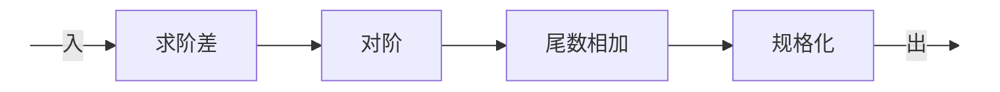
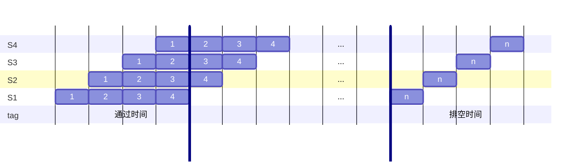
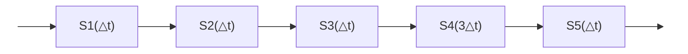
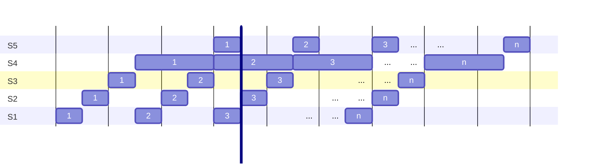
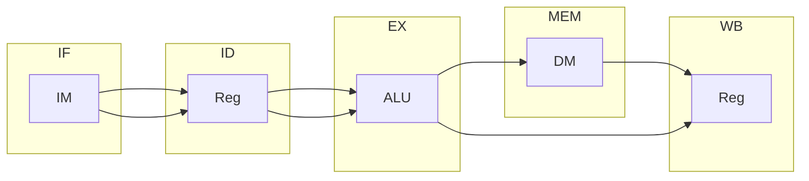
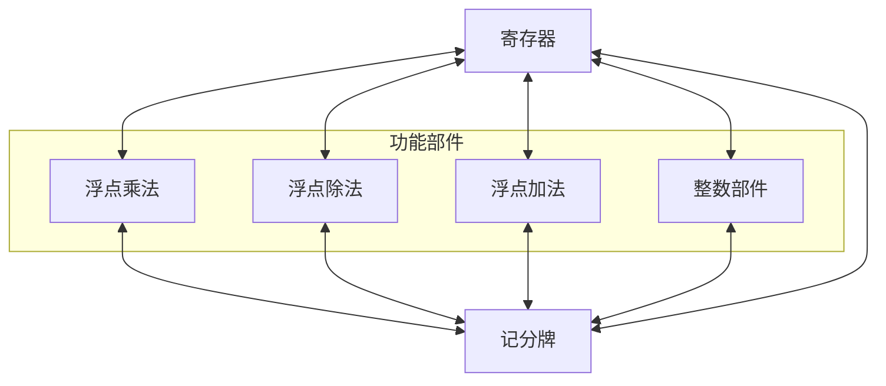
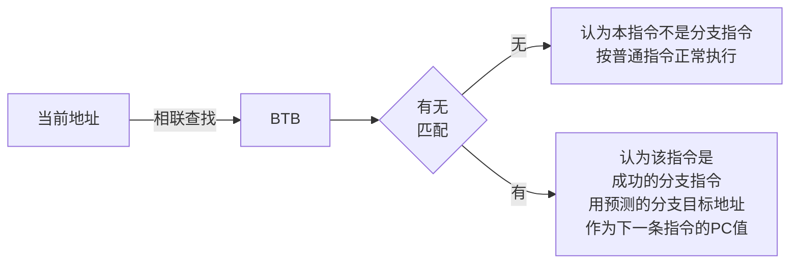

# 计算机系统结构

## 0 编者的话

摘自课程PPT与如下网站：

- [xqmmcqs's blog](ht\mathrm{TP}s://blog.xqmmcqs.com/tags/%E8%AE%A1%E7%AE%97%E6%9C%BA%E4%BD%93%E7%B3%BB%E7%BB%93%E6%9E%84/)


注重计算部分，概念与理论部分待补充。

教材如下：

- [textbook](/home/abe/code/courses/csa/textbook.pdf)

## 1 基础知识

### 1.1相关概念

### 1.2 基本原理和性能公式

#### 1.2.2 Amdahl 定律

**加速比**：$S_n=\frac{{perf}_{n}}{{perf}_{0}}=\frac{T_{0}}{T_{n}}$

**Amdahl 定律**：加快某部件执行速度所能获得的系统性能加速比，受限于该部件的执行时间占系统中总执行时间的百分比。
$$
S_n=\frac{T_{0}}{T_{n}}=\frac{1}{(1-Fe)+\frac{Fe}{Se}}
$$
其中

- $Fe$：可改进比例
- $Se$：部件加速比

#### 1.2.3 CPU 性能公式

- **CPU 时间**：执行一个程序所需 CPU 时间：$CPU时间=时钟周期数\times{t}=IC\times{CPI}\times{t}$
  - $t$：时钟周期时间：$t=\frac{1}{f（系统时钟频率）}$
  
  - 时钟周期数：$时钟周期数=\sum_{i=1}^n{(CPI_i\times{IC_i})}$
- CPI：一条指令的平均时钟周期数：$CPI=\frac{时钟周期数}{IC（执行程序的指令条数）}$
- MIPS：每秒百万条指令数：$MIPS=\frac{f}{CPI}$
- MFLOPS：每秒百万次浮点运算数

CPU 性能取决于三个参数：

- $t$：取决于硬件实现技术和计算机组成
- $CPI$：取决于计算机组成和指令系统的结构
- $IC$：取决于指令系统的结构和编译技术

### 1.3 性能评价标准

“$X$ 的性能是 $Y$ 的 $n$ 倍”：$n=\frac{执行时间_Y}{执行时间_X}=\frac{性能_x}{性能_y}$

总时间 = CPU 时间 + I/O 时间 + 运行其他程序的时间

CPU 时间 = 用户 CPU 时间 + 系统 CPU 时间

评价方法：CPU 时间、CPI、MIPS、MFLOPS。

比较若干测试程序在不同机器上的执行时间（$T_i$表示时间；$R_i=\frac{1}{T_i}$表示速度，如 MFLOPS）：

- **平均执行时间**：各程序执行时间的算术平均值：$S_m=\frac{1}{n}\sum_{i=1}^{n}T_i$
- **加权执行时间**：各程序执行时间的加权平均值：$A_m=\sum_{i=1}^{n}W_iT_i$
- **调和平均值法**：执行任务数量÷总耗时（速度不可简单相加）：$H_m=\frac{n}{\sum_{i=1}^{n}\frac{1}{R_i}}=\frac{n}{\sum_{i=1}^{n}T_i}$
- **几何平均值法**：执行速度的几何均值：$G_m=\sqrt[n]{\prod_{i=1}^{n}R_i}=\sqrt[n]{\prod_{i=1}^{n}\frac{1}{T_i}}$

## 3 流水线技术 	

### 3.1 基本概念

#### 3.1.1 什么是流水线

浮点加法流水线





流水线技术有以下特点

- 流水线把一个大的处理功能部件分解为多个**独立的**功能部件，并依靠它们的并行工作来提高处理速度。
- 流水线中各段的时间应尽可能相等，时间最长的段称为流水线的**瓶颈**。
- 流水线每一个段后面要有一个缓冲寄存器（锁存器），称为**流水寄存器**。
- 流水线技术适合**大量重复**的时序过程，只有在输入端不断地提供任务，才能充分发挥流水线的效率。
- 流水线需要有通过时间和排空时间。

#### 3.1.2 流水线的分类

- 按计算机系统等级分类
  - **部件级流水线（运算操作流水线）**：将运算操作流水线化，例如浮点加法流水线。
  - **处理机级流水线（指令流水线）**：将指令的执行过程流水线化。
  - **系统级流水线（宏流水线）**：把多个处理机串行连接，处理同一数据流。流水寄存器为存储器。

- 按流水线功能分类
  - **单功能流水线**：只完成一种固定功能，各段之间连接固定不变。

  - **多功能流水线**：各段可以进行不同的连接，以实现不同功能。ASC处理机的多功能流水线如图。
    
    ```mermaid
    graph LR
    	I1(( )):::invis --> 输入 --> 求阶差 --> 对阶 --> 相加 --> 规格化 --> 输出 --> O1(( )):::invis
    	I2(( )):::invis --> 输入 --> 相乘 --> 累加 --> 输出 --> O2(( )):::invis
    	classDef invis fill:transparent,stroke:transparent;
    ```
    
    - **静态流水线**：同一时刻，流水线中各段只能按同一种功能的连接方式工作。
    
      ```mermaid
      ---
          displayMode: compact
      ---
      gantt
          dateFormat YYYY
          axisFormat %0
      
      	section S8
          	1    : 1905, 1906
          	2    : 1906, 1907
          	3    : 1907, 1908
          	...  : 1908.5,
          	...  : 1909.5,
          	n - 1: 1910, 1911
          	n    : 1911, 1912
          	一 : 1915, 1916
          	二 : 1916, 1917
      	section S7
          	一 : 1914, 1915
          	二 : 1915, 1916
          	三 : 1916, 1917
      	section S6
          	一 : 1913, 1914
          	二 : 1914, 1915
          	三 : 1915, 1916
          	四 : 1916, 1917
          section S5
          	1    : 1904, 1905
          	2    : 1905, 1906
          	3    : 1906, 1907
          	...  : 1907.5,
          	...  : 1908.5,
          	n - 1: 1909, 1910
          	n    : 1910, 1911
          section S4
          	1    : 1903, 1904
          	2    : 1904, 1905
          	3    : 1905, 1906
          	...  : 1906.5,
          	...  : 1907.5,
          	n - 1: 1908, 1909
          	n    : 1909, 1910
          section S3
          	1    : 1902, 1903
          	2    : 1903, 1904
          	3    : 1904, 1905
          	...  : 1905.5,
          	...  : 1906.5,
          	n - 1: 1907, 1908
          	n    : 1908, 1909
          section S2
          	1    : 1901, 1902
          	2    : 1902, 1903
          	3    : 1903, 1904
          	...  : 1904.5,
          	...  : 1905.5,
          	n - 1: 1906, 1907
          	n    : 1907, 1908
          section S1
          	1    : 1900, 1901
          	2    : 1901, 1902
          	3    : 1902, 1903
          	...  : 1903.5,
          	...  : 1904.5,
          	n - 1: 1905, 1906
          	n    : 1906, 1907
              _ : vert, 1912, 
          	一 : 1912, 1913
          	二 : 1913, 1914
          	三 : 1914, 1915
          	四 : 1915, 1916
      ```
    
    - **动态流水线**：同一时刻，流水线中各段可以按照不同方式连接，同时执行多种功能。
    
      ```mermaid
      ---
          displayMode: compact
      ---
      gantt
          dateFormat YYYY
          axisFormat %0
      
      	section S8
          	1    : 1905, 1906
          	2    : 1906, 1907
          	3    : 1907, 1908
          	...  : 1908.5,
          	...  : 1909.5,
          	n - 1: 1910, 1911
          	n    : 1911, 1912
          	一 : 1912, 1913
          	二 : 1913, 1914
      	section S7
          	一 : 1911, 1912
          	二 : 1912, 1913
          	三 : 1913, 1914
      	section S6
          	一 : 1910, 1911
          	二 : 1911, 1912
          	三 : 1912, 1913
          	四 : 1913, 1914
          section S5
          	1    : 1904, 1905
          	2    : 1905, 1906
          	3    : 1906, 1907
          	...  : 1907.5,
          	...  : 1908.5,
          	n - 1: 1909, 1910
          	n    : 1910, 1911
          section S4
          	1    : 1903, 1904
          	2    : 1904, 1905
          	3    : 1905, 1906
          	...  : 1906.5,
          	...  : 1907.5,
          	n - 1: 1908, 1909
          	n    : 1909, 1910
          section S3
          	1    : 1902, 1903
          	2    : 1903, 1904
          	3    : 1904, 1905
          	...  : 1905.5,
          	...  : 1906.5,
          	n - 1: 1907, 1908
          	n    : 1908, 1909
          section S2
          	1    : 1901, 1902
          	2    : 1902, 1903
          	3    : 1903, 1904
          	...  : 1904.5,
          	...  : 1905.5,
          	n - 1: 1906, 1907
          	n    : 1907, 1908
          section S1
          	1    : 1900, 1901
          	2    : 1901, 1902
          	3    : 1902, 1903
          	...  : 1903.5,
          	...  : 1904.5,
          	n - 1: 1905, 1906
          	n    : 1906, 1907
          	一 : 1909, 1910
          	二 : 1910, 1911
          	三 : 1911, 1912
          	四 : 1912, 1913
      ```

- 按照流水线中是否存在反馈回路分类
  - 线性流水线：各段串行连接，没有反馈回路。数据通过流水线中各段时，每个段最多只流过一次。

  - 非线性流水线：各段除了有串行的连接外，还有反馈回路。非线性流水线存在调度问题。

    ```mermaid
    graph LR
    	I((输入)):::invis --> +1((+)) --> S1 --> +2((+)) --> S2 --> O((输出)):::invis
    	S2 --> S3 --> +2
    	S3 --> S4 --> +1
    	classDef invis fill:transparent,stroke:transparent;
    ```

    

- 根据流水线中任务流入流出顺序是否相同分类
  - **顺序流水线**：输出端任务流出顺序与输入端任务流入顺序相同，每一个任务在各段中是一个跟一个顺序流动的。
  - **乱序流水线**：输出端任务流出顺序与输入端任务流入顺序可以不同，也称作无序流水线，错序流水线，异步流水线。

  **流水线处理机**：指令部件中采用了流水线的处理机。

### 3.2 性能指标

记 $T_s$ 为 $k$ 段流水线顺序运行 $n$ 个任务的总时间，$T_k$ 为 $k$ 段流水线并行运行 $n$ 个任务的总时间，容易求得
$$
T_s=n\sum_{i=1}^{k}{\Delta{t_i}}
$$

$$
T_k=\sum_{i=1}^{k}{\Delta{t_i}}+(n−1)\max_{i=1}^{k}{\Delta{t_i}}
$$





#### 3.2.1 吞吐率

**吞吐率 $\mathrm{TP}$**：单位时间内流水线完成的任务数量或输出结果的数量，即
$$
\mathrm{TP}=\frac{n}{T_k}=\frac{n}{\sum_{i=1}^{k}{\Delta{t_i}}+(n−1)\max_{i=1}^{k}{\Delta{t_i}}}
$$
$n\gg{k}$ 时，有最大吞吐率
$$
\mathrm{TP}_{max}=\lim_{n\to\infty}{\frac{n}{\sum_{i=1}^{k}{\Delta{t_i}}+(n−1)\max_{i=1}^{k}{\Delta{t_i}}}}=\frac{1}{\max_{i=1}^{k}{\Delta{t_i}}}
$$


各段时间同为 $\Delta{t}$ 时有
$$
\mathrm{TP}=\frac{n}{(k+n−1)\Delta{t}}
$$

$$
\mathrm{TP}_{max}=\frac{1}{\Delta{t}}
$$

可以看到流水线吞吐率由瓶颈段决定。可以用下面的两种方法消除瓶颈段。

- **细分瓶颈段**：将瓶颈段切分为几个独立的功能段。

  ```mermaid
  graph LR
  	A(( )):::invis --> B["S1(△t)"] --> C["S2(△t)"] --> D["S3(△t)"] --> E1["S4-1(△t)"] --> E2["S4-2(△t)"] --> E3["S4-3(△t)"] --> F["S5(△t)"] --> G(( )):::invis
  	classDef invis fill:transparent,stroke:transparent;
  	subgraph S4
  		E1
  		E2
  		E3
  	end
  ```

- **重复设置瓶颈段**：重复设置的段并行工作，在时间上依次错开处理任务。

  ```mermaid
  graph LR
  	A(( )):::invis --> B["S1(△t)"] --> C["S2(△t)"] --> D["S3(△t)"] --> E1["S4a(△t)"] --> F["S5(△t)"] --> G(( )):::invis
  	D --> E2["S4b(△t)"] --> F
  	D --> E3["S4c(△t)"] --> F
  	classDef invis fill:transparent,stroke:transparent;
  ```

  ```mermaid
  ---
      displayMode: compact
  ---
  gantt
      dateFormat YYYY
      axisFormat %0
  
      section S5
      	1    : 1906, 1907
      	2    : 1907, 1908
      	3    : 1908, 1909
      	4    : 1909, 1910
      	5    : 1910, 1911
      	6    : 1911, 1912
      	7    : 1912, 1913
      	8    : 1913, 1914
      	9    : 1914, 1915
      	...  : 1915.5,
      	...  : 1916.5,
      	n - 2: 1917, 1918
      	n - 1: 1918, 1919
      	n    : 1919, 1920
      section S4c
      	3   : 1905, 1908
      	6   : 1908, 1911
      	9   : 1911, 1914
      	... : 1914.5,
      	... : 1915.5,
      	n   : 1916, 1919
      section S4b
      	2    : 1904, 1907
      	5    : 1907, 1910
      	8    : 1910, 1913
      	...  : 1913.5,
      	...  : 1914.5,
      	n - 1: 1915, 1918
      section S4a
      	1    : 1903, 1906
      	4    : 1906, 1909
      	7    : 1909, 1912
      	...  : 1912.5,
      	...  : 1913.5,
      	n - 2: 1914, 1917
      section S3
      	1   : 1902, 1903
      	2   : 1903, 1904
      	3   : 1904, 1905
      	4   : 1905, 1906
      	5   : 1906, 1907
      	6   : 1907, 1908
      	7   : 1908, 1909
      	8   : 1909, 1910
      	9   : 1910, 1911
      	... : 1911.5,
      	... : 1912.5,
      	... : 1913.5,
      	... : 1914.5,
      	n   : 1915, 1916
      section S2
      	1   : 1901, 1902
      	2   : 1902, 1903
      	3   : 1903, 1904
      	4   : 1904, 1905
      	5   : 1905, 1906
      	6   : 1906, 1907
      	7   : 1907, 1908
      	8   : 1908, 1909
      	9   : 1909, 1910
      	... : 1910.5,
      	... : 1911.5,
      	... : 1912.5,
      	... : 1913.5,
      	n   : 1914, 1915
      section S1
      	1   : 1900, 1901
      	2   : 1901, 1902
      	3   : 1902, 1903
      	4   : 1903, 1904
      	5   : 1904, 1905
      	6   : 1905, 1906
      	7   : 1906, 1907
      	8   : 1907, 1908
      	9   : 1908, 1909
      	... : 1909.5,
      	... : 1910.5,
      	... : 1911.5,
      	... : 1912.5,
      	n   : 1913, 1914
  ```

#### 3.2.2 加速比

**加速比 $S$**：完成同样任务，不使用流水线所用时间与使用流水线所用时间之比，即
$$
S=\frac{T_s}{T_k}=\frac{n\sum_{i=1}^{k}{\Delta{t_i}}}{\sum_{i=1}^{k}{\Delta{t_i}}+(n−1)\max_{i=1}^{k}{\Delta{t_i}}}
$$
$n\gg{k}$ 时，有最大加速比
$$
S_{max}=\lim_{n\to\infty}{\frac{n\sum_{i=1}^{k}{\Delta{t_i}}}{\sum_{i=1}^{k}{\Delta{t_i}}+(n−1)\max_{i=1}^{k}{\Delta{t_i}}}}=\frac{\sum_{i=1}^{k}{\Delta{t_i}}}{\max_{i=1}^{k}{\Delta{t_i}}}
$$


各段时间相等时，有
$$
S=\frac{nk}{k+n−1}
$$

$$
S_{max}=k
$$

#### 3.2.3 效率

**效率 $E$**：流水线中的设备实际使用时间与整个运行时间的比值，又称流水线设备利用率。
$$
E=\frac{T_s}{kT_k}=\frac{n\sum_{i=1}^{k}{\Delta{t_i}}}{k(\sum_{i=1}^{k}{\Delta{t_i}}+(n−1)\max_{i=1}^{k}{\Delta{t_i}})}
$$
$n\gg{k}$ 时，有最大效率
$$
E_{max}=\lim_{n\to\infty}{\frac{n\sum_{i=1}^{k}{\Delta{t_i}}}{k(\sum_{i=1}^{k}{\Delta{t_i}}+(n−1)\max_{i=1}^{k}{\Delta{t_i}})}}=\frac{\sum_{i=1}^{k}{\Delta{t_i}}}{k\max_{i=1}^{k}{\Delta{t_i}}}
$$
各段时间相等时，有
$$
E=\frac{n}{k+n−1}
$$

$$
E_{max}=1
$$

且有
$$
E=\mathrm{TP}\cdot\Delta{t}
$$

$$
E=\frac{S}{k}
$$

>#### 流水线的最佳段数
>
>定义 $\mathrm{PCR}$ 为单位价格的最大吞吐率，即
>$$
>\mathrm{PCR}=\frac{\mathrm{TP}_{max}}{C}=\frac{1}{(a+bk)(\frac{t}{k}+d)}
>$$
>其中 $t$ 为非流水机器串行完成一个任务的时间，$d$ 为锁存器延迟，$a$ 为流水段本身价格，$b$ 为锁存器价格。对上式变形得
>$$
>\mathrm{PCR}=\frac{1}{bdk+\frac{at}{k}+ad+bt}
>$$
>由均值不等式可得，当
>$$
>k=\sqrt{\frac{at}{bd}}
>$$
>时，$\mathrm{PCR}$最大。

### 3.3 非线性流水线的最优调度

#### 3.3.1 单功能非线性流水线的最优调度

**启动距离**（Initiation Interval）：向一条非线性流水线的输入端连续输入两个任务之间的时间间隔。

**禁用启动距离**：会引起非线性流水线功能段使用冲突的启动距离。

**预约表**（Reservation Table）：表示一个任务在该流水线中流过时，对各段的使用情况。

预约表示例如下。

| 功能段\时间 | 1    | 2    | 3    | 4    | 5    | 6    | 7    | 8    | 9    |
| ----------- | ---- | ---- | ---- | ---- | ---- | ---- | ---- | ---- | ---- |
| $S_1$       | √    |      |      |      |      |      |      |      | √    |
| $S_2$       |      | √    | √    |      |      |      |      | √    |      |
| $S_3$       |      |      |      | √    |      |      |      |      |      |
| $S_4$       |      |      |      |      | √    | √    |      |      |      |
| $S_5$       |      |      |      |      |      |      | √    | √    |      |

1. 根据预约表写出禁止表 $F$

   **禁止表**（Forbidden List）：由禁用启动距离构成的集合。示例中 $F=\set{1,5,6,8}$。

2. 根据禁止表 $F$ 写出初始冲突向量 $\boldsymbol{C}_0$

   **冲突向量**（Collision Vector）：$N$ 位二进制串。$\boldsymbol{C}_0=\pmatrix{c_N&\cdots&c_1}$满足
   $$
   c_i=\begin{cases}
   	1 & i {\in} F \\
   	0 & i {\notin} F
   \end{cases}
   $$
   示例中，$\boldsymbol{C}_0=\pmatrix{1&0&1&1&0&0&0&1}$

3. 根据初始冲突向量 $\boldsymbol{C}_0$ 画出状态转换图

   假设当前冲突向量是 $\boldsymbol{C}_k$，$j$ 是允许的时间间隔，则新的冲突向量为
   $$
   \mathrm{SHR}^{(j)}(\boldsymbol{C}_k)\or\boldsymbol{C}_0
   $$
   从初始冲突向量 $\boldsymbol{C}_0$ 出发，反复应用上述步骤，可以求得所有冲突向量以及产生这些向量所对应的时间间隔，由此画出用冲突向量表示的流水线状态转移图。示例中状态转移图如下。

   ```mermaid
   graph
   	10110001 -->|2| 10111101
   	10110001 -->|3| 10110111
   	10110001 -->|4| 10111011
   	10110001 -->|7,9+| 10110001
   	
   	10111101 -->|2| 10111111
   	10111101 -->|7,9+| 10110001
   	
   	10110111 -->|4| 10111011
   	10110111 -->|7,9+| 10110001
   	
   	10111011 -->|3| 10110111
   	10111011 -->|7,9+| 10110001
   	
   	10111111 -->|7,9+| 10110001
   ```

4. 根据状态转换图写出最优调度方案

   根据流水线状态图，由初始状态出发，任何一个闭合回路即为一种调度方案。例如 $(2,7)$ 表示反复循环使用启动距离 $2$ 和 $7$。平均时间间隔最小的调度方案即为最优调度方案。实例中所有可能的调度方案如下。

   | 调度策略  | 平均延迟拍数 |
   | --------- | ------------ |
   | (2,7)     | 4.5          |
   | (2,2,7)   | 3.67         |
   | (3,7)     | 5            |
   | (3,4)     | 3.5          |
   | (3,4,3,7) | 4.25         |
   | (3,4,7)   | 4.67         |
   | (4,3,7)   | 4.67         |
   | (4,7)     | 5.5          |
   | (7)       | 7            |

   最优方案为 $(3,4)$。

#### 3.3.2 多功能非线性流水线的最优调度

下以双功能（设为功能 A 和 B）非线性流水线为例说明多功能非线性流水线的最优调度方法。任务 A 的预约表如下。

| 段\时间 | 1    | 2    | 3    | 4    | 5    |
| ------- | ---- | ---- | ---- | ---- | ---- |
| $S_1$   | √    |      |      | √    |      |
| $S_2$   |      | √    |      |      |      |
| $S_3$   |      |      | √    |      | √    |

任务 B 的预约表如下。

| 段\时间 | 1    | 2    | 3    | 4    | 5    |
| ------- | ---- | ---- | ---- | ---- | ---- |
| $S_1$   |      | √    |      |      | √    |
| $S_2$   |      |      |      | √    |      |
| $S_3$   | √    |      | √    |      |      |

1. 把两个预约表重叠起来，得到如下预约表

   | 段\时间 | 1    | 2    | 3    | 4    | 5    |
   | ------- | ---- | ---- | ---- | ---- | ---- |
   | $S_1$   | A    | B    |      | A    | B    |
   | $S_2$   |      | A    |      | B    |      |
   | $S_3$   | B    |      | AB   |      | A    |

2. 由预约表求初始冲突向量和初始冲突矩阵

   **冲突矩阵**：由冲突向量构成，不同冲突向量对应下一个任务的不同功能。示例中，
   $$
   \boldsymbol{M}_A^{(0)}=\pmatrix{\boldsymbol{C}_{AA}\\\boldsymbol{C}_{AB}},
   \boldsymbol{M}_B^{(0)}=\pmatrix{\boldsymbol{C}_{BA}\\\boldsymbol{C}_{BB}}
   $$
   其中，$\boldsymbol{C}_{pq}(p,q\in\set{\mathrm{A},\mathrm{B}})$ 表示在一个 $p$ 类任务流入流水线后，对后续 $q$ 类任务的冲突向量。示例中，
   $$
   \begin{aligned}
   	\boldsymbol{C}_{AA} &= \pmatrix{0&1&1&0} \\
   	\boldsymbol{C}_{AB} &= \pmatrix{1&0&1&0} \\
   	\boldsymbol{C}_{BA} &= \pmatrix{1&0&1&1} \\
   	\boldsymbol{C}_{BB} &= \pmatrix{0&1&1&0} \\
   \end{aligned}
   $$
   因此，初始矩阵为
   $$
   \boldsymbol{M}_A^{(0)}=\pmatrix{\boldsymbol{C}_{AA}\\\boldsymbol{C}_{AB}}=\pmatrix{0&1&1&0\\1&0&1&0},
   \boldsymbol{M}_B^{(0)}=\pmatrix{\boldsymbol{C}_{BA}\\\boldsymbol{C}_{BB}}=\pmatrix{1&0&1&1\\0&1&1&0}
   $$

3. 由初始冲突矩阵画出状态图

   如果第一个流入的任务是 A 类，初始状态就是 $\boldsymbol{M}_A^{(0)}$；如果第一个流入的任务是 B 类，初始状态就是 $\boldsymbol{M}_B^{(0)}$。后续状态的冲突矩阵可由下式求得。
   $$
   \mathrm{SHR}^{(i)}(\boldsymbol{M}_k)\or\boldsymbol{M}_r^{(0)}
   $$
   其中 $\boldsymbol{M}_k$ 为当前状态，$r$ 表示下一个流入任务的类型，$i$ 是当前状态允许流入的 $r$ 型任务的时间间隔。求出所有可能得状态后，就可以画出状态图。示例中，状态图如下。

   ```mermaid
   graph
   	M0[0110<br/>1010]
   	M1[0111<br/>1111]
   	M3[1011<br/>0111]
   	M6[0111<br/>1010]
   	M7[1011<br/>0110]
   	M12[1111<br/>0111]
   	
   	M0 -->|A.1| M1
   	M0 -->|B.1<br/>B.3| M3
   	M0 -->|A.4| M0
   	
   	M1 -->|A.4| M0
   	
   	M3 -->|A.3| M6
   	M3 -->|B.4| M7
   	
   	M6 -->|A.4| M0
   	M6 -->|B.1<br/>B.3| M3
   	
   	M7 -->|A.3| M6
   	M7 -->|B.1| M12
   	M7 -->|B.4| M7
   	
   	M12 -->|B.4| M7
   ```

4. 由状态图得出最优调度方案

   只流入 A 类任务的最优调度方案是 $(\mathrm{A}.1,\mathrm{A}.4)$，只流入 B 类任务的最优调度方案是 $(\mathrm{B}.1,\mathrm{B}.4)$，混合流入 A、B 两类任务的最优调度方案是 $(\mathrm{B}.1,\mathrm{A}.3,\mathrm{A}.4)$。

### 3.4 流水线的相关与冲突

#### 3.4.1 经典 5 段 RISC 流水线

把一条指令的执行过程分为以下 5 个时钟周期。

1. **取指令周期（IF）**：以程序计数器（PC）中的内容作为地址，从存储器中取出指令并放入指令寄存器（IR），同时 PC 值加 4（假设每条指令占 4 个字节），指向顺序的下一条指令。
2. **指令译码/读寄存器周期（ID）**：对指令进行译码，并用 IR 中的寄存器地址去访问通用寄存器组，读出所需的操作数。
3. **执行/有效地址计算周期（EX）**：在这个周期，ALU 对在上一个周期准备好的操作数进行运算或处理。不同指令所进行的操作不同。
   - **load 和 store 指令**：ALU 把指令中所制定的寄存器的内容与偏移量相加，形成访存有效地址。
   - **寄存器-寄存器 ALU 指令**：ALU按照操作码指定的操作对从通用寄存器组中读出的数据进行运算。
   - **寄存器-立即数 ALU 指令**：ALU 按照操作码指定的操作对从通用寄存器组中读出的操作数和指令中给出的立即数进行运算。
   - **分支指令**：ALU 把指令中给出的偏移量与 PC 值相加，形成转移目标的地址。同时，对在前一个周期读出的操作数进行判断，确定分支是否成功。
4. **存储器访问/分支完成周期（MEM）**
   - **load 指令和 store 指令**：如果是 load 指令，就用上一个周期计算出的有效地址从存储器中读出相应单元的数据；如果是 store 指令，就把指定的数据写入这个有效地址所指出的存储器单元。
   - **分支指令**：如果分支“成功”，就把在前一个周期中计算好的转移目标地址送入 PC。分支指令执行完成；否则就不就行任何操作。
   - 其他类型的指令在此周期不做任何操作。
5. **写回周期（WB）**：把结果写入通用寄存器组。对于 ALU 运算执行来说，这个结果来自 ALU，而对于 load 指令来说，这个结果来自存储器。

把上述实现方案改造为流水线实现如下。



| 指令\时钟周期 |  1   |  2   |  3   |  4   |  5   |  6   |  7   |  8   |
| :------------ | :--: | :--: | :--: | :--: | :--: | :--: | :--: | :--: |
| 指令 $k$      |  IF  |  ID  |  EX  | MEM  |  WB  |      |      |      |
| 指令 $k+1$    |      |  IF  |  ID  |  EX  | MEM  |  WB  |      |      |
| 指令 $k+2$    |      |      |  IF  |  ID  |  EX  | MEM  |  WB  |      |
| 指令 $k+3$    |      |      |      |  IF  |  ID  |  EX  | MEM  |  WB  |

上述流水线存在如下问题：

- 须保证不会在同一时钟周期要求同一个功能段做两件不同的工作。
- ID 段要对通用寄存器组进行读操作，而 WB 段要对通用寄存器组进行写操作，为了解决对同一通用寄存器的访问冲突，我们把写操作安排在时钟周期的前半拍完成，把读操作安排在后半拍完成。
- IF 段需要设置一个专门的加法器，用于进行 PC 加 4 的操作。分支处理问题见[ 3.4.2 节](#3.4.2-相关与流水线冲突)。

#### 3.4.2 相关与流水线冲突

**相关**：两条指令之间由于存在某种依赖关系，从而不能在流水线中重叠执行或者只能部分重叠。分为如下三种类型。

- **数据相关**：考虑指令 $i$ 和 $j$，其中 $i$ 在 $j$ 前，定义关系 $R$ 满足 $jRi$ 当且仅当 $j$ 使用 $i$ 的结果，则称 $R^*$ 为数据相关。
  - 数据相关是严格偏序关系，反应了数据的流动关系，即如何从其生产者流动到消费者。
  - 数据流动经过寄存器时，由于寄存器是同一命名的，相关的检测比较容易。
  - 数据流动经过存储器时，相关的检测较为复杂。

- **名相关**：两条指令使用了相同的名，即指令访问的寄存器或存储单元的名称相同。但之间并没有数据流动。分为以下两种。

  - **反相关**：$j$ 写的名与 $i$ 读的名相同。
  - **输出相关**：$j$ 和 $i$ 写的名相同。


  名相关的两条指令不可逆序执行。可以通过寄存器换名消除名相关。

- **控制相关**：由分支指令引起的相关。需要根据分支指令的执行结果来确定后面该执行哪个分支上的指令。

  - 与某分支指令控制相关的指令不能被移到该分支之前。
  - 不与某分支指令控制相关的指令不能被移到该分支之后。

  **流水线冲突**：由于相关的存在，使得指令流中的下一条指令不能在指定的时钟周期开始执行。发生冲突时，往往需要使某些指令推后执行，从而使流水线出现停顿，这会降低流水线的效率和实际的加速比。流水线冲突有以下三种类型。

- **结构冲突**：因硬件资源满足不了指令重叠执行的要求而发生的冲突。以访存冲突为例。当 load 指令需要存取数时，若又要同时完成其后某条指令的“取指令”，就会发生访存冲突。如图所示。

  | 指令/时钟周期 |  1   |  2   |  3   |    4    |  5   |  6   |  7   |
  | :------------ | :--: | :--: | :--: | :-----: | :--: | :--: | :--: |
  | load          |  IF  |  ID  |  EX  | **MEM** |  WB  |      |      |
  | 指令 $i+1$    |      |  IF  |  ID  |   EX    | MEM  |  WB  |      |
  | 指令 $i+2$    |      |      |  IF  |   ID    |  EX  | MEM  |  WB  |
  | 指令 $i+3$    |      |      |      | **IF**  |  ID  |  EX  | MEM  |
  | 指令 $i+4$    |      |      |      |         |  IF  |  ID  |  EX  |

  为了消除这个结构冲突，可以再前一条指令访问存储器时，将流水线**停顿**一个时钟周期，推迟后面取指令的操作，如图所示。

  | 指令/时钟周期 |  1   |  2   |  3   |     4     |   5    |  6   |  7   |
  | :------------ | :--: | :--: | :--: | :-------: | :----: | :--: | :--: |
  | load          |  IF  |  ID  |  EX  |  **MEM**  |   WB   |      |      |
  | 指令 $i+1$    |      |  IF  |  ID  |    EX     |  MEM   |  WB  |      |
  | 指令 $i+2$    |      |      |  IF  |    ID     |   EX   | MEM  |  WB  |
  | 指令 $i+3$    |      |      |      | **stall** | **IF** |  ID  |  EX  |
  | 指令 $i+4$    |      |      |      |           |        |  IF  |  ID  |

  可以看出，为消除结构冲突而引入的停顿将影响流水线的性能。由于这种冲突出现的频度不低，一般采用分别设置独立的指令存储器和数据存储器的方法，或者仍只设置一个存储器，但采用分离的指令 Cache 和数据 Cache。假如结构冲突并不是经常发生，为之大量增加硬件就不值得了。

- **数据冲突**：当指令在流水线中重叠执行时，因需要用到前面指令的执行结果而发生的冲突。考虑如下指令。

  ```assembly
  DADD	R1,R2,R3
  DSUB	R4,R1,R5
  XOR 	R6,R1,R7
  AND 	R8,R1,R9
  ```

  DADD 指令后的所有指令都要用到 DADD 指令的计算结果，如图所示。

  | 指令/时钟周期       |  1   |  2   |   3    |   4    |   5    |  6   |
  | :------------------ | :--: | :--: | :----: | :----: | :----: | :--: |
  | DADD **R1**, R2, R3 |  IF  |  ID  |   EX   |  MEM   | **WB** |      |
  | DSUB R4, **R1**, R5 |      |  IF  | **ID** |   EX   |  MEM   |  WB  |
  | XOR R6, **R1**, R7  |      |      |   IF   | **ID** |   EX   | MEM  |
  | AND R8, **R1**, R9  |      |      |        |   IF   | **ID** |  EX  |

  若不采取措施，DSUB 指令和 XOR 指令读出的值将是错误的。

  按照指令读访问和写访问的先后顺序，可以将数据冲突分为三种类型。

  - **写后读冲突（Read After Write，RAW）**：$j$ 用到 $i$ 的运算结果，且在 $i$ 将结果写入寄存器之前就去读该寄存器，因而得到的是旧值。对应于**数据相关**。是最常见的一类数据冲突。

  - **写后写冲突（Write After Write，WAW）**：$j$ 和 $i$ 的结果寄存器相同，且在 $i$ 写入之前就先对该寄存器进行了写入操作，导致最后留下的是 $i$ 写入的值。对应于**输出相关**。仅发生于如下流水线。

    - 流水线中不止一个段可以进行写操作。
    - 指令被重新排序了。

     经典 5 段 RISC 流水线不会发生写后写冲突。

  - **读后写冲突（Write After Read，WAR）**：$j$ 的目的寄存器和 $i$ 的源寄存器相同，且在 $i$ 读取该寄存器之前先对它进行了写操作，导致 $i$​ 读到的值是错误的。对应于**反相关**。仅发生于如下流水线。

    - 有些指令的写操作提前了，有些指令的读操作之后了。
    - 指令被重新排序了。

     经典 5 段 RISC 流水线不会发生读后写冲突。

  一种简单的处理与上例类似的写后读冲突的方法是暂停流水线中 DADD 之后的所有指令，直到 DADD 指令将计算结果写入寄存器 R1 之后，再让 DADD 之后的指令继续执行。这种暂停会导致性能下降。

  可以采用**定向技术**来解决写后读冲突。关键思想是：将计算结果从其产生的地方直接送到其他指令需要它的地方，从而避免停顿。实现方式如下。

  1. EX 段和 MEM 段之间的流水寄存器中保存的 ALU 运算结果总是回送到 ALU 的入口。
  2. 当定向硬件检测到前一个 ALU 运算结果写入的寄存器就是当前 ALU 操作的寄存器时，控制逻辑选择定向的数据作为 ALU 的输入，而不采用从通用寄存器组读出的数据。

  | 指令/时钟周期       |  1   |  2   |   3    |   4    |   5    |   6    |
  | :------------------ | :--: | :--: | :----: | :----: | :----: | :----: |
  | DADD **R1**, R2, R3 |  IF  |  ID  | **EX** |  MEM   |   WB   |        |
  | DSUB R4, **R1**, R5 |      |  IF  |   ID   | **EX** |  MEM   |   WB   |
  | XOR R6, **R1**, R7  |      |      |   IF   |   ID   | **EX** |  MEM   |
  | AND R8, **R1**, R9  |      |      |        |   IF   |   ID   | **EX** |

  定向技术无法解决等待使用结果的指令需要结果时，计算结果尚未出来的写后读冲突。考虑如下情形。

  | 指令/时钟周期       |  1   |  2   |  3   |    4    |  5   |  6   |
  | :------------------ | :--: | :--: | :--: | :-----: | :--: | :--: |
  | LD R1, 0(R2)        |  IF  |  ID  |  EX  | **MEM** |  WB  |      |
  | DADD R4, **R1**, R5 |      |  IF  |  ID  | **EX**  | MEM  |  WB  |

  DADD 指令要用 LD 指令的结果。显然，这个定向是无法实现的。为保证上述指令序列能在流水线中正确执行，需要设置**流水线互锁机制**，检测发现数据冲突，使流水线停顿，直至冲突消失。停顿从等待相关数据的指令开始，到相应的指令产生需要的数据为止。

  为了减少停顿，对于无法用定向技术解决的数据冲突，可以通过在编译时让编译器重新组织指令顺序来消除冲突，这种技术称为**指令调度**或**流水线调度**。考虑如下表达式。
  $$
  A=B+C
  $$

  $$
  D=E-F
  $$

  编译形成代码如下。

  ```assembly
  LD  	Rb,B
  LD  	Rc,C
  DADD	Ra,Rb,Rc
  SD  	Ra,A
  LD  	Re,E
  LD  	Rf,F
  DSUB	Rd,Re,Rf
  SD  	Rd,D
  ```

  可以看到`DADD Ra,Rb,Rc`与`LD Rc,C`间存在冲突，`DSUB Rd,Re,Rf`与`LD Rf,F`间存在冲突，故需要插入两个停顿周期。利用调度技术重新组织代码如下。

  ```assembly
  LD  	Rb,B
  LD  	Rc,C
  LD  	Re,E
  DADD	Ra,Rb,Rc
  LD  	Rf,F
  SD  	Ra,A
  DSUB	Rd,Re,Rf
  SD  	Rd,D
  ```

  可以看到 DADD 指令和 DSUB 指令与 LD 指令的距离被加大，从而可以采用定向消除数据冲突，不需要插入停顿周期。

- **控制冲突**：流水线遇到分支指令或其他会改变 PC 值的指令所引起的冲突。分支指令的结果有如下两种。

  - **分支成功**：此时 PC 值需要改变为分支转移目标地址，改变 PC 值是在条件判定和转移地址计算完成后进行的，即 MEM 段。
  - **分支失败**：此时 PC 值保持正常递增。

  处理分支指令最简单的方法是**冻结**或**排空**流水线，即一旦在 ID 段检测到分支指令，就暂停其后所有指令的执行，直到分支指令到达 MEM 段，确定是否成功并计算出新的 PC 值为止。然后，按照新的 PC 值取指令。在这种情况下，分支指令给流水线带来了三个时钟周期的延迟。分支成功的情况如下表所示。

  | 指令/时钟周期  |  1   |  2   |     3     |     4     |  5   |  6   | 7    | 8    | 9    |
  | :------------- | :--: | :--: | :-------: | :-------: | :--: | :--: | ---- | ---- | ---- |
  | 分支指令       |  IF  |  ID  |    EX     |    MEM    |  WB  |      |      |      |      |
  | 分支目标指令   |      |  IF  | **stall** | **stall** |  IF  |  ID  | EX   | MEM  | WB   |
  | 分支目标指令+1 |      |      |           |           |      |  IF  | ID   | EX   | MEM  |
  | 分支目标指令+2 |      |      |           |           |      |      | IF   | ID   | EX   |

  分支失败的情况类似。我们把由分支指令引起的延迟称为**分支延迟**。为了减少分支延迟，可采取以下措施。

  - 在流水线中尽早判断出（或者猜测）分支是否成功。
  
  - 尽早计算出分支目标地址。
  
    可以把这两步工作提前到 ID 段完成，即分支指令是在 ID 段的末尾执行完成的，这样可以把分支延迟减少到一个周期。
  
    下面介绍三种进一步减少分支延迟的软件方法。
  
  - **预测分支失败**：当 ID 段检测到分支指令时，沿失败的分支继续处理指令。当确定分支失败时，流水线正常流动，如图所示。
  
    | 指令/时钟周期 |  1   |  2   |  3   |  4   |  5   |  6   | 7    | 8    |
    | :------------ | :--: | :--: | :--: | :--: | :--: | :--: | ---- | ---- |
    | 分支指令 $i$  |  IF  |  ID  |  EX  | MEM  |  WB  |      |      |      |
    | 指令 $i+1$    |      |  IF  |  ID  |  EX  | MEM  |  WB  |      |      |
    | 指令 $i+2$    |      |      |  IF  |  ID  |  EX  | MEM  | WB   |      |
    | 指令 $i+3$    |      |      |      |  IF  |  ID  |  EX  | MEM  | WB   |
  
    当确定分支成功时，流水线把在分支指令之后取出的指令转化为空操作，并按分支目标地址重新取指令执行，如图所示。
  
    | 指令/时钟周期  |  1   |  2   |    3     |    4     |    5     |    6     | 7    | 8    |
    | :------------- | :--: | :--: | :------: | :------: | :------: | :------: | ---- | ---- |
    | 分支指令 $i$   |  IF  |  ID  |    EX    |   MEM    |    WB    |          |      |      |
    | 指令 $i+1$     |      |  IF  | **idle** | **idle** | **idle** | **idle** |      |      |
    | 分支目标指令   |      |      |    IF    |    ID    |    EX    |   MEM    | WB   |      |
    | 分支目标指令+1 |      |      |          |    IF    |    ID    |    EX    | MEM  | WB   |
  
  - **预测分支成功**：与预测分支失败类似，当 ID 段检测到分支指令时，一旦计算出了分支目标地址，就开始从目标地址取指令执行。
  
  - **延迟分支**：在分支指令后插入若干个**延迟槽**，不管分支是否成功，都按顺序执行延迟槽中的指令。大多数情况下，延迟槽都只有一个。编译器将指令调度进延迟槽中。常见的调度方法有三种。
  
    - **从前调度**：把位于分支指令之前的一条独立指令移到延迟槽。
    - **从目标处调度**：把目标处的指令复制到延迟槽。
    - **从失败处调度**：把后续指令移到延迟槽。
  
    
    许多处理机采用了**分支取消**机制，其中分支指令隐含预测分支执行方向，预测成功时正常执行延迟槽中指令，失败时将指令转化成空操作。

### 3.5 流水线的实现

## 4 向量处理机

**向量**：由一组有序、具有相同类型和位数的元素组成的数据类型，适合流水处理。

**向量处理机**：设置了向量数据表示和相应的向量指令的流水处理机。

**标量处理机**：不具有向量数据表示和向量指令的处理机。

### 4.1 向量的处理方式

下面以计算表达式 $\boldsymbol{D}=\boldsymbol{A}\times(\boldsymbol{B}-\boldsymbol{C})$ 为例说明向量的处理方式，其中 $\boldsymbol{A}$，$\boldsymbol{B}$，$\boldsymbol{C}$，$\boldsymbol{D}$ 都是长度为 $N$ 的向量，设
$$
\begin{aligned}
    \boldsymbol{A} &= (a_1,a_2,\cdots,a_N) \\
    \boldsymbol{B} &= (b_1,b_2,\cdots,b_N) \\
    \boldsymbol{C} &= (c_1,c_2,\cdots,c_N) \\
    \boldsymbol{D} &= (d_1,d_2,\cdots,d_N)
\end{aligned}
$$

#### 4.1.1 横向处理方式

即按行的方式从左到右横向地进行计算。对于给定的例子 $\boldsymbol{D}=\boldsymbol{A}\times(\boldsymbol{B}-\boldsymbol{C})$，就是逐个求 $d_i$。

- 先计算 $a_1{\times}(b_1-c_1){\to}d_1$
- 再计算 $a_2{\times}(b_2-c_2){\to}d_2$
- $\vdots$
- 最后计算 $a_N{\times}(b_N-c_N){\to}d_N$

一般的计算机就是采用这种方式组成循环程序进行处理的。每次循环完成以下计算（共循环 $N$ 次）
$$
\begin{aligned}
	b_i-c_i &{\to} q_i \\
	a_i{\times}q_i &{\to} d_i
\end{aligned}
$$
进行流水处理时，在每次循环中都会发生一次数据相关。这种方式不适合向量处理机的并行处理。

#### 4.1.2 纵向处理方式

按列的方式从上到下纵向地进行计算。将整个向量按相同的运算处理完后，再进行别的运算。对于上例，就是先完成
$$
\matrix{b_1-c_1{\to}q_1\\\vdots\\b_N-c_N{\to}q_N}
$$
再计算
$$
\matrix{a_1-c_1{\to}q_1\\\vdots\\b_N-c_N{\to}q_N}
$$
表示成向量指令，就是
$$
\begin{aligned}
	\boldsymbol{B}-\boldsymbol{C} &{\to} \boldsymbol{Q} \\
	\boldsymbol{A}{\times}\boldsymbol{Q} &{\to} \boldsymbol{D}
\end{aligned}
$$
这里，在每条向量指令内部都是单一相同的运算，相关只发生在向量之间，只有一次。这种处理方式适用于向量处理机。

#### 4.1.3 纵横处理方式

把向量分成若干组，组内按纵向方式处理，依次处理各组。又称为**分组处理方式**。对于上例，设
$$
N=S{\times}n+r
$$
其中 $N$ 为向量长度，$S$ 为组数，$n$ 为每组的长度，$r$ 为余数。若余下的 $r$ 个数也作为一组处理，则共有 $S+1$ 个组。运算过程如下。

- 先算第一组。
  $$
  \begin{aligned}
  	\boldsymbol{B}_{1{\sim}n}-\boldsymbol{C}_{1{\sim}n} &{\to} \boldsymbol{Q}_{1{\sim}n} \\
  	\boldsymbol{A}_{1{\sim}n}{\times}\boldsymbol{Q}_{1{\sim}n} &{\to} \boldsymbol{D}_{1{\sim}n}
  \end{aligned}
  $$

- 再算第二组。
  $$
  \begin{aligned}
  	\boldsymbol{B}_{(n+1){\sim}2n}-\boldsymbol{C}_{(n+1){\sim}2n} &{\to} \boldsymbol{Q}_{(n+1){\sim}2n} \\
  	\boldsymbol{A}_{(n+1){\sim}2n}{\times}\boldsymbol{Q}_{(n+1){\sim}2n} &{\to} \boldsymbol{D}_{(n+1){\sim}2n}
  \end{aligned}
  $$

- 以此进行下去，直到计算完最后一组，即第 $S+1$ 组。
  $$
  \begin{aligned}
  	\boldsymbol{B}_{(Sn+1){\sim}N}-\boldsymbol{C}_{(Sn+1){\sim}N} &{\to} \boldsymbol{Q}_{(Sn+1){\sim}N} \\
  	\boldsymbol{A}_{(Sn+1){\sim}N}{\times}\boldsymbol{Q}_{(Sn+1){\sim}N} &{\to} \boldsymbol{D}_{(Sn+1){\sim}N}
  \end{aligned}
  $$

可以看出，执行时每组只发生一次数据相关。这种处理方式也适用于向量处理机。这种处理方式对向量长度 $N$ 的大小不限制，但它是以每 $n$ 个元素为一组进行分组处理的。$n$ 的值是固定的。

### 4.2 向量处理机的结构

向量处理机的结构因具体机器的不同而不同，由所采用的向量处理方式决定。纵向处理方式宜采用存储器-存储器型结构，分组处理方式宜采用寄存器-寄存器型结构。

#### 4.2.1 “存储器-存储器”结构

纵向处理方式中，向量长度 $N$ 大小不受限制。采用这种处理方式的向量处理机需要采用“存储器-存储器”结构，即向量指令的源向量和目的向量都是存放在存储器中的，运算的中间结果需要送回存储器（而不能通过设置向量寄存器来存放）。在这种向量处理机中，流水线运算部件的输入和输出端都直接（或经过缓冲器）与存储器相连，从而构成“存储器-存储器”型操作的运算流水线。

#### 4.2.2 “寄存器-寄存器”结构

分组处理方式中，向量被分为每 $n$ 个数据一组。以组为单位进行数据的存取和运算。虽然这种方式对向量长度 $N$ 没有限制，但组的长度 $n$ 却是固定不变的，所以可以设置能快速访问的向量寄存器，用于存放源向量、目的向量及中间结果。让运算部件的输入输出端都与向量寄存器相连，就构成了“寄存器-寄存器”型操作的运算流水线。

### 4.3 提高向量处理机性能的常用技术

#### 4.3.1 设置多个功能部件

#### 4.3.2 链接技术

**向量流水线链接**（Pipeline Chaining）：具有 RAW 相关的两条指令，在不出现结构冲突的情况下，可以把功能部件链接起来进行流水处理，已达到加快执行的目的。链接技术是定向技术在向量处理机中的应用。

#### 4.3.3 分段开采技术

当向量的长度大于向量寄存器的长度时，必须把长向量分成长度固定的段，然后循环分段处理，每一次循环只处理一个向量段。

#### 4.3.4 采用多处理机系统

### 4.4 向量处理机的性能评价

#### 4.4.1 向量指令的处理时间 $T_\mathrm{vp}$

#### 4.4.2 最大性能 $R_{\infty}$ 和半性能向量长度 $n_{1/2}$

#### 4.4.3 向量长度临界值 $n_v$

### 4.5 向量处理机实例

## 5 指令级并行及其开发（硬件方法）

**指令级并行（Instruction-Level Parallelism，ILP）**：指令之间存在的一种并行性，计算机可以利用 ILP 并行执行两条或两条以上的指令。开发 ILP 的途径有如下两种。

- **资源重复**：重复设置多个资源部件，让它们同时执行相邻或相近的多条指令。
- **流水线技术**：采用了流水线技术，使指令重叠并行执行。

### 5.1 指令级并行的概念

开发 ILP 的方法可以分为如下两大类。

- 基于硬件的动态开发方法
- 基于软件的静态开发方法


为了能充分开发程序中潜在的指令级并行，应该把硬件技术与软件技术相结合，把动态方法与静态方法相结合。

流水线处理机的实际 CPI 等于理想流水线的 CPI 加上各类停顿的时钟周期数。
$$
CPI_{流水线}=CPI_{理想}+停顿_{结构冲突}+停顿_{数据冲突}+停顿_{控制冲突}
$$
通过减少上式右边各项，就能减少 CPI，从而提高 IPC。

**基本程序块**：一串连续的，除了入口和出口以外，没有其他的分支指令和转入点的代码。简称**基本块**。

在基本块中能开发出的并行性是很有限的，必须跨越多个基本块开发 ILP。考虑下述语句。

```c
for (i = 1; i <= 500; i++)
    a[i] = a[i] + s;
```

在每一次循环内部都没有并行性可言，但每一次循环都可以与其他的循环重叠并行执行。第 6 章讨论如何把这种**循环级并行性**转换为 ILP。

### 5.2 相关与指令级并行

数据相关限制了所能开发的 ILP。可以从如下两个方面解决相关问题。

- 保持相关，但避免发生冲突。例如指令调度。
- 进行代码变换，消除相关。


开发 ILP 需要保持**程序顺序**，即由原来程序确定的在完全串行方式下指令的执行顺序，主要包括如下两个属性。

- **异常行为**：程序中异常的发生情况。开发 ILP 不能导致程序中发生新的异常。
- **数据流**：数据值从生产者到消费者的实际流动。


控制相关不是必须严格保持的，考虑如下代码。

```assembly
	DADDU	R1,R2,R3
	BEQZ	R12,Skipnext
	DSUBU	R4,R5,R6
	DADDU	R5,R4,R9
Skipnext:
	OR		R7,R8,R9
```

考虑将 DSUBU 移到分支指令前，与分支前的 DADDU 并行执行。若 R4 在 Skipnext 后不再被使用，且 DSUBU 不会产生异常，则该操作是保持数据流和异常行为的。

### 5.3 指令的动态调度

**静态调度**：在编译期间通过把相关的指令拉开“距离”来减少可能产生的停顿。

**动态调度**：在程序的执行过程中，依靠专门的硬件对代码进行调度，在保持数据流和异常行为的前提下，通过硬件对指令顺序进行重新安排，减少数据相关导致的停顿。

动态调度具有如下优点。

- 能够处理一些编译时情况不明的相关，比如涉及存储器访问的相关。
- 能够使本来是面向流水线优化编译的代码在其他动态调度的流水线上也能高效地执行。

#### 5.3.1 动态调度的基本思想

第 3 章的流水线是按序流出和按序执行的，如果某条指令被停顿，其后面所有指令也将停止前进。考虑如下代码。

```assembly
DIV.D	F4,F0,F2
ADD.D	F10,F4,F8
SUB.D	F12,F6,F14
```

ADD.D 指令与 DIV.D 指令关于 F4 相关，导致流水线停顿，SUB.D 指令也因此受阻，但实际上它与流水线中任何指令都没有关系，这是按序流出和按序执行带来的局限性。为了使 SUB.D 指令能继续执行下去，考虑将 ID 段细分为如下两段。

1. **流出（issue）**：指令译码，并检查是否存在结构冲突，如果不存在，就将指令流出。
2. **读操作数**：等待数据冲突消失（如果有），然后读操作数。


可以看出，指令的流出仍然是按序流出的，但在读操作数段可能停顿和互相跨越，因而进入执行段时就可能是乱序的了。乱序执行可能会带来 WAR 冲突和 WAW 冲突。流水线必须能检测出名相关，避免 WAR 冲突和 WAW 冲突。可以使用寄存器重命名消除它们。

采用动态调度的流水线支持多条指令同时处于执行当中，这要求流水线至少满足如下两个条件之一。

- 流水线具有多个功能部件。
- 流水线具有流水化的功能部件。


后续讨论中，假设流水线具有多个功能部件。

动态调度的处理机保持异常行为的方法为：当处理机确切地知道该指令将被执行时，才允许它产生异常。

动态调度处理机可能发生**不精确异常**，即当执行指令 $i$ 导致发生异常时，处理机的现场与严格按程序顺序执行时指令 $i$ 的现场不同。不精确异常使得在异常处理后难以接着继续执行程序。动态调度处理机发生不精确异常的原因如下。

- 发生异常时，流水线可能已经执行 $i$ 之后的指令。
- 发生异常时，流水线可能还没完成 $i$ 之前的指令。

#### 5.3.2 记分牌动态调度方法

目标：在没有结构冲突时，尽早执行没有数据冲突的指令。

关键设计：设置 issue 段，将指令与功能部件（Functional Unit, FU）和结果寄存器（Destination Register, D）绑定。

实现方式：将 FU 和 D 视为互斥访问的资源，设置 FU 表和 Result 表，记录相关信息以便检测并避免冲突。

记分牌中记录的信息由如下三部分构成。

- **指令状态表**：记录正在执行的各条指令已经进入到了哪一段。
- **FU 表**：记录各个 FU 的状态。每个 FU 有一项，每一项由以下9个字段组成。 
  - $\mathrm{Busy}$：忙标志，指出 FU 是否忙。初值为 false。
  - $\mathrm{Op}$：该 FU 被绑定的操作。
  - $\mathrm{F}i$：目的寄存器编号。
  - $\mathrm{F}j$，$\mathrm{F}k$：源寄存器编号。
  - $\mathrm{Q}j$，$\mathrm{Q}k$：即 Query，指出向源寄存器 $\mathrm{F}j$、$\mathrm{F}k$ 写数据的 FU。
  - $\mathrm{R}j$，$\mathrm{R}k$：即 Ready，为 true 表示 $\mathrm{F}j$，$\mathrm{F}k$ 中的操作数就绪且还未被取走，否则就被置为 false。
- **Result 表**：每个寄存器在该表中有一项，用于指出哪个 FU 将把结果写入该寄存器。如果当前正在运行的指令都不以它为目的寄存器，则其相应项置为 NULL。Result 各项的初值为 NULL。


记分牌工作流程如下：

1. **流出**：尝试为指令申请资源，FU 表和 Result 表记录资源是否空闲，空闲则申请，在 FU 表和 Result 表登记申请信息，随后将指令流出。
2. **读操作数**：如果 FU 需要读的数据可用，通知 FU 从源寄存器中读出源操作数并开始执行。从而导致指令可能开始乱序执行。
3. **执行**：取到操作数后，FU 开始执行。产出结果后，通知记分牌执行完成。这一段可能要占用多个时钟周期。
4. **写结果**：如果其它 FU 均不将读取与本 FU 目的寄存器的数据，通知 FU 把结果写入目的寄存器，并释放该指令使用的所有资源。


记分牌相关伪代码如下（对$X_k$的操作与对$X_j$的相同，故只列出$X_j$）：

- 流出：

  ```verilog
  always @ (posedge clk) begin
      if (!Busy[FU] && !Result[D]) begin
          Busy[FU] <= 1'b1;
          Op[FU] <= Op;
          Fi[FU] <= D;
          Fj[FU] <= S1;
          Qj[FU] <= Result[S1];
          Rj[FU] <= ~Qj[FU];
          Result[D] <= FU;
      end
  end
  ```

- 读操作数：

  ```verilog
  always @ (posedge clk) begin
      if (Rj[FU]) begin
          Rj[FU] <= 1'b0;
          Qj[FU] <= {WIDTH{1'b0}}; 
      end
  end
  ```

- 执行：

  ```verilog
  FU();
  ```

- 写结果：

  ```verilog
  always @ (posedge clk) begin
      if (for f: not (Fj[f] == Fi[FU] & Rj[f])) begin
          for f:
              if (Qj[f] == FU)
                  Rj[f] <= true;
          Result[Fi[FU]] <= NULL;
          Busy[FU] <= false;
      end
  end
  ```


记分牌算法可以避免所有冲突，逐一分析如下：

- 结构冲突：issue 段不会流出结构相关的指令，从而避免结构冲突。
- 数据冲突
  - WAW 冲突：issue 段不会流出输出相关的指令，从而避免 WAW 冲突。
  - RAW 冲突：读操作数段只会在数据可用时允许指令执行，从而避免 RAW 冲突。
  - WAR 冲突：指令处于写结果段时，由于指令是按序流出的，与当前指令反相关的指令 $j$ 一定已经流出，设生产 $j$ 需要的 D 中的数据的指令为 $i$ ，则 $i$ 会向 D 中写数据，故 $i$ 与当前指令存在输出相关。根据 issue 段中的资源申请机制，当前指令只能在 $i$ 写结果后流出，由于当前指令已流出，故 $i$ 已完成写结果，并更新 FU 表与 Result 表，故 $j$ 申请的 FU 的$R_j$，$R_k$ 段能标志 $j$ 是否已经读走 D 中的数据，故写结果段只会在所有名相关指令读完操作数后写结果，从而避免 WAR 冲突。
- 控制冲突：记分牌指令窗口中仅容纳一个基本块，基本块中指令无控制相关，故不会有控制冲突。


考虑如下具有记分牌的 MIPS 处理器。



考虑如下代码。

```assembly
L.D 	F6,34(R2)
L.D 	F2,45(R3)
MUL.D	F0,F2,F4
SUB.D	F8,F6,F2
DIV.D	F10,F0,F6
ADD.D	F6,F8,F2
```


某时刻指令状态表如下。

| 指令            | 流出 | 读操作数 | 执行 | 写结果 |
| --------------- | ---- | -------- | ---- | ------ |
| L.D F6,34(R2)   | √    | √        | √    | √      |
| L.D F2,45(R3)   | √    | √        | √    |        |
| MUL.D F0,F2,F4  | √    |          |      |        |
| SUB.D F8,F6,F2  | √    |          |      |        |
| DIV.D F10,F0,F6 | √    |          |      |        |
| ADD.D F6,F8,F2  |      |          |      |        |

FU 表如下。

| 部件名称 | $\mathrm{Busy}$ | $\mathrm{Op}$ | $\mathrm{F}i$ | $\mathrm{F}j$ | $\mathrm{F}k$ | $\mathrm{Q}j$ | $\mathrm{Q}k$ | $\mathrm{R}j$ | $\mathrm{R}k$ |
| -------- | --------------- | ------------- | ------------- | ------------- | ------------- | ------------- | ------------- | ------------- | ------------- |
| Integer  | yes             | L.D           | F2            | R3            |               |               |               | no            |               |
| Mult 1   | yes             | MULT.D        | F0            | F2            | F4            | Integer       |               | no            | yes           |
| Mult 2   | no              |               |               |               |               |               |               |               |               |
| Add      | yes             | SUB.D         | F8            | F6            | F2            |               | Integer       | yes           | no            |
| Divide   | yes             | DIV.D         | F10           | F0            | F6            | Mult 1        |               | no            | yes           |

Result 表如下。

| F0     | F2      | F4   | F6   | F8   | F10    | ...  | F30  |
| ------ | ------- | ---- | ---- | ---- | ------ | ---- | ---- |
| Mult 1 | Integer |      |      | Add  | Divide |      |      |

#### 5.3.3 Tomasulo 算法

核心思想：

- 记录和检测指令相关，操作数一旦就绪就立即执行，把发生 RAW 冲突的可能性减小到最少；
- 通过寄存器换名来消除 WAR 冲突和 WAW 冲突。


可以用寄存器换名消除 WAR 冲突和 WAW 冲突。考虑如下代码。

```assembly
DIV.D   	F0,F2,F4
ADD.D   	F6,F0,F8
S.D	    	F6,0(R1)
SUB.D   	F8,F10,F14
MUL.D   	F6,F10,F8
```

其中 ADD.D 和 MUL.D 关于 F6 存在输出相关，ADD.D 和 SUB.D 关于 F8 存在反相关，引入寄存器 S 和 T，将上述代码寄存器换名如下。

```assembly
DIV.D   	F0,F2,F4
ADD.D   	S,F0,F8
S.D	    	S,0(R1)
SUB.D   	T,F10,F14
MUL.D   	F6,F10,T
```

可以看到寄存器换名消除了名相关，从而避免了 WAR 冲突和 WAW 冲突。

基于 Tomasulo 算法的 MIPS 处理器浮点部件的基本结构如下。

- 保留站（Reservation Station，RS）
  - 设置在 FU 的入口，每个 FU 设有多个 RS
  - 每个 RS 有一个唯一标识
  - 每个 RS 保存一条已经流出并等待到本 FU 执行的指令
  - 如果该指令源操作数已就绪，则取到 RS 中，否则记录产生该操作数的 RS 的标识

- 公共数据总线（Common Data Bus，CDB）
  - 存储器和所有 FU 的结果都送到 CDB 上，由 CDB 把结果广播到各个需要的地方

- load/store 缓冲器
  - 行为与 RS 类似
  - load 缓冲器
    - 存放用于计算有效地址的分量
    - 记录正在进行的 load 访存，等待存储器响应
    - 保存已经完成了的 load 的结果，等待 CDB 传输

  - store 缓冲器
    - 存放用于计算有效地址的分量
    - 保存正在进行的 store 访存的目标地址，等待存储数据的到达
    - 保存地址和数据，等待存储器接收

- 浮点寄存器 FP
- 指令队列
  - 存储指令部件送来的指令，并按 FIFO 顺序流出

- 运算部件 FU


指令执行步骤

1. 流出
   - 从指令队列头部取一条指令
   - 如果该指令的操作所要求的 RS 有空闲的，就把该指令送到该 RS（设为 $r$）
   - 如果操作数以就绪，就将操作数送入 $r$，否则，将产生该操作数的 RS 的标识送入 $r$
   - 将目的寄存器设置为接收 $r$ 的结果
   - 如果没有空闲的 RS，指令将不能流出
2. 执行
   - RS 监视 CDB，一旦结果产生，RS 将立即获得数据
   - 当两个操作数都就绪后，RS 用相应 FU 执行指令规定的操作
   - 若同一 FU 有多条指令同时就绪，可以随机选择指令执行
3. 写结果
   - FU 计算完毕后将结果放到 CDB 上
   - 所有等待该结果的 FP 和 RS 同时从 CDB 上获得所需要的数据


RS 有以下 7 个字段

- Op：要对源操作数进行的操作
- Q$j$，Q$k$：将产生源操作数的保留站号。等于 0 表示操作数已经就绪且在 V$j$ 或 V$k$ 中，或者不需要操作数
- V$j$，V$k$ ：源操作数的值。对于每一个操作数来说，V 或 Q 字段只有一个有效。对于 load 来说，V$k$ 字段用于保存偏移量
- Busy：为 yes 表示本 RS 或缓冲单元忙
- A：仅 load 和 store 缓冲器有该字段。开始是存放指令中的立即数字段，地址计算后存放有效地址
- Q$i$：寄存器状态表。每个寄存器在该表中有对应的一项，用于存放将把结果写入该寄存器的 RS 标识。为 0 表示当前没有正在执行的指令要写该寄存器，也即该寄存器中的内容就绪


Tomasulo相关伪代码如下（对$X_k$的操作与对$X_j$的相同，故只列出$X_j$）：

1. 流出

   ```verilog
   always @ (posedge clk) begin
       if (存在 r 使得 RS[r].busy == no) begin
           if (Qi[rs] != 0) begin // 操作数未就绪
               RS[r].Qj <= Qi[rs]; // 存储保留站标识
           end
           else begin // 操作数已就绪
               RS[r].Vj = Regs[rs]; // 存储操作数
               RS[r].Qj <= 0;
           end
           RS[r].busy <= yes;
           RS[r].Op <= Op;
           Qi[rd] <= r;
       end
   end
   ```

2. 执行

   ```verilog
   always @ (posedge clk) begin
       if (RS[r].Qj == 0) begin
           if (RS[r].Op == L.D || RS[r].Op == S.D) begin
               RS[r].A <= RS[r].Vj + RS[r].A; // 计算有效地址
               if (RS[r].Op == L.D) begin
                   从 Mem[RS[r].A] 读取数据;
               end
           end
           else begin
           	FU();
           end
       end
   end
   ```

3. 写结果

   ```verilog
   always @ (posedge clk) begin
       if (执行结束 && CDB就绪) begin
           if (RS[r].Op == S.D) begin
               Mem[RS[r].A] <= RS[r].Vk
           end
           else begin
               对任意寄存器 x if (Qi[x] == r) begin // r 需要向寄存器 x 写结果
                   Regs[x] <= result;
                   Qi[x] <= 0;
               end
               对任意保留站 x if (RS[x].Qj == r) begin // 保留站 x 需要 r 的结果
                   RS[x].Vj <= result;
                   RS[x].Qj <= 0;
               end
           end
           RS[r].busy = no; // 释放保留站
       end
   end
   ```


考虑如下代码。

```assembly
L.D 	F6,34(R2)
L.D 	F2,45(R3)
MUL.D	F0,F2,F4
SUB.D	F8,F2,F6
DIV.D	F10,F0,F6
ADD.D	F6,F8,F2
```

某时刻指令状态表如下。

| 指令            | 流出 | 执行 | 写结果 |
| --------------- | ---- | ---- | ------ |
| L.D F6,34(R2)   | √    | √    | √      |
| L.D F2,45(R3)   | √    | √    |        |
| MUL.D F0,F2,F4  | √    |      |        |
| SUB.D F8,F2,F6  | √    |      |        |
| DIV.D F10,F0,F6 | √    |      |        |
| ADD.D F6,F8,F2  | √    |      |        |

RS 内容如下。

| RS 标识 | Busy | Op    | V$j$ | V$k$             | Q$j$  | Q$k$  | A          |
| ------- | ---- | ----- | ---- | ---------------- | ----- | ----- | ---------- |
| Load1   | no   |       |      |                  |       |       |            |
| Load2   | yes  | L.D   |      |                  |       |       | 45+Reg[R3] |
| Add1    | yes  | SUB.D |      | Mem[34+Regs[R2]] | Load2 |       |            |
| Add2    | yes  | ADD.D |      |                  | Add1  | Load2 |            |
| Add3    | no   |       |      |                  |       |       |            |
| Mult1   | yes  | MUL.D |      | Regs[F4]         | Load2 |       |            |
| Mult2   | yes  | DIV.D |      | Mem[34+Regs[R2]] | Mult1 |       |            |

Result 表如下。

| F0    | F2    | F4   | F6   | F8   | F10   | ...  | F30  |
| ----- | ----- | ---- | ---- | ---- | ----- | ---- | ---- |
| Mult1 | Load2 |      | Add2 | Add1 | Mult2 |      |      |

### 5.4 动态分支预测技术

#### 5.4.1 采用分支历史表

设计 Moore 型自动机，输入最近的分支执行情况（成功/失败），并据此进行预测。如下 4 状态 Moore 机预测成功率较高。
$$
BHT=(Q,q_0,\Sigma,\delta,\Lambda,g)
$$
其中
$$
\begin{aligned}
	      Q &= \set{SNT,WNT,WT,ST} \\
	    q_0 &= SNT \\
	 \Sigma &= \set{0,1} \\
	\Lambda &= \set{0,1}
\end{aligned}
$$
其中状态转换函数和输出函数见下表

| $q$  | $\delta(q,0)$ | $\delta(q,1)$ | $g(q)$ |
| ---- | ------------- | ------------- | ------ |
| SNT  | SNT           | WNT           | 0      |
| WNT  | SNT           | ST            | 0      |
| WT   | SNT           | ST            | 1      |
| ST   | WT            | ST            | 1      |

因其一定程度上记录了最近几次分支指令的执行情况，称该状态机为分支历史表（Branch History Table，BHT）。各个状态命名如下。

- SNT：强不跳转（Strongly Not Taken，SNT）
- WNT：弱不跳转（Weakly Not Taken，WNT）
- WT：弱跳转（Weakly Taken，WT）
- ST：强跳转（Strongly Taken，ST）

#### 5.4.2 采用分支目标缓冲器

分支目标缓冲器（Branch Target Buffer，BTB），也称为分支目标 Cache，能实现在 IF 段获得分支目标地址。BTB 

- 执行过的成功分支指令的地址
- 预测的分支目标地址

每次取指令的同时，用该指令的地址与 BTB 中的所有项的第一个字段比较。如果有匹配的，说明该指令是分支指令且上一次执行成功，据此预测这次执行也成功，其分支目标地址由第二个字段给出。如果没有匹配的，就把当前指令当做普通的指令来执行。



在 ID 段如果检测到分支预测错误，需要对 BTB 做相应的更新。

可以在 BTB 中增设 BHT 字段，存放所有执行过的分支指令以及上一次执行时的 BHT 值，从而更准确地预测转移方向。

可以在 BTB 中对于每条指令存放若干条分支目标处指令，形成分支目标指令缓冲器，从而一次提供分支目标处的多条指令，便于实现多流出。

#### 5.4.3 基于硬件的前瞻执行

扩充 Tomasulo 算法以支持前瞻执行（speculation）。增设再定序缓冲器（ReOrder Buffer，ROB），ROB 每项结构如下。

- 指令类型：指出该指令是分支指令、store 指令或寄存器操作指令
- 目的地址：给出指令执行结果应写入的目的寄存器号（如果是 load 和 ALU 指令）或存储器单元的地址（如果是 store 指令）
- 数据值字段：用来保存前瞻执行的结果，直到指令得到确认
- 就绪字段：指出指令是否已经完成执行并且数据已经就绪

指令执行步骤如下。

1. 流出
   - 从指令队列头部取一条指令
   - 如果有空闲的 RS 且有空闲的 ROB 项，就流出该指令，并填写相应信息
   - 否则停止流出指令
2. 执行
   - 如果操作数尚未就绪，等待，并不断监测 CDB
   - 如果操作数已就绪，执行操作
3. 写结果
   - 将结果与 ROB 编号放到 CDB 上，写到 ROB 以及所有等待该结果的 RS
   - 释放产生该结果的 RS
4. 确认
   - 对于预测错误的分支指令，清空 ROB，并从另一个分支重新开始执行
   - 对于其他指令，当指令到达 ROB 队列头部且结果已就绪，把结果写入目标处，并从 ROB 中删除该指令

考虑如下代码。

```assembly
L.D 	F6,34(R2)
L.D 	F2,45(R3)
MUL.D	F0,F2,F4
SUB.D	F8,F2,F6
DIV.D	F10,F0,F6
ADD.D	F6,F8,F2
```

某时刻 RS 内容如下。

| RS 标识 | Busy | Op    | V$j$             | V$k$             | Q$j$ | Q$k$ | Dest | A    |
| ------- | ---- | ----- | ---------------- | ---------------- | ---- | ---- | ---- | ---- |
| Load1   | no   |       |                  |                  |      |      |      |      |
| Load2   | no   |       |                  |                  |      |      |      |      |
| Add1    | no   |       |                  |                  |      |      |      |      |
| Add2    | no   |       |                  |                  |      |      |      |      |
| Add3    | no   |       |                  |                  |      |      |      |      |
| Mult1   | yes  | MUL.D | Mem[45+Regs[R3]] | Regs[F4]         |      |      | #3   |      |
| Mult2   | yes  | DIV.D |                  | Mem[34+Regs[R2]] | #3   |      | #5   |      |

ROB 内容如下。

| ROB 号 | Busy | 指令            | 状态   | 目的 | Value            |
| ------ | ---- | --------------- | ------ | ---- | ---------------- |
| 1      | no   | L.D F6,34(R2)   | 确认   | F6   | Mem[34+Regs[R2]] |
| 2      | no   | L.D F2,45(R3)   | 确认   | F2   | Mem[45+Regs[R3]] |
| 3      | yes  | MUL.D F0,F2,F4  | 写结果 | F0   | #2×Regs[F4]      |
| 4      | yes  | SUB.D F8,F2,F6  | 写结果 | F8   | #1-#2            |
| 5      | yes  | DIV.D F10,F0,F6 | 执行   | F10  |                  |
| 6      | yes  | ADD.D F6,F8,F2  | 写结果 | F6   | #4+#2            |

Result 表如下。

| 寄存器 | ROB 项编号 | Busy |
| ------ | ---------- | ---- |
| F0     | 3          | yes  |
| F2     |            | no   |
| F4     |            | no   |
| F6     | 6          | yes  |
| F8     | 4          | yes  |
| F10    | 5          | yes  |
| ...    |            | ...  |
| F30    |            | no   |

前瞻执行的指令是顺序完成的，能够实现精确异常。

### 5.5 多指令流出技术

多流出技术（Multiple Issue）：在每个时钟周期流出多条指令

多流出技术可使 CPI 小于 1

两种基本风格

- 超标量（superscalar）
- 超长指令字（Very Long Instruction Word，VLIW）

#### 5.5.1 基于静态调度的多流出技术

#### 5.5.2 基于动态调度的多流出技术

#### 5.5.3 超长指令字技术

#### 5.5.4 多流出处理器受到的限制

#### 5.5.5 超流水线处理机

## 9 互连网络

**互连网络**（Interconnection Network）：一种由开关原件按照一定的拓扑结构和控制方式构成的网络。用来实现计算机系统中节点之间的相互连接。

互连网络有三大要素

- 互连结构
- 开关元件
- 控制方式

### 9.1 互连函数

互连网络是输入节点到输出节点之间的一组互连，这种互连可以用互连函数来表示。假设互连网络有 $N$ 个输入端和 $N$ 个输出端，分别用 $0,1,\cdots,N-1$ 来表示，则互连函数表示了输入端号和输出端号的连接关系。

#### 9.1.1 互连函数的表示方法

用变量 $x$ 表示输入（设 $x=0,1,\cdots,N-1$），用函数 $f(x)$ 表示输出，则 $f(x)$ 表示：在互连函数 $f$ 的作用下，输入端 $x$ 连接到输出端 $f(x)$。

互连函数有时也称为置换函数（permutation）或排列函数。

可以用连线图来表示互连网络所实现的连接。

有的互连函数 $f(x)$ 可以采用循环表示法，即 $\pmatrix{x_0&x_1&x_2&\cdots&x_{j-1}}$，表示
$$
f(x_0)=x_1,f(x_1)=x_2,\cdots,f(x_{j-1})=x_0
$$
$j$ 称为该循环的长度。

设 $n=\log_2N$，则可以用 $n$ 位二进制来表示 $N$ 个输入端和输出端的二进制地址，互连函数表示为 $f(x_{n-1}x_{n-2}{\cdots}x_1x_0)$

#### 9.1.2 几种基本的互连函数

- **恒等函数**：实现同号输入端和输出端之间的连接。函数表达式如下。
  $$
  I(x_{n-1}x_{n-2}{\cdots}x_1x_0)=x_{n-1}x_{n-2}{\cdots}x_1x_0
  $$

- **交换函数**：实现二进制地址编码中第 $k$ 位互反的输入端与输出端之间的连接。函数表达式如下。
  $$
  E(x_{n-1}x_{n-2}{\cdots}x_{k+1}x_kx_{k-1}{\cdots}x_1x_0)=x_{n-1}x_{n-2}{\cdots}x_{k+1}\overline{x_k}x_{k-1}{\cdots}x_1x_0
  $$
  交换函数主要用于构造立方体互连网络和各种超立方体互连网络。它共有 $n=\log_2N$ 种互连函数。$N$ 为节点个数。

  当 $N=8$ 时，$n=3$，可得到常用的立方体互连函数：
  $$
  \mathrm{Cube}_0(x_2x_1x_0)=x_2x_1\overline{x_0} \\
  \mathrm{Cube}_1(x_2x_1x_0)=x_2\overline{x_1}x_0 \\
  \mathrm{Cube}_2(x_2x_1x_0)=\overline{x_2}x_1x_0
  $$

- **均匀洗牌函数**（shuffle）：将输入端分成数目相等的两半，前一半和后一半按类似均匀混洗扑克牌的方式交叉地连接到输出端（输出端相当于混洗的结果）。函数表达式如下。
  $$
  \sigma(x_{n-1}x_{n-2}{\cdots}x_1x_0=x_{n-2}x_{n-3}{\cdots}x_1x_0x_{n-1}
  $$
  即把输入端的二进制编号循环左移一位，就变成了其所要连接的输出端的编号。

  均匀洗牌函数也称为**混洗函数**。

  对于有些互连函数（设为 $s$），还可以

- **蝶式函数**（butterfly）：

- **反位序函数**

- **移数函数**

- **PM2I 函数**

### 9.2 互连网络的结构参数与性能指标

#### 9.2.1 互连网络的结构参数

#### 9.2.2 互连网络的性能指标

### 9.3 静态互连网络

### 9.4 动态互连网络

#### 9.4.1 总线网络

#### 9.4.2 交叉开关网络

#### 9.4.3 多级互连网络

#### 9.4.4 动态互连网络的比较

### 9.5 消息传递机制

#### 9.5.1 消息寻径方案

#### 9.5.2 死锁与虚拟通道

#### 9.5.3 流控制策略

#### 9.5.4 选播与广播寻径算法

## 10 多处理机

### 10.1 引言

#### 10.1.1 并行计算机系统结构的分类

#### 10.1.2 存储器系统结构和通信机制

#### 10.1.3 并行处理面临的挑战

### 10.2 对称式共享存储器的系统结构

#### 10.2.1 多处理机 Cache 一致性

#### 10.2.2 实现一致性的基本方案

#### 10.2.3 监听协议的实现

### 10.3 分布式共享存储器的系统结构

#### 10.3.1 目录协议的基本思想

#### 10.3.2 目录协议实例

#### 10.3.3 目录的三种结构

### 10.4 同步

#### 10.4.1 基本硬件原语

#### 10.4.2 用一致性实现锁

#### 10.4.3 同步性能问题

### 10.5 同时多线程

#### 10.5.1 将线程级并行转换为指令级并行

#### 10.5.2 同时多线程处理器的设计

#### 10.5.3 同时多线程的性能