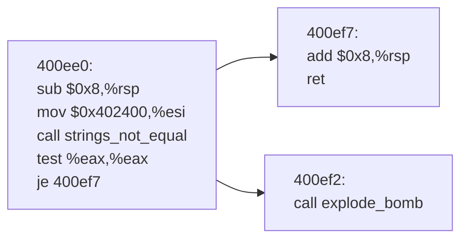

# x86-64 OBJDUMP反汇编代码转Mermaid表示流图

## 三地址码流图定义

流图是代码的一种图形表示，图中节点是代表计算的基本块，边代表控制流。

基本块是具有原子性的连续的语句序列，控制流从第一条语句（称为入口）进入，从最后一条语句（称为出口）流出，中途没有停止或分支。

使用如下规则确定每个基本块的入口语句：

1. 代码序列的第一条语句是一个入口语句
2. 任何一个条件或无条件转移语句转移到的目标语句是一个入口语句
3. 任何紧跟在一个条件或无条件转移语句之后的那条语句是一个入口语句

然后，根据入口语句确定基本块。每个基本块都是一个由入口语句引导的语句序列，即从一个入口语句（含该入口语句）开始，到下一个入口语句（不含此入口语句）或到一个停止语句（含该停止语句）之间的语句序列。

流图是有向图，节点是基本块。由程序的第一条语句开始的基本块称为流图的首节点。如果在某个执行序列中，基本块$B_2$紧跟在$B_1$之后执行，此时，或者有一个转移语句从$B_1$的最后一条语句转移到$B_2$的第一条语句，或者在程序的语句序列中，$B_2$紧跟在$B_1$之后，并且$B_1$的最后一条语句不是无条件跳转语句，在流图中，从$B_1$到$B_2$有一条有向边。

## 应用于x86-64汇编代码

我们将三地址码中的语句对应到x86-64代码的指令。我们定义如下指令为条件转移指令：

```assembly
je jne js jns jg jge jl jle ja jae jb jbe
```

定义如下指令为无条件转移指令：

```assembly
jmp
```

定义如下指令为停止指令：

```assembly
call explode_bomb
call __stack_chk_fail
ret
```

## 示例

对于如下反汇编程序段

```assembly
0000000000400ee0 <phase_1>:
  400ee0:	48 83 ec 08          	sub    $0x8,%rsp
  400ee4:	be 00 24 40 00       	mov    $0x402400,%esi
  400ee9:	e8 4a 04 00 00       	call   401338 <strings_not_equal>
  400eee:	85 c0                	test   %eax,%eax
  400ef0:	74 05                	je     400ef7 <phase_1+0x17>
  400ef2:	e8 43 05 00 00       	call   40143a <explode_bomb>
  400ef7:	48 83 c4 08          	add    $0x8,%rsp
  400efb:	c3                   	ret    
```

首先，对输入做预处理。定义映射关系$f:Addr\mapsto{Addr处的指令}$，其中$Addr$是字符串，指令格式要求如下

1. 指令均为二元组，分别是操作码和操作数，操作码和操作数均为字符串。
2. `ret`指令操作数为空
3. 跳转指令操作数为目标地址，例如`"400ef7"`
4. `call`指令的操作数为目标函数名，例如`"explode_bomb"`。

将上述映射关系按照$Addr$排序，要求可以按照$Addr$顺序遍历

其次，定义集合$EntryAddr$用于存放所有入口指令的地址

1. 根据规则可知，第一条指令为入口指令，其地址为`0x400ee0`，将其加入$EntryAddr$
2. 遍历程序，对于每个跳转语句（无论条件与无条件），将其目标指令地址加入$EntryAddr$，将其下一条语句地址加入$EntryAddr$，例如地址`0x400ef0`处指令`je 400ef7`，其目标指令地址为`0x400ef7`，其下一条语句地址为`0x400ef2`，将`0x400ef7`，`0x400ef2`加入$EntryAddr$
3. 最终，集合$EntryAddr$中应有`0x400ee0`，`0x400ef7`，`0x400ef2`

接着，对集合$EntryAddr$中的元素按升序排序，并确定所有基本块。在我们的例子中，对集合$EntryAddr$排序得到`0x400ee0`，`0x400ef2`，`0x400ef7`。由于基本块是由入口地址引导的指令序列，此处有三个入口地址，故有三个基本块。按$Addr$顺序遍历映射$f$，按照定义确定所有基本块。

确定所有基本块后，按照流图算法确定流图的边集合。为此，基本块结构需要存储如下信息

1. 开头地址
2. 结束地址

类型均为字符串。边集合$Edge$的每条边需要存储如下信息

1. 起点基本块入口地址
2. 终点基本块入口地址

因此，$EntryAddr$应为从开头地址到结束地址的映射，并按开头地址排序，而$Edge$是起点到终点的映射，$f$是地址到指令的映射。

有了上述集合后，图结构已经建立，算法需要按Mermaid格式以字符串形式输出该图。对于上例，算法应有如下输出



## 实现阶段

请在理解上述需求后，使用Python写一个初步的版本，要求逻辑清晰，功能明确，不考虑健壮性，不考虑异常处理，不考虑功能拓展，必要时添加注释。


