# Bomb Lab 实验报告

[TOC]

## Start

使用OBJDUMP工具反汇编二进制文件：

```bash
$ objdump -d bomb > bomb.s
```

## Phase 1

函数`phase_1`内容如下。

```assembly
0000000000400ee0 <phase_1>:
  400ee0:	48 83 ec 08          	sub    $0x8,%rsp
  400ee4:	be 00 24 40 00       	mov    $0x402400,%esi
  400ee9:	e8 4a 04 00 00       	call   401338 <strings_not_equal>
  400eee:	85 c0                	test   %eax,%eax
  400ef0:	74 05                	je     400ef7 <phase_1+0x17>
  400ef2:	e8 43 05 00 00       	call   40143a <explode_bomb>
  400ef7:	48 83 c4 08          	add    $0x8,%rsp
  400efb:	c3                   	ret    
```

为理解程序逻辑，画出程序流图如下。

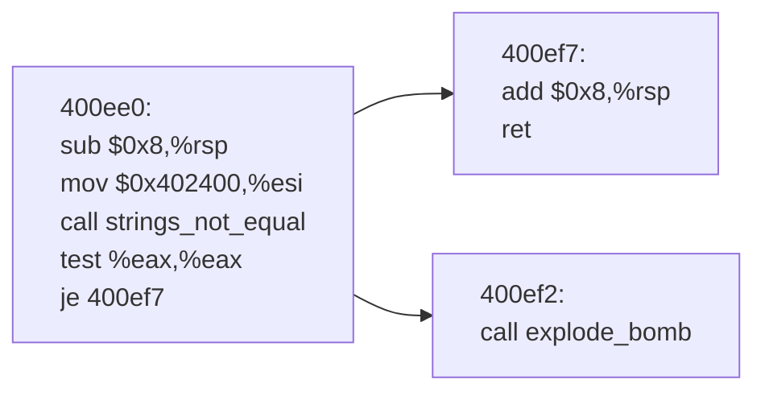

其中`%rdi`持有输入串。指令`test %eax, %eax`根据函数`strings_not_equal`返回值设置标志位，当返回值为`0`时，零标志位（ZF）被置位，随后`je`跳转，从而避免调用`explode_bomb`。因此，为了避免爆炸，我们需要函数`strings_not_equal`返回`0`。根据 x86-64 System V 调用约定，第一个参数通过`%rdi`传递，第二个参数通过`%rsi`传递，这表明`%rdi`中的字符串应等于`%esi`中的字符串。由于`%esi`存储的是`0x402400`，因此所需的输入是存储在`0x402400`处的字符串。该函数的逻辑可以表示为：

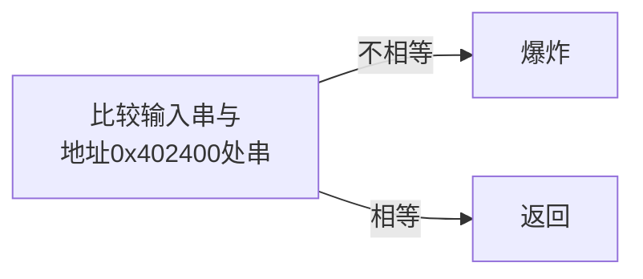

因此，第一阶段要求输入与存储在地址`0x402400`处的常量字符串完全匹配。该地址位于程序的只读数据段（`.rodata`），用于存储常量字符串。为了确定输入，使用GDB工具查看地址 `0x402400` 处的字符串如下。

```bash
$ gdb bomb
(gdb) x/s 0x402400
0x402400:	"Border relations with Canada have never been better."
```

该字符串为`"Border relations with Canada have never been better."`，这就是答案。

## Phase 2

函数`phase_2`内容如下。

```assembly
0000000000400efc <phase_2>:
  400efc:	55                   	push   %rbp
  400efd:	53                   	push   %rbx
  400efe:	48 83 ec 28          	sub    $0x28,%rsp
  400f02:	48 89 e6             	mov    %rsp,%rsi
  400f05:	e8 52 05 00 00       	call   40145c <read_six_numbers>
  400f0a:	83 3c 24 01          	cmpl   $0x1,(%rsp)
  400f0e:	74 20                	je     400f30 <phase_2+0x34>
  400f10:	e8 25 05 00 00       	call   40143a <explode_bomb>
  400f15:	eb 19                	jmp    400f30 <phase_2+0x34>
  400f17:	8b 43 fc             	mov    -0x4(%rbx),%eax
  400f1a:	01 c0                	add    %eax,%eax
  400f1c:	39 03                	cmp    %eax,(%rbx)
  400f1e:	74 05                	je     400f25 <phase_2+0x29>
  400f20:	e8 15 05 00 00       	call   40143a <explode_bomb>
  400f25:	48 83 c3 04          	add    $0x4,%rbx
  400f29:	48 39 eb             	cmp    %rbp,%rbx
  400f2c:	75 e9                	jne    400f17 <phase_2+0x1b>
  400f2e:	eb 0c                	jmp    400f3c <phase_2+0x40>
  400f30:	48 8d 5c 24 04       	lea    0x4(%rsp),%rbx
  400f35:	48 8d 6c 24 18       	lea    0x18(%rsp),%rbp
  400f3a:	eb db                	jmp    400f17 <phase_2+0x1b>
  400f3c:	48 83 c4 28          	add    $0x28,%rsp
  400f40:	5b                   	pop    %rbx
  400f41:	5d                   	pop    %rbp
  400f42:	c3                   	ret    
```

为理解程序逻辑，画出程序流图如下。

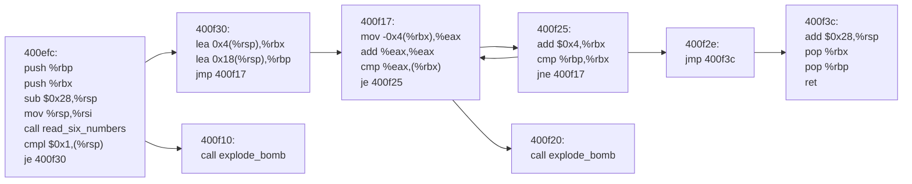

首先分析基本块`400efc`。函数`read_six_numbers`内容如下。

```assembly
000000000040145c <read_six_numbers>:
  40145c:	48 83 ec 18          	sub    $0x18,%rsp
  401460:	48 89 f2             	mov    %rsi,%rdx
  401463:	48 8d 4e 04          	lea    0x4(%rsi),%rcx
  401467:	48 8d 46 14          	lea    0x14(%rsi),%rax
  40146b:	48 89 44 24 08       	mov    %rax,0x8(%rsp)
  401470:	48 8d 46 10          	lea    0x10(%rsi),%rax
  401474:	48 89 04 24          	mov    %rax,(%rsp)
  401478:	4c 8d 4e 0c          	lea    0xc(%rsi),%r9
  40147c:	4c 8d 46 08          	lea    0x8(%rsi),%r8
  401480:	be c3 25 40 00       	mov    $0x4025c3,%esi
  401485:	b8 00 00 00 00       	mov    $0x0,%eax
  40148a:	e8 61 f7 ff ff       	call   400bf0 <__isoc99_sscanf@plt>
  40148f:	83 f8 05             	cmp    $0x5,%eax
  401492:	7f 05                	jg     401499 <read_six_numbers+0x3d>
  401494:	e8 a1 ff ff ff       	call   40143a <explode_bomb>
  401499:	48 83 c4 18          	add    $0x18,%rsp
  40149d:	c3                   	ret    
```

函数`read_six_numbers`被调用时，`%rdi`为输入串，`%rsi`为函数被调用前寄存器`%rsp`的值。函数保持`%rdi`，`%rsi`不变，做了如下数据传输。

| 目标           | 值            |
| -------------- | ------------- |
| `%rdx`         | `%rsi`        |
| `%rcx`         | `%rsi + 0x4`  |
| `%r8`          | `%rsi + 0x8`  |
| `%r9`          | `%rsi + 0xc`  |
| `(%rsp)`       | `%rsi + 0x10` |
| `(%rsp + 0x8)` | `%rsi + 0x14` |

随后将`%rsi`置为`0x4025c3`，并调用`sscanf`函数。使用GDB工具查看地址 `0x4025c3` 处的字符串如下。

```bash
$ gdb bomb
(gdb) x/s 0x4025c3
0x4025c3:	"%d %d %d %d %d %d"
```

可以推断函数`read_six_numbers`的功能是将输入串以`"%d %d %d %d %d %d"`格式读入栈中。故输入串应为6个用空格分隔的数字。随后，指令`cmpl $0x1,(%rsp)`比较`0x1`与`(%rsp)`并设置标志位，随后`je`跳转，从而避免调用`explode_bomb`。因此，为了避免爆炸，我们需要`(%rsp)`为`0x1`，即输入的第一个数字为1。

其次分析基本块`400efc`。可以看到函数将`%rbx`作为索引以遍历后5个数字，


该函数的逻辑可以表示为：

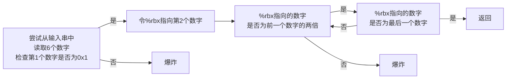

`"1 2 4 8 16 32"`

## Phase 3

函数`phase_3`内容如下。

```assembly
0000000000400f43 <phase_3>:
  400f43:	48 83 ec 18          	sub    $0x18,%rsp
  400f47:	48 8d 4c 24 0c       	lea    0xc(%rsp),%rcx
  400f4c:	48 8d 54 24 08       	lea    0x8(%rsp),%rdx
  400f51:	be cf 25 40 00       	mov    $0x4025cf,%esi
  400f56:	b8 00 00 00 00       	mov    $0x0,%eax
  400f5b:	e8 90 fc ff ff       	call   400bf0 <__isoc99_sscanf@plt>
  400f60:	83 f8 01             	cmp    $0x1,%eax
  400f63:	7f 05                	jg     400f6a <phase_3+0x27>
  400f65:	e8 d0 04 00 00       	call   40143a <explode_bomb>
  400f6a:	83 7c 24 08 07       	cmpl   $0x7,0x8(%rsp)
  400f6f:	77 3c                	ja     400fad <phase_3+0x6a>
  400f71:	8b 44 24 08          	mov    0x8(%rsp),%eax
  400f75:	ff 24 c5 70 24 40 00 	jmp    *0x402470(,%rax,8)
  400f7c:	b8 cf 00 00 00       	mov    $0xcf,%eax
  400f81:	eb 3b                	jmp    400fbe <phase_3+0x7b>
  400f83:	b8 c3 02 00 00       	mov    $0x2c3,%eax
  400f88:	eb 34                	jmp    400fbe <phase_3+0x7b>
  400f8a:	b8 00 01 00 00       	mov    $0x100,%eax
  400f8f:	eb 2d                	jmp    400fbe <phase_3+0x7b>
  400f91:	b8 85 01 00 00       	mov    $0x185,%eax
  400f96:	eb 26                	jmp    400fbe <phase_3+0x7b>
  400f98:	b8 ce 00 00 00       	mov    $0xce,%eax
  400f9d:	eb 1f                	jmp    400fbe <phase_3+0x7b>
  400f9f:	b8 aa 02 00 00       	mov    $0x2aa,%eax
  400fa4:	eb 18                	jmp    400fbe <phase_3+0x7b>
  400fa6:	b8 47 01 00 00       	mov    $0x147,%eax
  400fab:	eb 11                	jmp    400fbe <phase_3+0x7b>
  400fad:	e8 88 04 00 00       	call   40143a <explode_bomb>
  400fb2:	b8 00 00 00 00       	mov    $0x0,%eax
  400fb7:	eb 05                	jmp    400fbe <phase_3+0x7b>
  400fb9:	b8 37 01 00 00       	mov    $0x137,%eax
  400fbe:	3b 44 24 0c          	cmp    0xc(%rsp),%eax
  400fc2:	74 05                	je     400fc9 <phase_3+0x86>
  400fc4:	e8 71 04 00 00       	call   40143a <explode_bomb>
  400fc9:	48 83 c4 18          	add    $0x18,%rsp
  400fcd:	c3                   	ret 
```

注意到指令`jmp *0x402470(,%rax,8)`，利用GDB工具查看地址`0x402470`处内容如下。

```bash
$ gdb bomb
(gdb) x/8gx 0x402470
0x402470:	0x0000000000400f7c	0x0000000000400fb9
0x402480:	0x0000000000400f83	0x0000000000400f8a
0x402490:	0x0000000000400f91	0x0000000000400f98
0x4024a0:	0x0000000000400f9f	0x0000000000400fa6
```

据此画出程序流图如下。

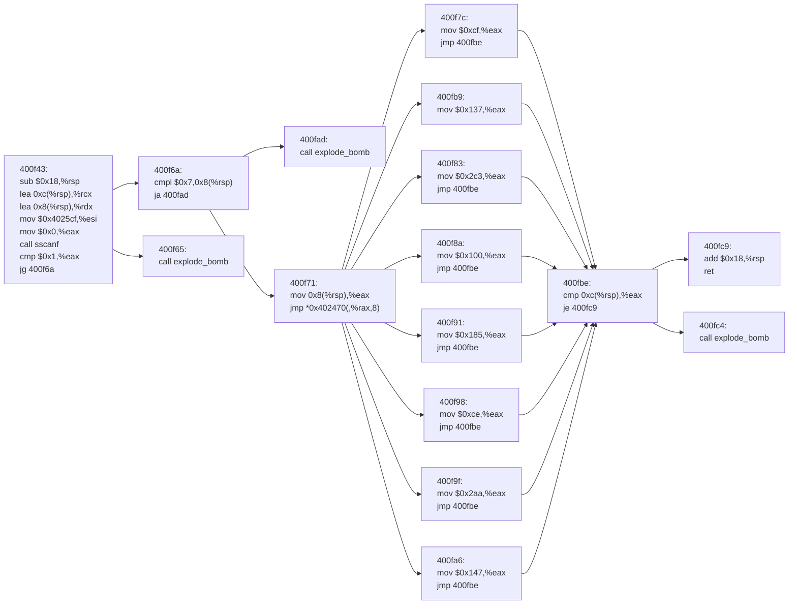

注意到指令`mov $0x4025cf,%esi`，利用GDB工具查看地址`0x4025cf`处内容如下。

```bash
$ gdb bomb
(gdb) x/s 0x4025cf
0x4025cf:	"%d %d"
```

故该函数逻辑可表示为：

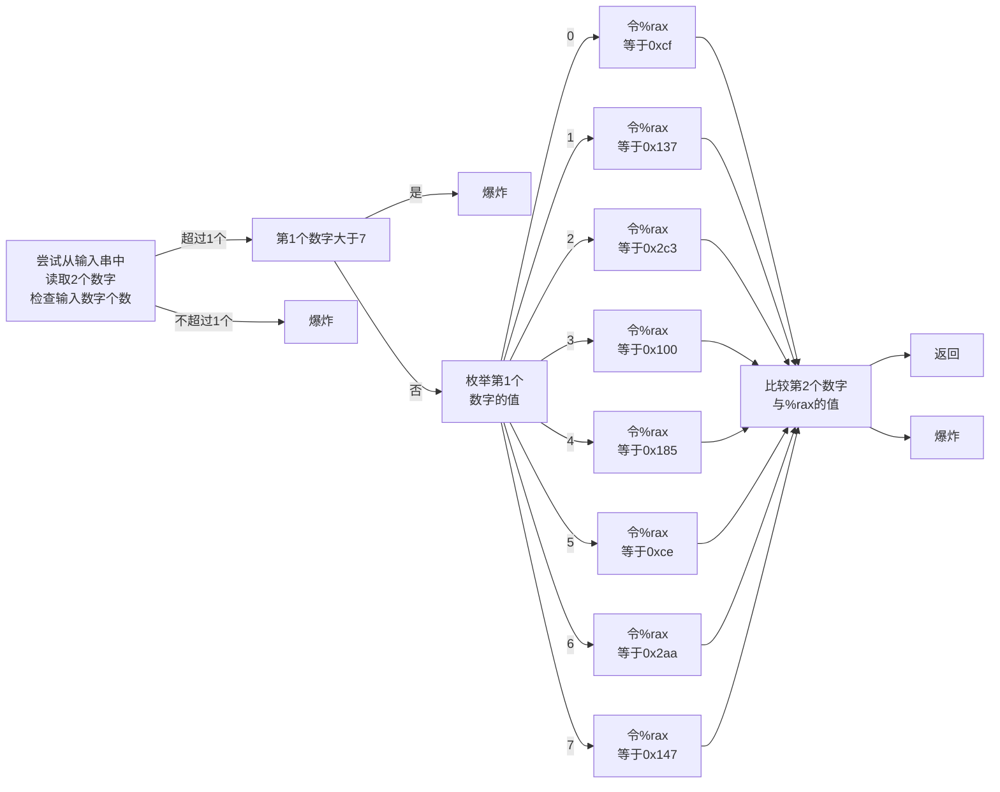

所有可能答案如下。

`0 207`

`1 311`

`2 707`

`3 256`

`4 389`

`5 206`

`6 682`

`7 327`

## Phase 4

函数`phase_4`内容如下。

```assembly
0000000000400fce <func4>:
  400fce:	48 83 ec 08          	sub    $0x8,%rsp
  400fd2:	89 d0                	mov    %edx,%eax
  400fd4:	29 f0                	sub    %esi,%eax
  400fd6:	89 c1                	mov    %eax,%ecx
  400fd8:	c1 e9 1f             	shr    $0x1f,%ecx
  400fdb:	01 c8                	add    %ecx,%eax
  400fdd:	d1 f8                	sar    %eax
  400fdf:	8d 0c 30             	lea    (%rax,%rsi,1),%ecx
  400fe2:	39 f9                	cmp    %edi,%ecx
  400fe4:	7e 0c                	jle    400ff2 <func4+0x24>
  400fe6:	8d 51 ff             	lea    -0x1(%rcx),%edx
  400fe9:	e8 e0 ff ff ff       	call   400fce <func4>
  400fee:	01 c0                	add    %eax,%eax
  400ff0:	eb 15                	jmp    401007 <func4+0x39>
  400ff2:	b8 00 00 00 00       	mov    $0x0,%eax
  400ff7:	39 f9                	cmp    %edi,%ecx
  400ff9:	7d 0c                	jge    401007 <func4+0x39>
  400ffb:	8d 71 01             	lea    0x1(%rcx),%esi
  400ffe:	e8 cb ff ff ff       	call   400fce <func4>
  401003:	8d 44 00 01          	lea    0x1(%rax,%rax,1),%eax
  401007:	48 83 c4 08          	add    $0x8,%rsp
  40100b:	c3                   	ret    

000000000040100c <phase_4>:
  40100c:	48 83 ec 18          	sub    $0x18,%rsp
  401010:	48 8d 4c 24 0c       	lea    0xc(%rsp),%rcx
  401015:	48 8d 54 24 08       	lea    0x8(%rsp),%rdx
  40101a:	be cf 25 40 00       	mov    $0x4025cf,%esi
  40101f:	b8 00 00 00 00       	mov    $0x0,%eax
  401024:	e8 c7 fb ff ff       	call   400bf0 <__isoc99_sscanf@plt>
  401029:	83 f8 02             	cmp    $0x2,%eax
  40102c:	75 07                	jne    401035 <phase_4+0x29>
  40102e:	83 7c 24 08 0e       	cmpl   $0xe,0x8(%rsp)
  401033:	76 05                	jbe    40103a <phase_4+0x2e>
  401035:	e8 00 04 00 00       	call   40143a <explode_bomb>
  40103a:	ba 0e 00 00 00       	mov    $0xe,%edx
  40103f:	be 00 00 00 00       	mov    $0x0,%esi
  401044:	8b 7c 24 08          	mov    0x8(%rsp),%edi
  401048:	e8 81 ff ff ff       	call   400fce <func4>
  40104d:	85 c0                	test   %eax,%eax
  40104f:	75 07                	jne    401058 <phase_4+0x4c>
  401051:	83 7c 24 0c 00       	cmpl   $0x0,0xc(%rsp)
  401056:	74 05                	je     40105d <phase_4+0x51>
  401058:	e8 dd 03 00 00       	call   40143a <explode_bomb>
  40105d:	48 83 c4 18          	add    $0x18,%rsp
  401061:	c3                   	ret    
```

为理解程序逻辑，画出程序流图如下。

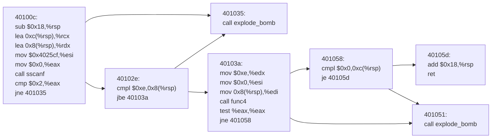

注意到指令`mov $0x4025cf,%esi`，在Phase 3已经查看过地址`0x4025cf`处内容为`"%d %d"`，故该函数逻辑可表示为：

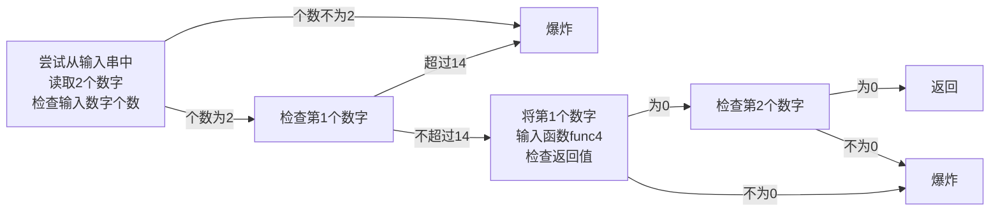

可以看出第2个数字需要为0，第1个数字需要在$[0,14]$之间，且需要函数`func4`返回`0`。画出函数`func4`的程序流图如下。

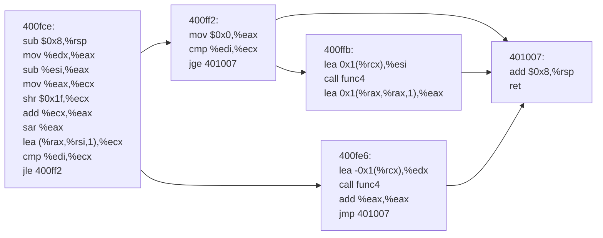

函数被调用时，`%rsi`值为`0`，`%rdx`值为`14`，故函数逻辑可表示为：


`7 0`

## Phase 5

函数`phase_5`内容如下。

```assembly
0000000000401062 <phase_5>:
  401062:	53                   	push   %rbx
  401063:	48 83 ec 20          	sub    $0x20,%rsp
  401067:	48 89 fb             	mov    %rdi,%rbx
  40106a:	64 48 8b 04 25 28 00 	mov    %fs:0x28,%rax
  401071:	00 00 
  401073:	48 89 44 24 18       	mov    %rax,0x18(%rsp)
  401078:	31 c0                	xor    %eax,%eax
  40107a:	e8 9c 02 00 00       	call   40131b <string_length>
  40107f:	83 f8 06             	cmp    $0x6,%eax
  401082:	74 4e                	je     4010d2 <phase_5+0x70>
  401084:	e8 b1 03 00 00       	call   40143a <explode_bomb>
  401089:	eb 47                	jmp    4010d2 <phase_5+0x70>
  40108b:	0f b6 0c 03          	movzbl (%rbx,%rax,1),%ecx
  40108f:	88 0c 24             	mov    %cl,(%rsp)
  401092:	48 8b 14 24          	mov    (%rsp),%rdx
  401096:	83 e2 0f             	and    $0xf,%edx
  401099:	0f b6 92 b0 24 40 00 	movzbl 0x4024b0(%rdx),%edx
  4010a0:	88 54 04 10          	mov    %dl,0x10(%rsp,%rax,1)
  4010a4:	48 83 c0 01          	add    $0x1,%rax
  4010a8:	48 83 f8 06          	cmp    $0x6,%rax
  4010ac:	75 dd                	jne    40108b <phase_5+0x29>
  4010ae:	c6 44 24 16 00       	movb   $0x0,0x16(%rsp)
  4010b3:	be 5e 24 40 00       	mov    $0x40245e,%esi
  4010b8:	48 8d 7c 24 10       	lea    0x10(%rsp),%rdi
  4010bd:	e8 76 02 00 00       	call   401338 <strings_not_equal>
  4010c2:	85 c0                	test   %eax,%eax
  4010c4:	74 13                	je     4010d9 <phase_5+0x77>
  4010c6:	e8 6f 03 00 00       	call   40143a <explode_bomb>
  4010cb:	0f 1f 44 00 00       	nopl   0x0(%rax,%rax,1)
  4010d0:	eb 07                	jmp    4010d9 <phase_5+0x77>
  4010d2:	b8 00 00 00 00       	mov    $0x0,%eax
  4010d7:	eb b2                	jmp    40108b <phase_5+0x29>
  4010d9:	48 8b 44 24 18       	mov    0x18(%rsp),%rax
  4010de:	64 48 33 04 25 28 00 	xor    %fs:0x28,%rax
  4010e5:	00 00 
  4010e7:	74 05                	je     4010ee <phase_5+0x8c>
  4010e9:	e8 42 fa ff ff       	call   400b30 <__stack_chk_fail@plt>
  4010ee:	48 83 c4 20          	add    $0x20,%rsp
  4010f2:	5b                   	pop    %rbx
  4010f3:	c3                   	ret 
```

为理解程序逻辑，画出程序流图如下。

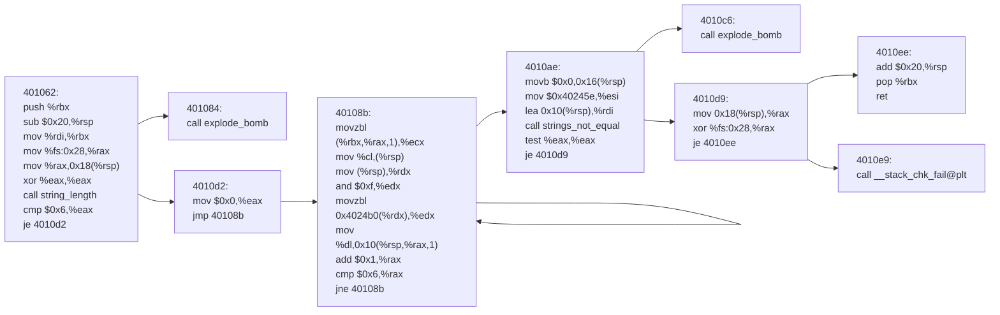


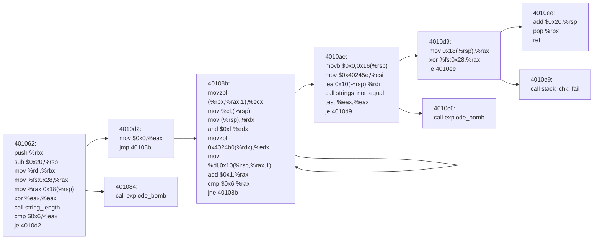

该函数逻辑可表示为：

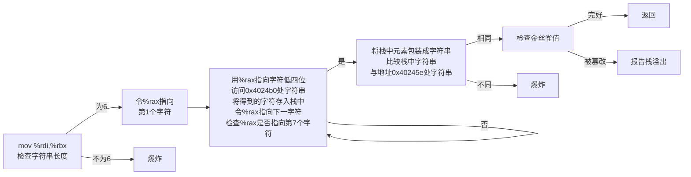

只需输入字符的ASCII值后四位为`9 f e 5 6 7`即可。

含有大部分可输出字符的ASCII表如下：

```
  2 3 4 5 6 7 
------------- 
0:   0 @ P ` p
1: ! 1 A Q a q
2: " 2 B R b r
3: # 3 C S c s
4: $ 4 D T d t
5: % 5 E U e u
6: & 6 F V f v
7: ' 7 G W g w
8: ( 8 H X h x
9: ) 9 I Y i y
A: * : J Z j z
B: + ; K [ k {
C: , < L \ l |
D: - = M ] m }
E: . > N ^ n ~
F: / ? O _ o DEL
```

选择答案`IONEFG`。

## Phase 6

函数`phase_6`内容如下。

```assembly
00000000004010f4 <phase_6>:
  4010f4:	41 56                	push   %r14
  4010f6:	41 55                	push   %r13
  4010f8:	41 54                	push   %r12
  4010fa:	55                   	push   %rbp
  4010fb:	53                   	push   %rbx
  4010fc:	48 83 ec 50          	sub    $0x50,%rsp
  401100:	49 89 e5             	mov    %rsp,%r13
  401103:	48 89 e6             	mov    %rsp,%rsi
  401106:	e8 51 03 00 00       	call   40145c <read_six_numbers>
  40110b:	49 89 e6             	mov    %rsp,%r14
  40110e:	41 bc 00 00 00 00    	mov    $0x0,%r12d
  401114:	4c 89 ed             	mov    %r13,%rbp
  401117:	41 8b 45 00          	mov    0x0(%r13),%eax
  40111b:	83 e8 01             	sub    $0x1,%eax
  40111e:	83 f8 05             	cmp    $0x5,%eax
  401121:	76 05                	jbe    401128 <phase_6+0x34>
  401123:	e8 12 03 00 00       	call   40143a <explode_bomb>
  401128:	41 83 c4 01          	add    $0x1,%r12d
  40112c:	41 83 fc 06          	cmp    $0x6,%r12d
  401130:	74 21                	je     401153 <phase_6+0x5f>
  401132:	44 89 e3             	mov    %r12d,%ebx
  401135:	48 63 c3             	movslq %ebx,%rax
  401138:	8b 04 84             	mov    (%rsp,%rax,4),%eax
  40113b:	39 45 00             	cmp    %eax,0x0(%rbp)
  40113e:	75 05                	jne    401145 <phase_6+0x51>
  401140:	e8 f5 02 00 00       	call   40143a <explode_bomb>
  401145:	83 c3 01             	add    $0x1,%ebx
  401148:	83 fb 05             	cmp    $0x5,%ebx
  40114b:	7e e8                	jle    401135 <phase_6+0x41>
  40114d:	49 83 c5 04          	add    $0x4,%r13
  401151:	eb c1                	jmp    401114 <phase_6+0x20>
  401153:	48 8d 74 24 18       	lea    0x18(%rsp),%rsi
  401158:	4c 89 f0             	mov    %r14,%rax
  40115b:	b9 07 00 00 00       	mov    $0x7,%ecx
  401160:	89 ca                	mov    %ecx,%edx
  401162:	2b 10                	sub    (%rax),%edx
  401164:	89 10                	mov    %edx,(%rax)
  401166:	48 83 c0 04          	add    $0x4,%rax
  40116a:	48 39 f0             	cmp    %rsi,%rax
  40116d:	75 f1                	jne    401160 <phase_6+0x6c>
  40116f:	be 00 00 00 00       	mov    $0x0,%esi
  401174:	eb 21                	jmp    401197 <phase_6+0xa3>
  401176:	48 8b 52 08          	mov    0x8(%rdx),%rdx
  40117a:	83 c0 01             	add    $0x1,%eax
  40117d:	39 c8                	cmp    %ecx,%eax
  40117f:	75 f5                	jne    401176 <phase_6+0x82>
  401181:	eb 05                	jmp    401188 <phase_6+0x94>
  401183:	ba d0 32 60 00       	mov    $0x6032d0,%edx
  401188:	48 89 54 74 20       	mov    %rdx,0x20(%rsp,%rsi,2)
  40118d:	48 83 c6 04          	add    $0x4,%rsi
  401191:	48 83 fe 18          	cmp    $0x18,%rsi
  401195:	74 14                	je     4011ab <phase_6+0xb7>
  401197:	8b 0c 34             	mov    (%rsp,%rsi,1),%ecx
  40119a:	83 f9 01             	cmp    $0x1,%ecx
  40119d:	7e e4                	jle    401183 <phase_6+0x8f>
  40119f:	b8 01 00 00 00       	mov    $0x1,%eax
  4011a4:	ba d0 32 60 00       	mov    $0x6032d0,%edx
  4011a9:	eb cb                	jmp    401176 <phase_6+0x82>
  4011ab:	48 8b 5c 24 20       	mov    0x20(%rsp),%rbx
  4011b0:	48 8d 44 24 28       	lea    0x28(%rsp),%rax
  4011b5:	48 8d 74 24 50       	lea    0x50(%rsp),%rsi
  4011ba:	48 89 d9             	mov    %rbx,%rcx
  4011bd:	48 8b 10             	mov    (%rax),%rdx
  4011c0:	48 89 51 08          	mov    %rdx,0x8(%rcx)
  4011c4:	48 83 c0 08          	add    $0x8,%rax
  4011c8:	48 39 f0             	cmp    %rsi,%rax
  4011cb:	74 05                	je     4011d2 <phase_6+0xde>
  4011cd:	48 89 d1             	mov    %rdx,%rcx
  4011d0:	eb eb                	jmp    4011bd <phase_6+0xc9>
  4011d2:	48 c7 42 08 00 00 00 	movq   $0x0,0x8(%rdx)
  4011d9:	00 
  4011da:	bd 05 00 00 00       	mov    $0x5,%ebp
  4011df:	48 8b 43 08          	mov    0x8(%rbx),%rax
  4011e3:	8b 00                	mov    (%rax),%eax
  4011e5:	39 03                	cmp    %eax,(%rbx)
  4011e7:	7d 05                	jge    4011ee <phase_6+0xfa>
  4011e9:	e8 4c 02 00 00       	call   40143a <explode_bomb>
  4011ee:	48 8b 5b 08          	mov    0x8(%rbx),%rbx
  4011f2:	83 ed 01             	sub    $0x1,%ebp
  4011f5:	75 e8                	jne    4011df <phase_6+0xeb>
  4011f7:	48 83 c4 50          	add    $0x50,%rsp
  4011fb:	5b                   	pop    %rbx
  4011fc:	5d                   	pop    %rbp
  4011fd:	41 5c                	pop    %r12
  4011ff:	41 5d                	pop    %r13
  401201:	41 5e                	pop    %r14
  401203:	c3                   	ret
```

```mermaid
graph LR
	4010f4["<div align='left'>4010f4:<br/>push %r14<br/>push %r13<br/>push %r12<br/>push %rbp<br/>push %rbx<br/>sub $0x50,%rsp<br/>mov %rsp,%r13<br/>mov %rsp,%rsi<br/>call read_six_numbers<br/>mov %rsp,%r14<br/>mov $0x0,%r12d<br/></div>"]
	401114["<div align='left'>401114:<br/>mov %r13,%rbp<br/>mov 0x0(%r13),%eax<br/>sub $0x1,%eax<br/>cmp $0x5,%eax<br/>jbe 401128<br/></div>"]
	401123["<div align='left'>401123:<br/>call explode_bomb<br/></div>"]
	401128["<div align='left'>401128:<br/>add $0x1,%r12d<br/>cmp $0x6,%r12d<br/>je 401153<br/></div>"]
	401132["<div align='left'>401132:<br/>mov %r12d,%ebx<br/></div>"]
	401135["<div align='left'>401135:<br/>movslq %ebx,%rax<br/>mov (%rsp,%rax,4),%eax<br/>cmp %eax,0x0(%rbp)<br/>jne 401145<br/></div>"]
	401140["<div align='left'>401140:<br/>call explode_bomb<br/></div>"]
	401145["<div align='left'>401145:<br/>add $0x1,%ebx<br/>cmp $0x5,%ebx<br/>jle 401135<br/></div>"]
	40114d["<div align='left'>40114d:<br/>add $0x4,%r13<br/>jmp 401114<br/></div>"]
	401153["<div align='left'>401153:<br/>lea 0x18(%rsp),%rsi<br/>mov %r14,%rax<br/>mov $0x7,%ecx<br/></div>"]
	401160["<div align='left'>401160:<br/>mov %ecx,%edx<br/>sub (%rax),%edx<br/>mov %edx,(%rax)<br/>add $0x4,%rax<br/>cmp %rsi,%rax<br/>jne 401160<br/></div>"]
	40116f["<div align='left'>40116f:<br/>mov $0x0,%esi<br/>jmp 401197<br/></div>"]
	401176["<div align='left'>401176:<br/>mov 0x8(%rdx),%rdx<br/>add $0x1,%eax<br/>cmp %ecx,%eax<br/>jne 401176<br/></div>"]
	401181["<div align='left'>401181:<br/>jmp 401188<br/></div>"]
	401183["<div align='left'>401183:<br/>mov $0x6032d0,%edx<br/></div>"]
	401188["<div align='left'>401188:<br/>mov %rdx,0x20(%rsp,%rsi,2)<br/>add $0x4,%rsi<br/>cmp $0x18,%rsi<br/>je 4011ab<br/></div>"]
	401197["<div align='left'>401197:<br/>mov (%rsp,%rsi,1),%ecx<br/>cmp $0x1,%ecx<br/>jle 401183<br/></div>"]
	40119f["<div align='left'>40119f:<br/>mov $0x1,%eax<br/>mov $0x6032d0,%edx<br/>jmp 401176<br/></div>"]
	4011ab["<div align='left'>4011ab:<br/>mov 0x20(%rsp),%rbx<br/>lea 0x28(%rsp),%rax<br/>lea 0x50(%rsp),%rsi<br/>mov %rbx,%rcx<br/></div>"]
	4011bd["<div align='left'>4011bd:<br/>mov (%rax),%rdx<br/>mov %rdx,0x8(%rcx)<br/>add $0x8,%rax<br/>cmp %rsi,%rax<br/>je 4011d2<br/></div>"]
	4011cd["<div align='left'>4011cd:<br/>mov %rdx,%rcx<br/>jmp 4011bd<br/></div>"]
	4011d2["<div align='left'>4011d2:<br/>movq $0x0,0x8(%rdx)<br/>mov $0x5,%ebp<br/></div>"]
	4011df["<div align='left'>4011df:<br/>mov 0x8(%rbx),%rax<br/>mov (%rax),%eax<br/>cmp %eax,(%rbx)<br/>jge 4011ee<br/></div>"]
	4011e9["<div align='left'>4011e9:<br/>call explode_bomb<br/></div>"]
	4011ee["<div align='left'>4011ee:<br/>mov 0x8(%rbx),%rbx<br/>sub $0x1,%ebp<br/>jne 4011df<br/></div>"]
	4011f7["<div align='left'>4011f7:<br/>add $0x50,%rsp<br/>pop %rbx<br/>pop %rbp<br/>pop %r12<br/>pop %r13<br/>pop %r14<br/>ret<br/></div>"]
    4010f4 --> 401114
    401114 --> 401128
    401114 --> 401123
    401128 --> 401153
    401128 --> 401132
    401132 --> 401135
    401135 --> 401145
    401135 --> 401140
    401145 --> 401135
    401145 --> 40114d
    40114d --> 401114
    401153 --> 401160
    401160 --> 401160
    401160 --> 40116f
    40116f --> 401197
    401176 --> 401176
    401176 --> 401181
    401181 --> 401188
    401183 --> 401188
    401188 --> 4011ab
    401188 --> 401197
    401197 --> 401183
    401197 --> 40119f
    40119f --> 401176
    4011ab --> 4011bd
    4011bd --> 4011d2
    4011bd --> 4011cd
    4011cd --> 4011bd
    4011d2 --> 4011df
    4011df --> 4011ee
    4011df --> 4011e9
    4011ee --> 4011df
    4011ee --> 4011f7

```

