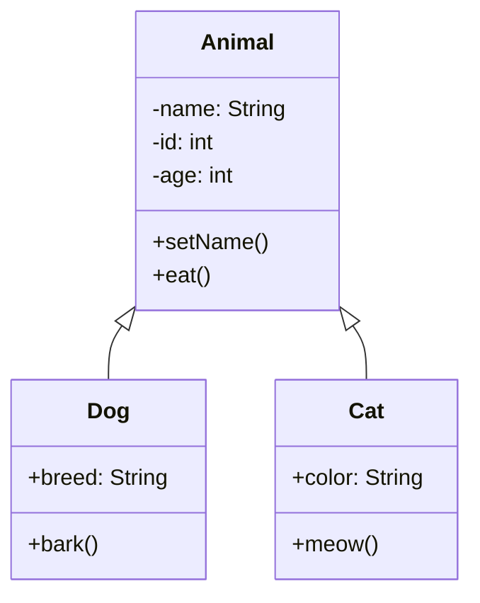

```flow
st=>start: 开始
login=>operation: 登录操作
cond=>condition: 成功?
end=>end: 结束

st->login->cond
cond(yes)->end
cond(no)->login
```


```sequence
Note left of 客户端: 发起请求
客户端->服务器: HTTP请求
Note right of 服务器: 处理请求
服务器-->客户端: 返回响应
Note over 客户端,服务器: 完成交互
```

