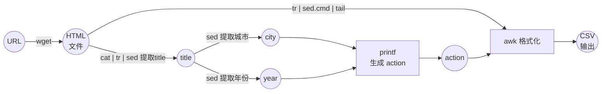

# Linux课程实验报告

班级：2023211303

学号：2023210710

姓名：陈子容

[TOC]
## 一、实验目的

1. 掌握Linux下文本处理工具（例如grep、sed、awk）的基本用法。
2. 学会从半结构化的HTML网页中提取所需数据。
3. 理解通过管道组合多个命令解决实际问题的思路。

## 二、实验环境

- 操作系统：Ubuntu 22.04
- 工具：bash, wget, grep, sed, awk
- 数据来源：`https://www.tianqi24.com/` 历史天气页面

## 三、实验内容与要求

从给定的历史天气网页中提取以下字段：
- 城市名
- 日期（YYYY-MM-DD格式）
- 最高温度
- 最低温度
- 空气质量AQI
- 降水量

输出格式为CSV，示例：
```
北京,2023-07-01,38,24,53,0
开封,2020-11-21,8,2,90,3.98
```

## 四、实验思路

整体处理流程分为五步：

1. **下载HTML文件**：使用`wget`下载指定URL的页面。
2. **提取城市名和年份**：从`<title>`标签中解析出城市和年份。
3. **压缩HTML**：删除所有空格和换行，将多行结构压缩为单行。
4. **定位数据区块**：通过`<ul class="col6">`标签定位包含天气数据的列表。
5. **清理并输出**：删除HTML标签，将`</div>`替换为空格作为字段分隔符，最后用`awk`按列输出CSV格式。

将思路总结如图所示。


## 五、处理步骤与命令解释

处理脚本`ans.sh`内容如下。

```bash
#!/bin/bash
wget $1 &> /dev/null
file=$(echo $1 | sed "s/.*\(history[0-9]*\.html\)/\1/")
title=$(cat $file | tr -d '\n' | sed 's/.*<title>\(.*\)<\/title>.*/\1/')
city=$(echo $title | sed 's/\(.*\)市.*/\1/')
year=$(echo $title | sed 's/.*市\([0-9]*\).*/\1/')
action=$(printf '{printf \"%s,%s-%%s,%%s,%%s,%%s,%%s\\n\", $1, $3, $4, $5, $7}' $city $year)
cat $file | tr -d '\n ' | sed -f sed.cmd | tail -n +2 | awk "$action"
```

其中参数`$1`为网页URL，对各个命令解释如下。

### 步骤1：下载HTML文件

```bash
wget $1 &> /dev/null
```
- `wget`：下载指定URL
- `$1`：脚本的第一个参数，即网页URL
- `&> /dev/null`：屏蔽wget的输出信息

### 步骤2：提取文件名
```bash
file=$(echo $1 | sed "s/.*\(history[0-9]*\.html\)/\1/")
```
- 从URL中提取文件名，如`history202307.html`

### 步骤3：提取`<title>`标签内容
```bash
title=$(cat $file | tr -d '\n' | sed 's/.*<title>\(.*\)<\/title>.*/\1/')
```
- `cat`：读取文件
- `tr -d '\n'`：删除所有换行，将多行合并为一行
- `sed`：用正则匹配`<title>`标签，只保留标签内的内容

### 步骤4：从标题中提取城市名
```bash
city=$(echo $title | sed 's/\(.*\)市.*/\1/')
```
- 匹配“市”字前面的所有内容，例如“北京市”→“北京”

### 步骤5：从标题中提取年份
```bash
year=$(echo $title | sed 's/.*市\([0-9]*\).*/\1/')
```
- 匹配“市”字后面的连续数字，例如“北京市2023年07月”→“2023”

### 步骤6：构建awk处理程序
```bash
action=$(printf '{printf \"%s,%s-%%s,%%s,%%s,%%s,%%s\\n\", $1, $3, $4, $5, $7}' $city $year)
```
- 使用`printf`将城市名和年份拼接到`awk`的格式化字符串中
- 生成的内容类似于：`{printf "北京,2023-%s,%s,%s,%s,%s\n", $1, $3, $4, $5, $7}`

### 步骤7：处理HTML并输出
```bash
cat $file | tr -d '\n ' | sed -f sed.cmd | tail -n +2 | awk "$action"
```
- `tr -d '\n '`：删除所有空格和换行，将HTML压缩为单行
- `sed -f sed.cmd`：执行sed脚本文件，完成数据提取和标签清理
- `tail -n +2`：删除第一行（表头）
- `awk "$action"`：按列输出CSV格式

`sed.cmd`脚本内容如下

```
s/.*<ulclass="col6">\(.*\)<\/ul>.*/\1/
s/<\/li>/\n/g
s/<\/div>/ /g
s/<[^>]*>//g
s/℃//g
```
每条命令的作用：
1. 提取`<ulclass="col6">`和`</ul>`之间的所有内容（天气数据区块）
2. 将`</li>`替换为换行，使每天数据独立成行
3. 将`</div>`替换为空格，作为字段分隔符
4. 删除所有剩余的HTML标签
5. 删除温度单位“℃”

### 脚本数据流图

`ans.sh`脚本数据流图如下。



## 六、测试过程与结果

测试脚本`test.sh`内容如下

```bash
#!/bin/bash
rm history*.html &> /dev/null
./ans.sh www.tianqi24.com/beijing/history202307.html
echo ""
./ans.sh www.tianqi24.com/kaifeng/history202011.html
rm history*.html &> /dev/null
```

执行`./test.sh`后，输出如下：

```
北京,2023-07-01,38,24,53,0
北京,2023-07-02,37,25,77,0
北京,2023-07-03,33,23,41,0
北京,2023-07-04,37,21,21,0
北京,2023-07-05,40,21,54,0
北京,2023-07-06,40,21,86,0
北京,2023-07-07,36,23,29,0
北京,2023-07-08,38,25,26,0
北京,2023-07-09,39,24,40,0
北京,2023-07-10,38,25,53,0
北京,2023-07-11,34,25,47,11.03
北京,2023-07-12,31,21,43,0
北京,2023-07-13,36,22,25,0
北京,2023-07-14,34,23,30,0
北京,2023-07-15,34,23,26,0
北京,2023-07-16,36,23,42,0
北京,2023-07-17,36,23,49,0
北京,2023-07-18,35,25,70,0
北京,2023-07-19,36,24,56,0
北京,2023-07-20,35,22,57,0
北京,2023-07-21,33,22,46,2.9398
北京,2023-07-22,36,20,28,0
北京,2023-07-23,36,20,36,5.58
北京,2023-07-24,35,22,63,5.7451
北京,2023-07-25,36,21,50,1.619
北京,2023-07-26,37,21,1,0.2569
北京,2023-07-27,33,24,1,0.1961
北京,2023-07-28,33,23,1,0
北京,2023-07-29,29,22,1,17.6849
北京,2023-07-30,28,23,1,89.5335
北京,2023-07-31,28,22,1,57.5202

开封,2020-11-01,21,8,73,0
开封,2020-11-02,20,5,63,0
开封,2020-11-03,18,6,52,0
开封,2020-11-04,19,8,65,0
开封,2020-11-05,19,10,80,0
开封,2020-11-06,23,10,49,0
开封,2020-11-07,23,6,45,0
开封,2020-11-08,18,7,48,0
开封,2020-11-09,20,6,158,0
开封,2020-11-10,21,10,92,0
开封,2020-11-11,24,9,105,0
开封,2020-11-12,22,9,95,0
开封,2020-11-13,19,8,197,0
开封,2020-11-14,19,8,91,0
开封,2020-11-15,21,10,81,0
开封,2020-11-16,17,11,81,0
开封,2020-11-17,16,10,38,25.35
开封,2020-11-18,15,9,39,0
开封,2020-11-19,16,5,49,0
开封,2020-11-20,12,4,62,1.1
开封,2020-11-21,8,2,90,3.98
开封,2020-11-22,7,1,74,0
开封,2020-11-23,6,0,84,0
开封,2020-11-24,8,0,52,0
开封,2020-11-25,9,0,95,0
开封,2020-11-26,9,0,83,0
开封,2020-11-27,9,1,90,0
开封,2020-11-28,7,1,44,0
开封,2020-11-29,8,-1,189,0
开封,2020-11-30,6,0,209,0
```

数据完整，格式符合要求。

## 七、实验总结

本次实验成功利用Linux文本工具链（grep、sed、awk）从HTML网页中提取了结构化数据。虽然纯文本工具在处理复杂HTML时存在一定局限性，但通过合理的设计（如先压缩再插入分隔符）仍能完成数据提取任务。这加深了对管道操作和正则表达式的理解，也体会到了命令行工具组合的灵活性与强大。
