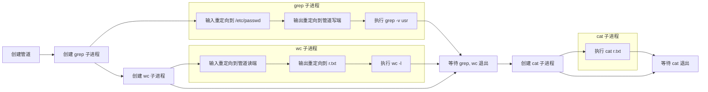

# Linux 系统编程实验：Shell管道与重定向功能实现
班级：2023211303
学号：2023210710
姓名：陈子容

[TOC]

---

## 一、实验目的

1. 利用`fork()`、`exec()`、`dup2()`、`pipe()`、`open()`、`wait()`等系统调用，编写C语言程序实现指定Shell命令等价功能。
2. 掌握Linux进程创建、进程替换、管道通信、文件描述符重定向的底层原理与使用方法。
3. 理解Shell中管道`|`、输入重定向`<`、输出重定向`>`的实现机制。
4. 学会对系统调用进行封装，统一处理调用异常，提升代码健壮性。
5. 体会Linux多进程协作、文件描述符生命周期管理的设计思想。

## 二、实验环境
- 操作系统：Ubuntu 22.04.5 LTS (jammy)
- 内核版本：6.8.0-111-generic
- 编译器：gcc (Ubuntu 14.3.0-12ubuntu1~22~ppa2) 14.3.0
- 编辑器：VIM - Vi IMproved 8.2
- 开发工具：make、bash

## 三、实验要求
### 基本要求
- 编写C语言程序，实现与Shell命令 `grep -v usr < /etc/passwd | wc –l > r.txt; cat r.txt` 完全一致的功能。
- 使用`fork`、`pipe`、`dup2`、`open`、`wait`、`execlp`等指定系统调用与函数。

### 功能拆解
1. 输入重定向：将标准输入重定向为`/etc/passwd`文件，对应 `< /etc/passwd`。
2. 管道通信：通过管道连接`grep`进程与`wc`进程，对应管道符 `|`。
3. 输出重定向：将`wc`进程标准输出重定向至`r.txt`文件，对应 `> r.txt`。
4. 多进程顺序执行：依次执行过滤、统计、文件查看三个功能，模拟Shell分号`;`串行执行逻辑。

## 四、核心函数与系统调用
本实验使用以下关键系统调用与封装函数：
- `fork()`：创建子进程，实现多进程并发执行。
- `pipe()`：创建匿名管道，完成父子进程、兄弟进程间数据传输。
- `dup2()`：复制文件描述符，实现标准输入、标准输出重定向。
- `open()`：打开文件，支持普通读取、文件创建、清空截断及权限设置。
- `close()`：关闭文件描述符，释放系统资源。
- `wait()`：父进程阻塞等待子进程退出，控制进程执行顺序。
- `execlp()`：进程替换，加载外部命令程序并执行，完成命令功能。
- 自定义封装函数：`Fork`、`Pipe`、`Dup2`、`Open`、`Close`、`Wait`，统一异常处理。

## 五、程序设计思路
### 1. 整体架构
1. **系统调用封装**：对`fork`、`pipe`、`dup2`、`open`、`close`、`wait`进行二次封装，调用失败时通过`perror`打印错误信息并退出程序。
2. **管道创建**：主进程首先创建匿名管道，作为`grep`与`wc`进程的数据通道。
3. **多进程创建与分工**
   - 第一个子进程：实现输入重定向，执行`grep -v usr`，将结果写入管道。
   - 第二个子进程：从管道读取数据，实现输出重定向，执行`wc -l`并将结果写入`r.txt`。
   - 第三个子进程：读取并输出`r.txt`内容，执行`cat r.txt`。
4. **文件描述符管理**：所有进程在重定向完成后，及时关闭无用管道端与文件描述符，防止管道永久阻塞。
5. **进程等待**：父进程通过`wait`依次等待子进程执行完毕，保证整体执行顺序与Shell一致。

### 2. 执行流程
1. 初始化管道，创建管道读写两端文件描述符。
2. 创建第一个子进程，重定向标准输入为`/etc/passwd`，标准输出为管道写端，调用`execlp`执行`grep`命令。
3. 创建第二个子进程，重定向标准输入为管道读端，标准输出为`r.txt`文件，调用`execlp`执行`wc`命令。
4. 等待前两个子进程全部退出。
5. 创建第三个子进程，调用`execlp`执行`cat`命令读取并打印`r.txt`。
6. 等待最后一个子进程退出。



## 六、核心代码展示
```c
#include <stdio.h>
#include <stdlib.h>
#include <stdarg.h>
#include <unistd.h>
#include <fcntl.h>
#include <sys/types.h>
#include <sys/stat.h>
#include <sys/wait.h>

pid_t Fork(void)
{
	pid_t pid = fork();
	if (pid == -1)
	{
		perror("fork");
		exit(EXIT_FAILURE);
	}
	return pid;
}

int Dup2(int oldfd, int newfd)
{
	int fd = dup2(oldfd, newfd);
	if (fd == -1)
	{
		perror("dup2");
		exit(EXIT_FAILURE);
	}
	return fd;
}

void Pipe(int pipefd[2])
{
	int rv = pipe(pipefd);
	if (rv == -1)
	{
		perror("pipe");
		exit(EXIT_FAILURE);
	}
}

int Open(const char *pathname, int flags, ...)
{
	int fd;

	if (flags & (O_CREAT | __O_TMPFILE))
	{
		va_list ap;
		va_start(ap, flags);
		mode_t mode = va_arg(ap, mode_t);
		fd = open(pathname, flags, mode);
		va_end(ap);
	}
	else
	{
		fd = open(pathname, flags);
	}

	if (fd == -1)
	{
		perror("open");
		exit(EXIT_FAILURE);
	}

	return fd;
}

void Close(int fd)
{
	int rv = close(fd);
	if (rv == -1)
	{
		perror("close");
		exit(EXIT_FAILURE);
	}
}

pid_t Wait(int *wstatus)
{
	pid_t pid = wait(wstatus);
	if (pid == -1)
	{
		perror("wait");
		exit(EXIT_FAILURE);
	}
	return pid;
}

int main()
{
	int pipefd[2];
	Pipe(pipefd);

	if (Fork() == 0)
	{
		Close(pipefd[0]);

		int fd = Open("/etc/passwd", O_RDONLY);
		Dup2(fd, STDIN_FILENO);
		Close(fd);

		Dup2(pipefd[1], STDOUT_FILENO);
		Close(pipefd[1]);

		execlp("grep", "grep", "-v", "usr", NULL);

		perror("execlp");
		exit(EXIT_FAILURE);
	}

	Close(pipefd[1]);

	if (Fork() == 0)
	{
		Dup2(pipefd[0], STDIN_FILENO);
		Close(pipefd[0]);

		int fd = Open("r.txt", O_WRONLY | O_CREAT | O_TRUNC, 0644);
		Dup2(fd, STDOUT_FILENO);
		Close(fd);

		execlp("wc", "wc", "-l", NULL);

		perror("execlp");
		exit(EXIT_FAILURE);
	}

	Close(pipefd[0]);

	Wait(NULL);
	Wait(NULL);

	if (Fork() == 0)
	{
		execlp("cat", "cat", "r.txt", NULL);

		perror("execlp");
		exit(EXIT_FAILURE);
	}

	Wait(NULL);

	return 0;
}
```

## 七、编译与运行
### 编译命令
```bash
gcc -Wall main.c -o main
```

### 运行测试示例
#### 1. 运行自编程序
```bash
$ ./main
10
```

#### 2. 执行对应Shell命令
```bash
$ grep -v usr < /etc/passwd | wc -l > r.txt; cat r.txt
10
```

#### 3. 查看生成文件内容
```bash
$ cat r.txt
10
```

## 八、实验总结
1. 本次实验成功实现目标Shell命令的全部功能，熟练掌握了`fork`、`pipe`、`dup2`、`execlp`等核心系统调用的使用。
2. 深入理解了Linux文件描述符、匿名管道、进程重定向的底层工作机制，理清了Shell管道与重定向的实现原理。
3. 掌握了多进程的创建、等待、协作流程，养成了及时关闭文件描述符、处理系统调用异常的编码习惯。
4. 学会了对基础系统调用进行模块化封装，提升代码健壮性与可维护性。
5. 通过实验打通了“Shell命令”与“底层系统调用”的关联，对Linux系统“万物皆文件”的设计思想有了更直观的认识。