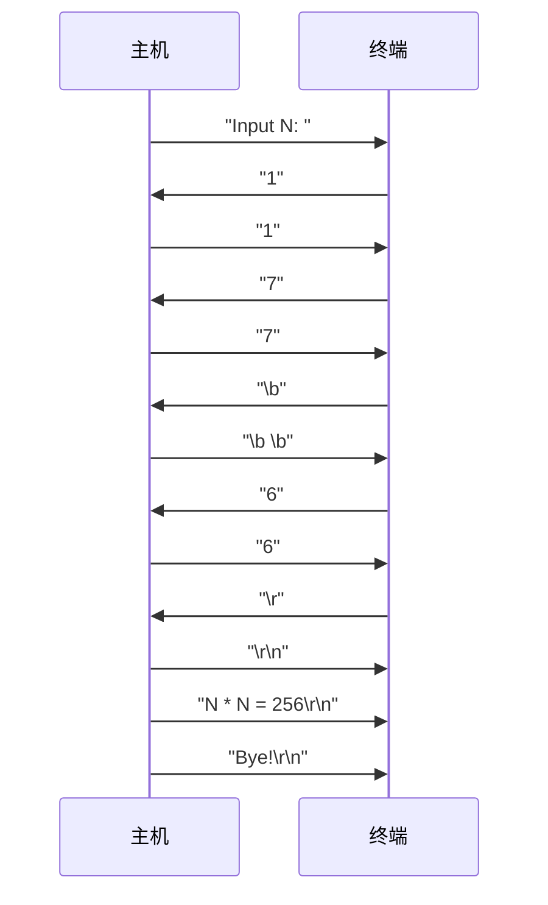

# Linux

## 1 开始使用Linux

### 1.0 Linux前传

### 1.1 Linux发展过程

### 1.2 系统登录与退出

终端:主机的输入和输出设备

- 终端通过电缆把用户的按键信息送到主机，把主机发来的信息在屏幕上显示

主机:程序和数据的存储及处理

- 数据及程序存放在主机的硬盘上，程序的运行也都由主机内的CPU占用主机内存来完成

驱动程序

- 不同的硬件需要不同的驱动程序
- 与行律模块的接口：上行和下行字符流

行律的作用

- 一行内字符的缓冲、回显与编辑，直到按下回车键
- 数据加工，如：将\n （换行）转化为\r\n （回车换行）
- 将Ctrl-C字符转化为中止进程运行的信号(signal， SIGINT)

主机与终端之间的通信过程

```c
#include <stdio.h>
int main(void)
{
    int n;   
    printf("Input N: "); // 程序之后进入阻塞态
    scanf("%d", &n); // “回车” 后恢复运行
    printf("N * N = %d\n", n * n);
    printf("Bye!\n");
}
```



调整行律的方法

- 编程
- 相关命令`stty`
  - `stty erase  ^H`   按Ctr-H时擦除1个字符
  - `stty -a`              打印行律的所有控制信息

```sh
$ stty -a
speed 38400 baud; rows 38; columns 149; line = 0;
intr = ^C; quit = ^\; erase = ^?; kill = ^U; eof = ^D; eol = <undef>; eol2 = <undef>; swtch = <undef>; start = ^Q; stop = ^S; susp = ^Z; rprnt = ^R;
werase = ^W; lnext = ^V; discard = ^O; min = 1; time = 0;
-parenb -parodd -cmspar cs8 -hupcl -cstopb cread -clocal -crtscts
-ignbrk -brkint -ignpar -parmrk -inpck -istrip -inlcr -igncr icrnl ixon -ixoff -iuclc -ixany -imaxbel iutf8
opost -olcuc -ocrnl onlcr -onocr -onlret -ofill -ofdel nl0 cr0 tab0 bs0 vt0 ff0
isig icanon iexten echo echoe echok -echonl -noflsh -xcase -tostop -echoprt echoctl echoke -flusho -extproc
```

终端转义序列

- Esc：ASCII码`1B`（十进制27，八进制033）

```sh
$ clear | xxd
00000000: 1b5b 481b 5b32 4a1b 5b33 4a              .[H.[2J.[3J
```

软件流量控制的方式（利用流控字符Xon和Xoff）

- 终端希望主机暂停发送数据时，发Xoff字符
- 终端希望主机继续发送数据时，发Xon字符
- Xoff/Xon控制字符分别被定义为ASCII码的17和19，对应键盘按键Ctrl-S和Ctrl-Q，手动流控
- 按下Ctrl-S键暂停显示，按Ctrl-Q键继续显示
- 按下Ctrl-S后暂停显示，有的终端按任意键继续，而有的终端要求必须按下Ctrl-Q后才继续显示，否则其它按键都不能使得终端继续显示。 

登录

### 1.3 使用系统命令

`man`

```sh
$ man 2 open
```

- 1 命令；
- 2 系统调用；
- 3 库函数；
- 5 配置文件

`date`

```sh
$ date
2026年 06月 18日 星期四 18:44:03 CST
$ date "+%Y.%m.%d  %H:%M:%S   Day %j"
2026.06.18  18:44:06   Day 169
```

`who`

```sh
$ who
abe      :0           2026-06-18 18:32 (:0)
$ tty
/dev/pts/0
$ whoami
abe
```

`uptime`，`w`和`sar`

```sh
$ uptime
 19:03:55 up 32 min,  1 user,  load average: 0.13, 0.19, 0.15
$ w
 19:03:58 up 32 min,  1 user,  load average: 0.13, 0.19, 0.15
USER     TTY      来自           LOGIN@   IDLE   JCPU   PCPU WHAT
abe      :0       :0               18:32   ?xdm?   5:56   0.00s /usr/libexec/gdm-x-session --run-script env GNOME_SHELL_SESSION_MODE=ubuntu /usr/bin
```

`top`

```sh
$ top

top - 19:05:40 up 33 min,  1 user,  load average: 0.09, 0.17, 0.14
任务: 498 total,   1 running, 497 sleeping,   0 stopped,   0 zombie
%Cpu(s):  0.2 us,  0.1 sy,  0.0 ni, 99.7 id,  0.0 wa,  0.0 hi,  0.0 si,  0.0 st
MiB Mem :  15670.8 total,   7900.5 free,   4011.4 used,   3758.8 buff/cache
MiB Swap:      0.0 total,      0.0 free,      0.0 used.  10442.4 avail Mem 

 进程号 USER      PR  NI    VIRT    RES    SHR    %CPU  %MEM     TIME+ COMMAND                                                                       
   4602 abe       25   5 1658800 200100 149084 S   3.3   1.2   0:55.90 wpsoffice                                                                     
   2454 abe       20   0   71.1g 532308 154076 S   3.0   3.3   1:20.71 WebKitWebProces                                                               
   1516 abe       20   0   28.3g 214860 147608 S   1.3   1.3   1:16.48 Xorg                                                                          
    963 mysql     20   0 2374556 399100  36368 S   1.0   2.5   0:14.71 mysqld                                                                        
   2536 abe       20   0 1318596  52300  30244 S   0.7   0.3   0:05.49 verge-mihomo                                                                  
   7596 abe       20   0 5267648 605248 318496 S   0.7   3.8   0:34.24 firefox                                                                       
   8590 abe       20   0   16628   4504   3316 R   0.7   0.0   0:00.03 top    
```

`free`

```sh
$ free
               total        used        free      shared  buff/cache   available
内存：   16046888     4091236     8102040     1115032     3853612    10706176
交换：          0           0           0
```

`vmstat`

```sh
$ vmstat
procs -----------memory---------- ---swap-- -----io---- -system-- ------cpu-----
 r  b 交换 空闲 缓冲 缓存   si   so    bi    bo   in   cs us sy id wa st
 0  0      0 8116556 120728 3698656    0    0    36     6  254  447  1  0 99  0  0
```

`passwd`

- 普通用户
  - 使用`passwd`命令更改自己的上机口令，在更改前系统会先验证原来的口令
- 超级用户
  - 修改口令之前不验证旧的口令
  - 可修改自己的口令，还可强迫设置其它用户口令
  - 命令`passwd liu`
    - 将用户`liu`的口令强迫设置为某一已知口令
    - **超级用户无法读取其它用户的口令**
    - 当普通用户忘记口令时，可请求超级用户强设口令
  - 修改超级用户`root`的口令时要特别注意

## 2 文本文件处理

### 2.1 文本文件及处理工具

### 2.2 读取文件内容

`more`/`less`：逐屏显示文件

```sh
$ more shudu.c
$ ls -l | more
```

`ca`与`od`：列出文件内容

```sh
$ echo abcdABCD | cat     
abcdABCD
$ echo abcdABCD | cat -n
     1	abcdABCD
$ echo abcdABCD | od -c
0000000   a   b   c   d   A   B   C   D  \n
0000011
$ echo abcdABCD | od -t x1
0000000 61 62 63 64 41 42 43 44 0a
0000011
$ echo abcdABCD | od -t d1
0000000   97   98   99  100   65   66   67   68   10
0000011
```

`head`与`tail`：显示文件的头部或者尾部

- 默认只选择10行
- `head –n -20 msg.c` 除去文件尾部20行其余均算“头”
- `tail –n +20 msg.c` 除去文件头部20行其余均算作“尾”

`tee`：三通

`wc`：字计数

- 常用选项`-l`：只列出行计数

`sort`：对文件内容排序

- `-n`选项(Numberic):对于数字按照算术值大小排序，而不是按照字符串比较规则，例如123与67

`tr`：翻译字符

```sh
$ echo report | tr '[a-z]' '[A-Z]'
REPORT
```

`uniq`：筛选文件中的重复行

### 2.3 正则表达式及应用

#### 正则表达式的概念

非特殊字符与其自身匹配

转义字符：`\.`，`\*`，`\$`，`\^`，`\[`，`\\`分别与`.`，`*`，`$`，`^`，`[`，`\`匹配

圆点(`.`)匹配任意单字符

集合

- `[abcd]`与`a`，`b`，`c`，`d`匹配
- `[\*.]`与`\`，`*`，`.`匹配
- `[a-d]`与`a`，`b`，`c`，`d`匹配
- `[a-zA-Z0-9]`
- `[][]`与`[`，`]`匹配
- `[ad-]`与`a`，`d`，`-`匹配
- `[^a-z]`匹配任一非小写字母
- `[a-z^]`能匹配27个单字符

正则表达式可串结

单字符正则表达式后跟`*`，匹配此单字符正则表达式的0次或任意多次出现

锚点

- `123$`匹配文件中行尾的`123`
- `$123`匹配`$123`
- `^printf`匹配行首的`printf`
- `Hel^lo`匹配`Hel^lo`

正则表达式扩展

- 分组`()`
  - `(xy)*`
- 或
  - `(pink|green)`
- 重复次数
  - `[0-9]+`
  - `a?`
  - `[1-9][0-9]\{6,8\}`

#### 文本行筛选

`grep 模式 文件名列表`

- `-n`  显示时每行前面显示行号
- `-v`  显示所有不包含模式的行
- `-i`  字母比较时忽略字母的大小写
- `-F`, --fixed-strings       Fixed strings (instead of regular expressions)
- `-G`, --basic-regexp       Basic regular expression (BRE)
- `-E`, --extended-regexp Extended regular expression (ERE)
- `-P`, --perl-regexp          Perl-compatible regular expression (PCRE)

```sh
$ ls -l / | grep '^d' | wc -l
17
```

#### 流编辑及正则表达式替换

- `sed '命令' 文件名列表`
- `sed –e '命令1' –e '命令2' –e '命令3' 文件名列表`
- `sed -f 命令文件  文件名列表`

```sh
cat pm25.txt | sed 's/\[[^][]*]//g'
```

- `s/\([0-9][0-9]\)-\([0-9][0-9]\)-\([0-9][0-9]*\)/\3.\1.\2/g`将  `04-26-1997`替换为`1997.04.26`

#### 复杂筛选及加工`awk`

`awk`：**逐行**扫描进行文本处理

- `awk '程序' 文件名列表`
- `awk -f 程序文件名  文件名列表`

程序  `条件｛动作}`

- 一段程序：`awk`自动对每行文本执行条件判断，满足条件执行动作 （内置循环）
- 多段程序：允许多段程序，程序间用空格或分号隔开

处理方式

- `NR` 行号
- `$1` 第1域内容
- `$0` 整个这一行的内容

`awk`描述的条件

- 与C语言类似的算数运算
- 与C语言类似的关系运算
- 与C语言类似的逻辑运算
- 正则表达式的模式匹配
  - `/regexpr/` 包含该模式的行
  - 正则表达式匹配运算符  `~`    `!~`
    - 例如： `$2 ~  "[1-9][0-9]*"`
- 不指定任何条件，对所有文本行执行动作
- `BEGIN`  开始处理所有文本行之前执行动作
- `END`     处理完所有文本行之后执行动作

`awk`描述的动作

- 自定义变量的赋值
- 程控制（与C语言类似）
  - 条件判断 `if`
  - 循环控制 `for`
  - 表示程序块的`{}`
- `print 变量1， 变量2，……`
- `printf("格式串"，变量1，变量2，……)`

```sh
$ ps -ef | awk '/mysql/{ print $2; }'      
985
20134
$ cat hello.c | awk '{printf("%d: %s\n", NR, $0)}'
1: #include <stdio.h>
2: 
3: int main() {
4: 	printf("Hello World\n");
5: 	return 0;
6: }
$ ls -s /bin | awk '$1 > 10000 { print $2 }'
635664
clash-verge
gdb
hugo
qemu-system-i386
qemu-system-x86_64
verge-mihomo
verge-mihomo-alpha
x86_64-linux-gnu-lto-dump-11
x86_64-linux-gnu-lto-dump-12
x86_64-linux-gnu-lto-dump-14
```

### 2.4 文件比对

#### 文件内容比对

两文件逐字节比较：`cmp`

`cmp file1 file2`

`md5sum`/`sha1sum`:文件内容比较

```sh
$ md5sum * > sum
$ md5sum -c sum 
exam.pdf: 成功
note.md: 成功
start.sh: 成功
```

#### 求文本文件版本间差异

求出两个文件的差别：`diff`

`diff file1 file2`

`diff –u file1 file2`

### 2.5 `vi`编辑器

#### 状态编辑和光标移动lc

#### 查找、编辑及存盘作业

## 3 文件系统管理

### 3.1 文件名和文件统配符

#### 文件命名和目录结构

取名的合法字符

- 除斜线外的所有字符都是命名的合法字符
- 不可打印字符也可以做文件名(除了字节0） 
- 斜线（`/`）留做路径名分割符

大小写字母有区别

| **路径**           | **说明**                                                     |
| ------------------ | ------------------------------------------------------------ |
| `/unix`            | 程序文件，UNIX内核                                           |
| `/etc`             | 供系统维护管理用的命令和配置文件。<br />例如：文件`/etc/passwd`:存放的是用户相关的配置信息；<br />文件`/etc/issue`:登录前在login之上的提示信息；<br />文件`/etc/motd`:存放登录成功后显示给用户的信息。<br />文件系统管理的程序有`fsck`,`mount`,`shutdown`等。<br />许多系统维护的命令，在不同的UNIX系统之间区别很大 |
| `/tmp`, `/usr/tmp` | 存放临时文件                                                 |
| `/bin`             | 系统常用命令，如，`ls`,`ln`,`cp`,`cat`等                     |
| `/dev`             | 存放设备文件，如终端设备文件，磁带机，打印机等               |
| `/usr/include`     | C语言头文件存放目录                                          |
| `/usr/bin`         | 存放一些常用命令，如`ftp`,`make`等                           |
| `/lib`,`/usr/lib`  | 存放各种库文件，包括C语言的链接库文件，动态链接库，还包括与终端类型相关的terminfo终端库等。<br />静态链接库文件有`.a`后缀，动态链接库文件的后缀不是`.DLL`,而是`.so`。<br />UNIX很早就广泛的使用动态链接库，静态链接库逐渐过时。<br />`.a`取名于archive(存档)，`.so`取名于shared objects(共享对象) |
| `/usr/spool`       | 存放与用户有关的一些临时性文件，如：打印队列，已收到但未读的邮件等 |

#### 文件通配符规则

星号 `*`

- 匹配任意长度的文件名字符串(包括空字符串)
- 点字符(`.`)，当它作为文件名或路径名分量的第一个字符时，必须显式匹配
- 斜线(`/`)也必须显式匹配

问号 `?`  

- 匹配任一单字符

方括号 `[ ]`

- 匹配括号内任一字符，也可以用减号指定一个范围
- 例:  `[A-Z]*`   `*.[ch]`       `[Mm]akefile`

波浪线 `~`  （Bash特有的）

- `~`                  当前用户的主目录(home)
- `~kuan`         用户`kuan`的主目录(home)

#### 文件通配符处理过程

文件名通配符的处理**由shell完成**，分以下三步

- 在shell提示符下，从键盘输入命令，被shell接受
- shell对所键入内容作若干加工处理，其中含有对文件通配符的展开工作(文件名生成)，生成结果命令
- 执行前面生成的结果命令

### 3.2 文件和目录的管理

#### 列出文件目录

`ls`:文件名列表

```sh
$ ls -F /
bin@   cdrom/  etc/   lib@    lib64@   lost+found/  mnt/  proc/  run/   srv/  tmp/  var/
boot/  dev/    home/  lib32@  libx32@  media/       opt/  root/  sbin@  sys/  usr/
```

#### 文件的复制与删除

`cp`: 拷贝文件

`cp file1  file2`

`cp file1  file2  ...  filen dir`

- `cp backup.d/p*.c` 结果：`backup.d`目录下文件`p1.c`将覆盖掉`p2.c`
- `cp backup.d/p*.c  .` 将这两个文件拷贝回当前目录

`mv`: 移动文件

`mv  file1  file2`

`mv  file1  file2 ... filen  dir`

`mv  dir1  dir2`

`rm`: 删除文件

`rm  file1  file2  ...  filen `

- `-r` 递归地(Recursive)删除实参表中的目录，也就是删除一整棵目录树。
- `-i`  每删除一个文件前需要操作员确认(Inform)
- `-f`  强迫删除(Force)。只读文件也被删除并且无提示，无操作权限的文件强制删除也不能删掉

显式区分命令选项和处理对象

用`--`显式地表示命令行参数列表中选项的结束，分隔选项和处理对象，也适用于其他命令

`rm -i -- -i`

#### 目录管理

`pwd`命令：打印当前工作目录

`cd`命令：改变当前工作目录

`cd`是shell的一个**内部**命令

`cp`: 复制目录

- `–r` 递归地复制一个目录

- `–v` 冗长(verbose)方式：复制目录时实时列出正在复制的文件的名字
- `–u` 增量拷贝(update)，便于备份目录
  - 根据文件的时戳，不拷贝相同的或者过时的版本的文件，以提高速度
  - `dir1`和`dir2`不慎颠倒位置，不会出现灾难性后果

`cp -ruv work.d/* bak.d` 将`work.d`中的内容增量拷贝到备份目录`bak.d`中

`rsync`:数据备份工具（增量拷贝）

#### 目录遍历的命令

`find`:遍历目录树

`find verl.d ver2.d -name '*.c' -print`

- 范围：当前目录的子目录`ver1.d` 和`ver2.d`
- 条件：与名字`*.c`匹配。注:`*.c`应当用引号括起
- 动作：把查找到的文件的路径名打印出来

`find`命令的特点

- 类似`awk`对文本的逐行扫描，`find`对目录森林中的文件和目录逐个扫描

`find`关于条件的选项

- `-name wildcard` 文件名与`wildcard`匹配
  - 必需的引号
  - 这里的“文件名”仅指路径名的最后一部分
  - 对通配符的解释由`find`完成
- `-regex pattern` **整个路径名**与正则表达式`pattern`匹配
- `-type`
  - `f`:普通文件
  - `d`:目录
  - `l`:符号连接文件
  - `c`:字符设备文件
  - `b`:块设备文件
  - `p`:管道文件
- `-size ±n单位`   指定文件大小（大于`+`，等于，小于`-`）
  - 单位有`c`(字符), `b`(块，512字节), `k`(1024),`M`(兆),`G`（吉），默认为`b`
- `-mtime  ±ndays`   文件最近修改时间
- `-newer file`   文件最近修改时间比`file`的还晚
- 可以用`()` `–o` `!`等表示多条件的“与”，“或”，“非”

`find`关于动作的选项

- `-print` 打印查找的文件的路径名
- `-exec` 对查找到的目标执行某一命令
  - 在`-exec`及随后的**分号**之间的内容作为一条命令
  - 在这命令的命令参数中，`{}`代表遍历到的目标文件的路径名

- `-ok` 与`-exec`类似，只是对查找到符合条件的目标执行一个命令前需要经过操作员确认

#### 目录遍历的应用

- `find . -type d -print` 从当前目录开始查找，寻找所有目录，打印路径名
- `find / -name 'stud*' -type d -print` 指定了两个条件：名字与`stud*`匹配，类型为目录
- `find / -type f -mtime -10 -print` 从根目录开始检索最近10天之内曾经修改过的普通磁盘文件（目录不算）
- `find . ! -type d -links +2 -print` 从当前目录开始检索link数大于2的非目录文件
- `find ~ -size +100k \( -name core -o -name '*.tmp' \) -print` 从主目录开始寻找大于100KB的名叫`core`或有`.tmp`后缀
- `find /lib /usr -name 'libc*.so' -exec ls -lh {} \;`
- `find ~ -size +100k \( -name core -o -name '*.tmp' \) -ok rm {} \;`
- `find src -name \*.c -exec grep -n -- --help {} /dev/null \;` 在目录`src`中所有`.c`文件中查找`--help`字符串
  - `/dev/null`文件的作用：特殊设备文件，读不出写不入；陪伴`{}`中的每个文件，构成两个`grep`的待搜索文件，以打印文件名。

#### 批量处理文件

利用`find`与`xargs`的组合

`find src -name \*.c -exec grep -n -- --help {} /dev/null \;` 效率低，因为每个命中的对象都需要执行`grep`命令：创建一个进程，完成任务后进程消亡

`find src -name \*.c –print | xargs grep -n -- --help` 利用`find`精确筛选，利用`grep`批量处理文件，提高效率

#### 打包与压缩

`tar`:文件归档

`tar ctxv[f device]] file-list`

选项第一字母指定要执行的操作，是必需的

- `c`: Create创建新磁带。从头开始写，以前存于磁带上的数据会被覆盖掉
- `t`: Table列表。磁带上的文件名列表，当不指定文件名时，将列出所有的文件
- `x`: eXtract抽取。从磁带中抽取指定的文件。当不指定文件名时，抽取所有文件

除功能字母外的其它选项

- `v`: Verbose冗长。每处理一个文件，就打印出文件的文件名，并在该名前冠以功能字母
- `f`: File。指定设备文件名
- `z`: 采用压缩格式(gzip算法）
- `j`: 采用压缩格式(bzip2算法)

### 3.3 命令获取信息的方法

#### 命令获取信息的方法

运行时获取信息的常见方式易变性从小到大为

- 配置文件
- 环境变量
- 命令行参数
- 交互式键盘输入

#### 命令行参数的三种风格

### 3.4 文件系统

#### 文件系统的创建与安装

`mkfs /dev/sdb` 创建文件系统`mkfs`（磁盘格式化，块设备）

`mount /dev/sdb /mnt` 安装子文件系统`mount`

`umount  /dev/sdb` 卸个已安装的子文件系统

`df`: 文件系统空闲空间

```sh
$ df -h
文件系统        大小  已用  可用 已用% 挂载点
tmpfs           1.6G  2.5M  1.6G    1% /run
/dev/nvme0n1p6  118G   72G   40G   65% /
tmpfs           7.7G  7.1M  7.7G    1% /dev/shm
tmpfs           5.0M  4.0K  5.0M    1% /run/lock
efivarfs        438K  285K  149K   66% /sys/firmware/efi/efivars
tmpfs           7.7G     0  7.7G    0% /run/qemu
/dev/nvme0n1p1  296M  103M  194M   35% /boot/efi
tmpfs           1.6G  184K  1.6G    1% /run/user/1000
```

#### 文件系统的存储结构


#### 硬链接

```sh
$ ln chapt0 intro
$ ls -l chapt0  intro
-rw-rw-rw- 2  kc kermit 17935 Dec 12 18:07 chapt0
-rw-rw-rw- 2  kc kermit 17935 Dec 12 18:07 intro 
$ ls -i chapt0  intro
    13210  chapt0
    13210  intro
```

不允许对目录用`ln`命令建立硬连接

一般来说，**目录的link数=直属子目录数+2**

#### 符号链接

```sh
$ ln -s users_on sym.link
$ ls -l sym.link
lrwxrwxrwx 1 guest other 8 Jul 26 16:57 sym.link->users_on
```

若符号连接含相对路径名，是相对于符号链接文件的位置(不是相对于调用进程的当前工作目录)

适用于目录，也适用于不同的文件系统

#### 系统调用

`printf`类函数格式字符串中的`%m`会被替换成上次系统调用失败的错误代码对应的消息（message）

#### 访问i节点和目录

### 3.5 文件和目录的权限

#### 文件的权限

权限的三个级别

- 文件主
  - 每个文件有唯一的属主
- 同组用户
- 其他用户

 普通文件的权限

- 读
- 写
  - 不可写文件也可能会被删除
- 可执行

两类可执行文件

- 程序文件（可执行文件）
  - 二进制的CPU指令集合，满足操作系统规定的格式才可以被加载运行
- 脚本文件：
  - 文本文件默认的解释程序为`/bin/sh`
  - 可以在文件的第一行自行指定解释程序（必须是第一行，`#!`必须是这个文件首先出现的两个字符），例如：
    - `#! /bin/bash`
    - `#! /usr/bin/bc`
  - 解释程序也可以是用户自己编写的应用程序
  - 脚本程序运行时，实际上是由解释程序创建了一个进程

#### 目录的权限

- 读权限
  - 若无读权限，那么“目录表”文件不许读，`ls`会失败
- 写权限
  - 若无写权限，那么“目录表”文件不许写
  - 创建文件，删除文件，文件改名会修改目录文件
  - 修改文件不需要修改目录文件，需要修改i节点
  - 目录无写权限不是指目录下所有文件禁止写
- 执行权限
  - 有执行权限意味着分析路径名过程中可检索该目录
  - `cat /a/b/c` 要求`/`，`/a`，`/a/b`三目录有x权限，`c`文件有读权限；否则，命令执行失败
  - `cd ../st8`要求当前目录，`..`和`st8`必须有x权限
- STICKY目录
  - 问题：对于公共目录，用户user1和user2没有写权限，就不可以在这个目录下创建新文件；若有写权限，用户user1的文件就算是“只读文件”也可以被user2删除
  - STICKY属性用于解决这个问题：目录有写权限并且带STICKY属性，此目录下的文件仅文件主可以删除，其他用户删除操作会失败

```sh
$ ls -ld /tmp
drwxrwxrwt 22 root root 4096  6月 20 17:01 /tmp
```

#### 权限相关命令

确定文件的权限

```sh
$ ls -l   
总计 4
-rw-rw-r-- 1 abe abe 81  6月 19 14:27 hello.c
$ ls -ld .
drwxrwxr-x 2 abe abe 4096  6月 19 14:32 .
```

`chmod`：修改权限

`chmod [ugoa][+-=][rwxst] 文件名表`

- u--user  文件主的权限
- g--group 同组用户的权限
- o--other 其他用户权限
- a--all   所有上述三级权限
- t--Sticky
- s--SUID

`chmod   644  xyz1 xyz2`

- `八进制：      6     4    4 `
- `二进制：     110   100  100`
- `权限：       rw-   r--  r--`

只允许文件主和超级用户修改文件权限

`umask`命令：决定文件/目录的初始权限

- 用`vi`新建文件
- 用输出重定向创建文件
- 创建新目录

umask是进程属性的一部分

umask是shell内部命令

```sh
$ umask        
002
```

`umask 022`  将umask值设置为八进制的022

掩码值的含义

- 例：掩码值（八进制）:  022
- 二进制：       000 010 010
- 取消新文件/目录的组w权限和其他用户w权限

系统调用umask：修改进程自身的umask属性值

```c
int umask(int mask); 
```

- mask为指定的新umask值，返回值为原先的umask值
- 读出进程umask属性而不改变它，需调umask两次

例:当umask为077时，用C程序

```c
fd=open(filename,O_CREAT|O_WRONLY,0666);
```

open的权限为0666，屏蔽掉077后实际为0600

#### SUID权限

进程实际UID/有效UID 

- 一般情况下，进程的实际UID和有效UID相等。
- 打开文件`open()`时，系统根据进程的有效UID，与文件所有者UID之间的关系和文件的权限进行访问合法性验证
- 可执行程序具有SUID权限，进程的实际UID和有效UID不再相等。实际UID是当前用户，而有效UID为可执行文件的文件主。
- SUID使得用户可以通过文件主提供的程序，以文件主的权限访问文件，但这种访问依赖于文件主提供的程序，进行有限的访问。

```sh
$ chmod u+s query
$ ls -l query 
-rws--x--x 1 abe abe 16360  6月 15 15:23 query
```

```sh
$ ls -l list.txt query 
-rw------- 1 abe abe   763 Jun 15 15:05 list.txt
-rws--x--x 1 abe abe 16360 Jun 15 15:23 query
$ ./query
#================================================================
#  登录名  工作证号 姓名   月份  工资   奖金    补助   扣除  总额
#----------------------------------------------------------------
   liang   2074   梁振宇   03    4560   4400    180     90   8050
   liang   2074   梁振宇   04    4660   4450    230     70   8270
#================================================================
# 注：燃气费自本年度开始不再从工资中扣除。
$ cat list.txt
cat: list.txt: Permission denied
```

## 4 bash及脚本程序设计

### 4.1 shell的基本机制

#### 关于shell

#### bash的启动

新创建子进程，并在子进程中执行脚本

- `bash<lsdir` 无法携带命令行参数
- `bash lsdir`
- `./lsdir`

在当前shell进程中执行脚本

- `. lsdir`
- `source lsdir`

#### 历史与别名

历史替换

- `!!`   引用上一命令
- `!str`  以`str`开头的最近用过的命令，如:`!v` `!m` `!.`

TAB键补全

- 每行的首个单词：TAB键补全搜索`$PATH`下的命令
- 行中的其它单词：TAB键补全当前目录下的文件名

#### 输入重定向

- `<filename` 从文件`filename`中获取`stdin`
- `<<word`  从shell脚本获取数据**直到遇到定界符**`word`（允许替换）

```sh
$ cat << TOAST
* Now : `date`
* My Home Directory is $HOME
TOAST

* Now : 2026年 06月 20日 星期六 17:55:00 CST
* My Home Directory is /home/abe
$ cat <<  'TOAST'
* Now : `date`
* My Home Directory is $HOME
TOAST

* Now : `date`
* My Home Directory is $HOME
```

- `<<<word`    从命令行获取信息作为标准输入

```sh
$ base64 <<< meiyoumima # 等价于 echo meiyoumima | base64
bWVpeW91bWltYQo=
$ base64 <<< 'mei you mi ma'
bWVpIHlvdSBtaSBtYQo=
```

#### 输出重定向与管道

`stdout`输出重定向

- `>filename` 将`stdout`重定向到文件`filename`，文件已存在则先清空（覆盖方式）
- `>>filename` 将`stdout`重定向**追加**到文件`filename`尾

`stderr`输出重定向

- `2> filename` 将文件句柄2重定向到文件`filename`
- `2>&1` 将文件句柄2重定向到文件描述符1指向的文件
- `./stda >rpt 2>&1` `stdout`和`stderr`均存入文件`rpt`
- `./stda 2>&1 >rpt` `stderr`定向到终端，`stdout`重定向到文件

管道：将前一个命令的标准输出重定向到后面命令的标准输入，但不重定向标准错误

- `ls  -l  |  grep  '^d'`  前一命令的`stdout`作后一命令的`stdin`
- `cc try.c -o try 2>&1 |  more` 前一命令的`stdout`+`stderr`作为下一命令的`stdin`
- `|` **先将前一个命令的标准输出重定向到后面命令的标准输入，再处理前一个命令中的重定向**

### 4.2 变量

#### 变量赋值及使用

变量

- **第一个字符必须为字母**
- 其余字符可以是字母，数字，下划线
- 存储字符串

```sh
$ addr=20.1.1.254
$ echo ${addr}A                          
20.1.1.254A
```

shell内部开关

- `set -u`  当引用一个未定义的变量时，产生一个错误
- `set +u`  当引用一个未定义的变量时，认为是一个空串（默认情形）
- `set -x`  执行命令前打印出shell替换后的命令及参数，为区别于正常的shell输出，前面冠以+号
- `set +x`  取消上述设置

命令`echo`

`echo arg1 arg2 arg3 ...`

`echo`支持C语言字符串常数描述格式的转义和`\c`

```sh
$ echo Beijing    China
Beijing China
$ echo "Beijing    China"
Beijing    China
$ echo -e '\065'                    
5
$ echo -e "\r$cnt \c"
8 $ echo -e "\r$cnt"   
8
```

命令`printf`

```sh
$ proto=TCP/IP
$ printf '\033[01;33mConnect to %s Network\n'  $proto
Connect to TCP/IP Network
$ printf "\033[01;33mConnect to %s Network\n"  $proto
Connect to TCP/IP Network
```

格式：`echo -e "\033[字背景颜色;字体颜色m字符串\033[0m"`

ANSI控制码

- `\033[y;xH`   设置光标位置
- `\033[0m`     关闭所有属性

#### 在脚本中编辑文件

`read`:读用户的输入

```sh
$ read name
cpp.c
$ echo $name
cpp.c
$ ls -l $name
-rw-rw-r-- 1 abe abe 0  6月 23 18:49 cpp.c
```

`ed`命令

`ed [选项] [filename]`

- `A`：切换到输入模式，在文件的最后一行之后输入新的内容；
- `C`：切换到输入模式，用输入的内容替换掉最后一行的内容；
- `i`：切换到输入模式，在当前行之前加入一个新的空行来输入内容；
- `d`：用于删除最后一行文本内容；
- `n`：用于显示最后一行的行号和内容；
- `w`：<文件名>：一给定的文件名保存当前正在编辑的文件；
- `q`：退出`ed`编辑器

```sh
printf  'Input IP address: '
read addr

ed myap.conf > /dev/null 2>&1 << TOAST
/SERVER        # 正则表达式找 SERVER 行
.d             # 删除当前 SERVER 行    
i              # 开始插入新行
SERVER $addr   # 变量addr值修正SERVER
.              # 返回ed的命令行状态
w
q
TOAST     # 两个TOAST之间段落为ed的标准输入

echo Bye
```

#### 环境变量

环境变量和局部变量

- 所创建的shell变量，默认为局部变量
- 局部变量转换为环境变量，例如：`export proto`
- shell启动的子进程继承环境变量，不继承局部变量
- 子进程对环境变量的修改，不影响父进程中同名变量

系统的环境变量

- `HOME`：用户主目录的路径名

  ```sh
  $ echo $HOME
  /home/abe
  ```

- `PATH`：命令查找路径

  - `PATH=/bin:/usr/bin:/etc`
  - 与DOS/Windows不同的是，它**不首先搜索当前目录**
  - `PATH=.:/bin:/usr/bin:/etc` 先搜索当前目录(危险!)
  - `PATH=/bin:/usr/bin:/etc:.` 后搜索当前目录(危险!)

  ```sh
  $ echo $PATH      
  /home/abe/.cargo/bin:/home/abe/.local/bin:/usr/local/sbin:/usr/local/bin:/usr/sbin:/usr/bin:/sbin:/bin:/usr/games:/usr/local/games:/snap/bin:/home/abe/tools/nvim-linux-x86_64/bin
  ```

- `TERM`：终端类型

  - 全屏幕操作的软件(如vi)，使用它搜索终端库

  ```sh
  $ echo $TERM
  xterm-256color
  ```

相关命令`set`/`env` 

- 内部命令`set`列出当前**所有变量**及其值以及函数定义
- 外部命令`/bin/env`列出**环境变量**及其值

环境变量的引用

- 脚本程序直接引用环境变量值
- C程序通过函数 `getenv()` 引用环境变量

### 4.3 替换

shell的替换工作：先替换命令行再执行命令

- 文件名生成

  - 遵循文件通配符规则，按照字典序排列
  - 无匹配文件：保持原文

  ```sh
  $ ls *.c            
  hello.c
  ```

- 变量替换

  ```sh
  $ ls $HOME
  code  Desktop  Documents  Downloads  Music  Pictures  Public  Templates  tools  Videos
  $ echo "My home is $HOME, Terminal is $TERM"
  My home is /home/abe, Terminal is xterm-256color
  ```

- 命令替换

  ```sh
  $ echo "`whoami`-$(date '+%Y%m%d-%H%M%S').log"
  abe-20260623-214048.log
  ```

shell内部变量：位置参数

- `$0`      脚本文件本身的名字
- `$1` `$2` 1号命令行参数，2号命令行参数，以此类推
- `$#`       命令行参数的个数
- `$*`   等同于`"$1 $2 $3 $4 ..."`
- `$@`   等同于`"$1"  "$2"  "$3" ...` 

内部命令`shift`

- 位置参数的移位操作
- `$#`的值减1，旧的`$2`变为`$1`，旧的`$3`变为`$2`，以此类推
- 其他用法如：`shift 3`（移位三个位置）

### 4.4 元字符和转义

#### 元字符

shell元字符

- `SPACE` `\t` 命令行参数分隔符
- `\n` 执行键入的命令
- `> < |`             重定向与管道 (还有`||`)
- `;`                    用于一行内输入多个命令(还有`;;`)
- `&`                   后台运行  (还有`&&`)
- `$`                          引用shell变量
- `` ` ``                          反向单引号，用于命令替换
- `*` `[]` `?`            文件通配符 (`echo "*"`与`echo *`不同）
- `\`                   取消后继字符的特殊作用(转义)
- `(` `)`                      用于定义shell函数或在子shell中执行一组命令
- `(` `)` `>` `<` `|` `;` `&` 等除了它们自身的特殊含义外还同时起到分隔符的作用(同空格)
  - 例如：`ls>file.txt;wc -l file.txt&sort<file.txt|uniq`

转义符

- 反斜线作转义符，取消其后元字符的特殊作用
- 如果反斜线加在非元字符前面，反斜线跟没有一样

#### 引号与转义处理

双引号`"`

- 除`$`和``` ` ```外**特殊字符的特殊含义被取消**(保留一定的灵活性)`
- 需要的转义 `\"`   `\$`    `` \` ``    `\\`
- `echo *` 与　`echo "*"`

单引号`'`

- 对所括起的任何字符，**不作特殊解释**。
- 系统扫描单引号开始，停止对所有字符的特殊解释，直到再次遇到单引号

```sh
$ echo "My home dir is $HOME"
My home dir is /home/abe
$ echo 'My home dir is $HOME'
My home dir is $HOME
```

转义符后面跟非特殊字符

- 引号内，尽量维持字面含义，以便于类似`awk`在命令行中的程序片段
- 没有引号时，属于**未定义**的情况，转义符后面最好不跟非特殊字符

```sh
$ echo \$                    
$
$ echo "\$"
$
$ echo \A  
A
$ echo "\A"
\A
```

#### 例题：终止指定名字的所有进程

### 4.5 条件

#### shell中的逻辑判断

判定一条命令是否执行成功

- 方法：命令执行的返回码
- **0表示成功**，非0表示失败

shell内部变量`$?`

- 上一命令的返回码，shell自定义变量
- 用管道线连接在一起的若干命令，进行条件判断时以最后一个命令执行的返回码为准

```sh
$ ls -d xyz
xyz
$ echo $?
0
$ ls -d xyz1
xyz1: not found
$ echo $?
2
```

复合逻辑

- 用`&&`或`||`连结两个命令
- 可以利用复合逻辑中的“短路计算”特性实现最简单的条件
  - `cmd1 && cmd2` 若`cmd1`执行成功(返回码为0)则执行`cmd2`，否则不执行`cmd2`
  - `cmd1 || cmd2` 若`cmd1`执行失败(返回码不为0)则执行`cmd2`，否则不执行`cmd2`

```sh
$ ls -d xdir >/dev/null && echo FOUND
FOUND
$ ls -d ydir >/dev/null 2>&1 || echo No ydir
No ydir
```

命令`true`与`false`

- `/bin/true` 返回码总为0
- `/bin/false` 返回码总不为0
- 有的shell为了提高效率，将 `true` 和 `false` 设置为内部命令

自编程序用作条件判断

```sh
$ cat odd.c
#include <stdlib.h>
int main(int argc, char **argv)
{
    int a = argc < 2 ? 0 : atoi(argv[1]);
    return a % 2 == 0 ? 1 : 0; 
}
$ a=7
$ ./odd $a && echo ODD 
ODD
$ a=90
$ ./odd $a && echo ODD
$
```

#### `test`命令和方括号命令

命令`test`与`[`

- 命令`/usr/bin/[` 要求其最后一个命令行参数必须为`]`
- 除此之外`/usr/bin/[` 与 `/usr/bin/test`功能相同
- 有的Linux系统中`/usr/bin/[`是一个指向`test`的符号连接
- 注意：不要将方括号理解成一个词法符号
- 举例
  - `test -r /etc/motd`
  - `[ -r /etc/motd ]`
    - `[` 是命令
    - `]` 是参数
    - 空格不能省略

文件特性检测

- `-f`  普通文件
- `-d`  目录文件
- `-r`  可读
- `-w`  可写
- `-x`  可执行
- `-s`  size>0
- 例
  - `test -r /etc/motd && echo readable`
  - `[ -r /etc/motd ] && echo readable`

字符串比较

- `str1 = str2`     `str1`与`str2`串相等  (bash也允许以`==`代替`=`) 
- `str1 != str2`    `str1`串与`str2`串不等
- 注意：等号和不等号两侧的空格不可少
- `[ "$a" = "" ] && echo empty string`  注意：`$a`的引号
- ` test $# = 0 && echo "No argument"`
- `[ $level=0 ]` 仅判断`$level=0`是否为空字符串，非空即返回0

```sh
$ level=8
$ [ $level=0 ] && echo level is Zero
level is Zero
$ [ $level = 0 ] && echo level is Zero
$ 
```

整数的比较

- `-eq`  ＝
- `-ne`  ≠
- `-gt`  ＞
- `-ge`  ≥
- `-lt`  ＜
- `-le`  ≤
- 例:  ``test `ls | wc -l` -ge 100 && echo "Too many files"``

复合条件

- `!`     NOT（非）
- `-o`   OR （或）
- `-a`   AND （与）
- 例: 如果变量`cmd`的值为一个可执行命令，执行该命令
- `[ ! -d $cmd -a -x $cmd ] && $cmd`
  - 注意：必需的空格不可省略
  - `$cmd`：执行命令

#### 命令组合

命令组合的两种方式`{}`与`()`

- `(list)`     在**子shell**中执行命令表`list`
- `{ list;}`  在**当前shell**中执行命令表`list`
- 注意：左花括号后面必须有一个空格
- 圆括号是shell元字符，花括号不是，它作为一个特殊**内部命令**处理。所以必须是一行的行首单词

> 内部命令/关键字必须是一行的行首单词，元字符不必须

#### 条件分支

条件结构`if`：两个或多个分支

`if condition; then list; elif condition; then list; else list; fi`

- `if`/`then`/`elif`/`else`/`fi`为关键字(内部命令) 

- 关键字作为内部命令，要么在行首，要么前面有分号来分隔命令

```sh
if [ $# = 0 ]; then         # 等号两侧的空格以及then之前的分号
    echo "Usage: $0 <name>"
    exit 1
fi

PIDS=`ps -e | awk '/[0-9]:[0-9][0-9] '$1'$/ { printf("%d ", $1);}'`

if ["$PIDs" = "" ]         #  $PIDs两侧的双引号不可少
then
    echo None is killed.
else
    echo kill $PIDS
    kill $PIDS
fi 
```

`case`结构：多条件分支

`case word in pattern1) list1;; pattern2) list2;; ...;; esac`

- `word`与`pattern`匹配：使用shell的文件名匹配规则
- `;;`是一个整体，不能在两分号间加空格，也不能用两个连续的空行代替
- 可以使用竖线表示多个模式
- `word`与多个模式匹配时，执行遇到的第一个命令表

```sh
case "$1" in  # 注意$1两侧的引号
  start)
    echo "Starting ABC service"
    # do somthing here
    ;;
  stop)
    echo "Stop ABC service"
    # do somthing here
    ;;
  force-reload|restart)
    $0 stop
    $0 start
    ;;
  status)
    echo "Display status of ABC service"
    # do somthing here
    ;;
  *)
    echo "Usage: $0 {start|stop|restart|force-reload|status}"
    exit 1
    ;;
esac 
```

### 4.6 循环

#### 表达式运算

`expr`命令：算术运算、关系运算、逻辑运算、正则表达式运算

- 括号`()`
- 算数运算(5种)  `+`   `-`   `*`   `/`   `%`
- 关系运算(6种)  `>`   `>=`   `<`   `<=`   `=`   `!=`
- 逻辑运算(2种) `|`   `&`
- 正则表达式运算       `:`
  - `expr string : pattern`
  - 正则表达式`pattern`匹配字符串`string`，**打印匹配长度**
  - `pattern`中用`\(`和`\)`括起一部分，能匹配时**打印括号内能匹配的部分**，否则为空字符串

```sh
$ a=2
$ b=8
$ c=10
$ expr $a \* \( $b + $c \)
36
$ expr '(' $a + 4 '<' $b ')' '&' '(' $c != 8 ')'
1
$ expr 123 : "[0-9]*"
3
$ expr A123 : "[0-9]*"
0
$ expr unit : ".*"`     # `: ".*"` 用于获得字符串长度
4
$ expr `pwd` : '.*/\([^/]*\)$'
hello
```

#### 内部命令`eval`

将程序中输入的或者加工出来的数据作为程序来执行（解释型语言才可能具备的特点）

```sh
$ date +"hour=%H; minute=%M"
hour=15; minute=03
$ eval `date +"hour=%H; minute=%M"`
$ echo $hour $minute
15 03
```

#### while循环

`while condition; do list; done`

`while`、`do`、`done`作为关键字，必须以独立命令行的首个单词身份出现，shell才能将它们解释为内部命令

```sh
if [ $# = 0 ]           # 脚本程序未获得参数
then
    echo "Usage: $0 : <number>"
else
    count=$1 
    while [ $count -gt 0 ] 
    do
        count=`expr $count - 1` 
        echo -e "\015 $count  \c"    # 015=13，换行符
        sleep 1 
    done	  
fi
```

#### `for`循环

`for name in word1 word2 ...; do list; done`

`for name; do list; done` 相当于 `for name in $1 $2 ...; do list; done`

```sh
if [ -d /etc/rc.d ]
then
    for cmd in /etc/rc.d/*/* /etc/rc.d/*
    do
        [ ! -d $cmd -a -x $cmd ] && $cmd
    done
fi
```

```sh
for i 
do
    PIDS=`ps -e | awk '/[0-9]:[0-9][0-9] '$i'$/ { printf("%d ", $1);}'`
    
    if [ "$PIDs" = "" ]
    then
        echo -e "No \"$i\" is killed."
    else
        echo "kill $PIDS  ($i)"
        kill $PIDS
    fi
done
```

`seq`命令

```sh
$ for i in `seq 1 3`; do ping -c1 -w1 192.168.0.$i; done

PING 192.168.0.1 (192.168.0.1) 56(84) bytes of data.

--- 192.168.0.1 ping statistics ---
1 packets transmitted, 0 received, 100% packet loss, time 0ms

PING 192.168.0.2 (192.168.0.2) 56(84) bytes of data.

--- 192.168.0.2 ping statistics ---
1 packets transmitted, 0 received, 100% packet loss, time 0ms

PING 192.168.0.3 (192.168.0.3) 56(84) bytes of data.

--- 192.168.0.3 ping statistics ---
1 packets transmitted, 0 received, 100% packet loss, time 0ms
```

`break`，`continue`，`exit`

- 内部命令`break`
  - 循环结构`for`/`while`中使用，中止循环
  - 例：`break`
  - `break 2`   中止两重循环
- 内部命令`continue`
  - 在循环结构`for`/`while`中使用，提前结束本轮循环
- 内部命令`exit`
  - 结束脚本程序的执行，退出。`exit`的参数为该进程执行结束后的返回码
  - 例：`exit 1`

### 4.7 函数

语法

- `name() { list;}`

参数引用

- 函数定义完成之后，该函数名作为一个自定义内部命令执行，后面可以调用
- 调用时函数名后附加上0到多个参数
- 在函数体内部以`$1`，`$2`，...或`$*`，`$@`方式引用

返回值

- 函数体内用内部命令`return`使函数有返回码，0表示成功，非零表示失败
- 函数内部可以创建和修改变量，函数返回后其它程序可以访问

```sh
# Usage: get_attr 变量名 提示信息 默认值 取值表
get_attr()
{
    while true
    do
        echo -e "$2 [$3] : \c"; read val
        [ "$val" = "" ] && val=$3   # 赋缺省值
        for i in $4
        do
            [ "$val" = "$i" ] && break 2   # 跳出for和while
        done
        echo -e "Invalid choice \"$val\", must be in \"$4\""
    done
    eval "$1=$val"
}
```

### 上机作业

## 5 进程控制与进程间通信

### 5.1 进程的基本概念

####  进程的基本概念和逻辑内存

程序

- 指令和数据的集合
- 存放在磁盘上的一个普通文件里
- 文件的i节点中标为可执行，内容符合系统要求

进程

- 包括指令段、用户数据段和系统数据段的执行环境
  - 指令段(Text)
    - 程序的CPU指令代码，包括：主程序和子程序编译后的CPU指令代码，以及调用的库函数代码
    - 指令段的大小固定不变，只读

  - 用户数据段
    - 全局变量，静态(static)变量，字符串常数
    - 允许数据段增长和缩小，实现内存的动态分配
      - 系统调用`sbrk()`允许编程调整数据段的大小（调整单位为“页”）
      - 内存管理库函数，如：`malloc()`，`free()`

  - 用户栈段
    - 程序执行所需要的栈空间，实现函数的调用
      - 用于保存子程序返回地址
      - 在函数和被调函数之间传递参数
      - 函数体内部定义的变量(静态变量除外)

    - `main`函数得到的命令行参数以及环境参数
      - 存放在栈的最底部
      - `main`函数运行之前，这些部分就已经被系统初始化

    - 栈段的动态增长与增长限制（`getrlimit`, `setrlimit`）

  - 系统数据段
    - 上述三部分在进程私有的独立的逻辑地址空间内（CPU用户态访问）
    - 系统数据段是内核内的数据，每个进程对应一套
    - 包括页表和进程控制块PCB


`size`命令观察可执行程序的段大小

`size filename-list`

```sh
$ size grep awk cat more
   text	   data	    bss	    dec	    hex	filename
 168401	   4304	  68336	 241041	  3ad91	grep
 145874	   5536	  77784	 229194	  37f4a	awk
  24502	   1440	    312	  26254	   668e	cat
  36803	   1780	     24	  38607	   96cf	more
```

- `text`: 指令段
- `data`: 只读型数据区、初始化的读写型数据区
- `bss`： 未初始化数据区   block started by symbol
- `dec`： 上述三段空间和的十进制表示
- `hex`： 上述三段空间和的十六进制表示
- `filename`：文件名

进程和程序的关系

- 程序用于初始化进程的指令段和用户数据段，初始化后，进程和初始化它的程序之间无联系
- 进程运行时磁盘上的程序文件不可修改/删除
- 同时运行的多个进程可由同一程序初始化得到，进程之间没什么联系。内核通过安排它们共享指令段甚至不同程序的进程共享函数库（动态链接）以节省内存，但这种安排对用户来说是透明的

####  进程的执行状态

在操作系统内核中，含有进程的属性，包括:

- 页表（基地址寄存器PDBR）
- 打开的文件描述符表
- 核心态堆栈（几KB）
- 进程状态，优先级信息
- 当前目录(记录了当前目录的i-节点)，根目录
- umask值
- 进程PID，PPID
- 进程主的实际UID/GID，有效UID/GID
- 进程组组号（一个终端上启动的所有进程构成一个进程组）

进程PCB被分为user结构和proc结构两部分

- user结构(约5000字节)，`<sys/user.h>`
  - 进程运行时才需要的数据在user结构
  - 核心态堆栈占用了较多空间
- proc结构(约300字节)，`<sys/proc.h>`
  - 进程不运行时也需要的管理信息存于proc结构
- 用户程序不能直接存取和修改进程的系统数据
- 系统调用可用来访问或修改这些属性
  - `chdir`， `umask`，`open`， `close`，`setpgrp`， `getpid`， `getppid`

进程的基本状态

- 进程创建之后，主要有运行状态和睡眠状态(也叫阻塞状态，等待状态，挂起状态，等等)
- 内核总是在分时处理运行状态的进程，而不顾那些处于睡眠状态的进程
- 睡眠状态的进程，在条件满足后转化为运行状态进程
- 在睡眠时，不占用CPU时间
  - 注意：在编程时，尽量不要让程序处于忙等待状态

进程的调度

- 内核将可运行进程按优先级调度，高优先级进程优先
- 进程的优先级总在不停地发生变化
- 处于睡眠状态的进程一旦被叫醒后，被赋以高优先级，以保证人机会话操作和其它外设的响应速度
- 用户程序用`nice()`系统调用有限地调整进程的优先级（非root用户只能将优先级调低）


命令`ps`查阅进程状态(process status)(实际上就是将内核中PCB数组的内容有选择地打印出来)

- 无选项：只列出在当前终端上启动的进程
  - 列出的项目有：`PID`，`TTY`，`TIME`，`COMMAND`
- `e`选项：列出系统中所有的进程(进程范围)
- `f`选项：以full格式列出每一个进程(控制列的数目)
- `l`选项：以long格式列出每一个进程(控制列的数目)

```sh
$ ps -ef | head      
UID          PID    PPID  C STIME TTY          TIME CMD
root           1       0  0 14:35 ?        00:00:01 /sbin/init splash
root           2       0  0 14:35 ?        00:00:00 [kthreadd]
root           3       2  0 14:35 ?        00:00:00 [pool_workqueue_release]
root           4       2  0 14:35 ?        00:00:00 [kworker/R-rcu_g]
root           5       2  0 14:35 ?        00:00:00 [kworker/R-rcu_p]
root           6       2  0 14:35 ?        00:00:00 [kworker/R-slub_]
root           7       2  0 14:35 ?        00:00:00 [kworker/R-netns]
root           9       2  0 14:35 ?        00:00:00 [kworker/0:0H-events_highpri]
root          12       2  0 14:35 ?        00:00:00 [kworker/R-mm_pe]
$ ps -el | head
F S   UID     PID    PPID  C PRI  NI ADDR SZ WCHAN  TTY          TIME CMD
4 S     0       1       0  0  80   0 - 41635 -      ?        00:00:01 systemd
1 S     0       2       0  0  80   0 -     0 -      ?        00:00:00 kthreadd
1 S     0       3       2  0  80   0 -     0 -      ?        00:00:00 pool_workqueue_release
1 I     0       4       2  0  60 -20 -     0 -      ?        00:00:00 kworker/R-rcu_g
1 I     0       5       2  0  60 -20 -     0 -      ?        00:00:00 kworker/R-rcu_p
1 I     0       6       2  0  60 -20 -     0 -      ?        00:00:00 kworker/R-slub_
1 I     0       7       2  0  60 -20 -     0 -      ?        00:00:00 kworker/R-netns
1 I     0       9       2  0  60 -20 -     0 -      ?        00:00:00 kworker/0:0H-events_highpri
1 I     0      12       2  0  60 -20 -     0 -      ?        00:00:00 kworker/R-mm_pe
```

命令`ps`列出的进程属性

- `UID`：用户ID(注册名)
- `PID`：进程ID
- `C`：CPU占用指数：最近一段时间(秒级别)进程占用CPU情况。不同系统算法不同
  - 例如：正占CPU进程10ms加1，所有进程1秒衰减一半
- `PPID`：父进程的PID
- `STIME`：启动时间
- `SZ`：进程逻辑内存大小(Size)
- `TTY`：终端的名字
- `COMMAND`：命令名
- `WCHAN`：进程睡眠通道(Wait Channel)，进程阻塞在何处
- `TIME`：累计执行时间(占用CPU的时间) 
- `PRI`：优先级
- `S`：状态，S(Sleep)，R(Run)， Z(Zombie)

####  进程的执行时间

进程执行时间包括睡眠时间，CPU时间(用户时间和系统时间)

`time`:进程执行的时间

外部命令`/usr/bin/time`和内部命令`time`输出的数据格式不同

```sh
$ /usr/bin/time find /usr -name '*.c' -print
0.13user 0.19system 0:00.32elapsed 99%CPU (0avgtext+0avgdata 5376maxresident)k
0inputs+0outputs (0major+1831minor)pagefaults 0swaps
$ time find /usr -name '*.h' -print
find /usr -name '*.h' -print  0.16s user 0.27s system 84% cpu 0.505 total
```

与CPU时间有关的命令`vmstat`

```sh
$ vmstat   
procs -----------memory---------- ---swap-- -----io---- -system-- ------cpu-----
 r  b 交换 空闲 缓冲 缓存   si   so    bi    bo   in   cs us sy id wa st
 0  1      0 7650576 291000 3812748    0    0     7     3   86   80  1  0 99  0  0
```

系统调用`times()`

- 当前进程CPU时间，已结束子进程占用过的CPU时间

```c
clock_t times(struct tms *buf);
struct tms {
      clock_t tms_utime;  /* user  CPU time */
      clock_t tms_stime;  /* system CPU time */
      clock_t tms_cutime; /* user CPU time, terminated children */
      clock_t tms_cstime; /* system CPU time, terminated children */
};
```

`clock()`

- 返回`times()`的四个CPU时间的总和。单位是`1/CLOCKS_PER_SEC`秒

`getrusage()`函数，`times()`函数的升级版本

- 返回CPU时间，还返回表示资源使用状况的另外14个值，包括内存使用情况，I/O次数，进程切换次数

与时间有关的函数

- 标准函数库中`time()`：获得当前时间坐标
  - 坐标0为1970年1月1日零点，单位：秒
  - `t=time(0);`和`time(&t);`都会使`t`值为当前时间坐标
- 函数`gettimeofday()`
  - 获得当前时间坐标，坐标的0是1970年1月1日零点
  - 可以精确到微秒μs(10-6秒)
- `mktime`将年月日时分秒转换为坐标值
- `ctime()`和`asctime()`，`localtime()`
  - 坐标值和年月日时分秒转换
- `strftime`
  - 定制表示日期和时间的字符串（包括年月日时分秒等）

忙等待

- 多任务系统中“忙等待”的程序是不可取的
- 程序14行前增加`sleep(1)`：1秒定时轮询
- `select()`调用可将睡眠时间设为10毫秒级精度

```c
 1 #include <fcntl.h>
 2 main(int argc, char **argv)
 3 {
 4     unsigned char buf[1024];
 5     int len, fd;
 6     if ( (fd = open(argv[1], O_RDONLY)) < 0) {
 7         perror("Open file");
 8         exit(1);
 9     }
10     lseek(fd, 0, SEEK_END);
11     for(;;) {
12         while ( (len = read(fd, buf, sizeof buf)) > 0)
13            write(1, buf, len);
14     }
15 }
```

### 5.2 进程控制

####  进程的生命周期：从生到死

`fork`：创建新进程

- 功能   `int fork(void);`
  - `fork`系统调用是创建新进程的唯一方式；没有参数
  - 原先的进程称做“父进程”，新创建进程被称作“子进程”
  - 完全复制：新进程的指令，用户数据段，堆栈段
  - 部分复制：系统数据段
- `fork`返回值：父子进程都收到返回值，但不相同
  - 1次调用，2次返回：
    - 父进程(返回值>0，是子进程的PID)
    - 子进程(返回值=0)，失败时返回-1
- 内核实现
  - 创建新的PCB，复制父进程环境(包括PCB和内存资源)给子进程
  - 父子进程可以共享程序和数据(例如：copy-on-write技术，COW)，但是系统核心的这些安排，对程序员透明

`exec`系统调用

- 功能
  - 用一个指定的程序文件，重新初始化一个进程
  - 可指定新的命令行参数和环境参数(初始化堆栈底部)
  - `exec`不创建新进程，只是将当前进程重新初始化了指令段和用户数据段，堆栈段以及CPU的PC指针（指向新程序的main函数）
- 6种格式`exec`系统调用
  - `exec`前缀，后跟一至两个字母
    - `l`—list
    - `v`—vector
    - `e`—env
    - `p`—path
  - l与v：指定命令行参数的两种方式，`l`以表的形式，`v`要事先组织成一个指针数组
  - `e`：需要指定`envp`来初始化进程。
  - `p`：使用环境变量`PATH`查找可执行文件
  - 六种格式的区别：不同的参数方式初始化堆栈底部

```c
int execl  (char *path, char *arg0, char *arg1, ..., (char *) 0);
int execv  (char *path, char **argv);
int execle (char *path, char *arg0, char *arg1, ..., (char *) 0, char **envp);
int execve (char *path, char **argv, char **envp);  // 系统调用
int execlp (char *file, char *arg0, char *arg1, ..., (char *) 0);
int execvp (char *file, char **argv);
int execvpe(char *file, char **argv, char **envp);
```

- 空指针`(char *) 0`标识命令行参数的结束
- 前四个调用的第一个参数：路径名`path`
- 后两个调用的第一个参数：可执行文件名`file`，路径按环境变量`PATH`值搜索

命令行参数和环境参数

- 位于进程堆栈底部的初始化数据

- 访问命令行参数的方法（`argc`, `argv`)

- 访问环境参数的三种方法

  - 通过C库定义的外部变量`environ`

    ```c
    main() {
        extern char **environ;
        char **p;
        p = environ;
        while (*p) printf("[%s]\n", *p++);
    }
    ```

  - `main`函数的第三个参数

    ```c
    main(int argc, char **argv, char **env) {
        char **p;
        p = env;
        while (*p) printf("[%s]\n", *p++);
    }
    ```

  - `getenv`库函数调用

    ```c
    main() {
        char *p;
        p = getenv("HOME");
        if (p) printf ("[%s]\n");
    }
    ```

“僵尸”进程(zombie或defunct)

- 进程生命期结束时的特殊状态
  - 系统已经释放了进程占用的包括内存在内的系统资源，但仍在内核中保留进程的部分数据结构，记录进程的终止状态，等待父进程来“收尸”
  - 父进程的“收尸”动作完成之后，“僵尸”进程不再存在
- 僵尸进程占用资源很少，仅占用内核进程表资源
  - 过多的僵尸进程会导致系统有限数目的进程表被用光
- 孤儿进程
  - 所有孤儿进程都作为1号进程（操作系统的init进程）的子进程
    - 0号：调度进程 swapper；
    - 2号：页守护进程 page daemon

`wait`系统调用

- 功能

  - 等待进程的子进程终止
  - 如果已经有子进程终止，则立即返回

- 函数原型

  ```c
  #include <sys/types.h>
  #include <sys/wait.h>
  pid_t wait(int *stat_loc);
  ```

  - 函数返回值为已终止的子进程PID

- `waitpid()`和`wait3()` : `wait`系统调用的升级版本，资源等管理信息

```c
int status, pid;
pid = wait(&status);
```

- `status`中含有子进程终止的原因:   
  - `TERMSIG(status)`为被杀信号
  - `EXITSTATUS(status)`为退出码

#### 自编shell: xsh0

```c
void main(void) {
    char buf[256], *argv[256], **p;
    int sv;
    for (;;) {
        printf("=> ");
        if (fgets(buf, sizeof(buf), stdin) == NULL)
            exit(0);
        for (p = &argv[0], *p = strtok(buf, " \t\n"); *p; *++p = strtok(NULL, " \t\n"));
        if (argv[0] == NULL)
            continue;
        if (strcmp(argv[0], "exit") == 0)
            exit(0);
        if(fork() == 0) {
            execvp(argv[0], argv);
            fprintf(stderr, "** Bad command\n");
            exit(1);
        }
        wait(&sv);
    }
}
```

```sh
=> who am i
root       ttyp0        Nov 29 09:56
=> ps -f
 UID   PID  PPID C    STIME   TTY     TIME CMD
root  1012  1011 0 09:56:00 ttyp0 00:00:00 login -c -p
root  1020  1012 0 09:56:14 ttyp0 00:00:00 -csh
root  1060  1020 2 10:36:37 ttyp0 00:00:00 xsh0
root  1062  1060 4 10:36:46 ttyp0 00:00:00 ps -f
=> ls -l *.c
ls: *.c not found: No such file or directory (error 2)
=> mmx
** Bad command
=> ls -l xsh0
-rwxr--r--   1 root   other  43417 Dec  1  1998 xsh0
=> exit

```

库函数`system`：运行一个命令 

```c
int system(char *string);
```

- 执行用字符串传递的shell命令，可使用管道符和重定向
- 库函数`system()`是利用系统调用`fork`，`exec`，`wait`实现的

```c
int main(void)
{
    char fname[256], cmd[256], buf[256];
    FILE *f;
 
    sprintf(fname, "/tmp/eth-status-%d.txt", getpid()); //构造临时文件
    sprintf(cmd, "ifconfig -a > %s", fname); //构造字符串，内容是一条命令 
    printf("Execute \"%s\"\n", cmd);
    system(cmd); //启动新进程，把字符串cmd的内容作为一条命令执行
 
    f = fopen(fname, "r"); //程序中分析处理cmd的执行结果
    while (fgets(buf, sizeof buf, f)) 
    	  printf("%s", buf);
    fclose(f);

    printf("Remove file \"%s\"\n", fname);
    unlink(fname); //删除临时文件
}
```

`system`提供了将“手敲眼看”变为“程序内执行”的一个便捷封装（`fork`, `exec`, `wait`）

### 5.3 重定向与管道

#### 进程与文件描述符

磁盘文件目录(分两级)

- i节点，文件名

活动文件目录AFD(分三级)

- 文件描述符表FDT：每进程一张，PCB的`user`结构中
  - `user`结构中整型数组`u_ofile`记录进程打开的文件
  - 文件描述符`fd`是`u_ofile`数组的下标
- 系统文件表SFT：整个内核一张，`file`结构

```c
struct file {
    char f_flag; /* 读、写操作要求 */
    char f_count; /* 引用计数 */
    char f_offset; /* 文件读写位置指针 */
    char f_inode; /* 内核中inode数组的下标 */
};
```

- 活动i节点表：整个内核一张，`inode`结构
  - 内存中`inode`表是外存中`inode`的缓存
  - 内存`inode`表里也有个专用的引用计数


文件描述符的继承与关闭

- `fork`创建的子进程继承父进程的文件描述符表
- 父进程在`fork`前打开的文件，父子进程有相同的文件偏移


例:文件描述符的继承与关闭

```c
void main() {
    int fd;
    fd = open("xxf1f2.txt", O_CREAT | O_WRONLY, 0666);
    if (fork() > 0) {
        char *str = "Message from process F1\n";
        int i;
        for (i = 0; i < 200; i++) {
            write(fd, str, strlen(str));
            sleep(1);
        }
        close(fd);
    } else {
        char fdstr[16];
        sprintf(fdstr, "%d", fd); // 文件描述符fd转为字符串fdstr传给execlp
        execlp("./f2", "f2", fdstr, 0);
        printf("failed to start 'f2': %m\n");
    }
}
```

```c
int main(int argc, char **argv) {
    int fd, i;
    static char *str = "Message from process F2\n";
    fd = strtol(argv[1], 0, 0);
    for (i = 0; i < 200; i++) {
        if (write(fd, str, strlen(str)) < 0) // 直接用文件描述符fd,已经在父进程f1调用fork时将文件描述符表继承给子进程f2
            printf("Write error: %m\n");
        sleep(1);
    }
    close(fd);
}
```

close-on-exec标志

- 文件设置了close-on-exec标志，执行`exec()`系统会自动关闭这些文件

  - 在`open()`调用的第二个参数里可以加`O_CLOEXEC`属性
  - 通过系统调用`fcntl()`设置

- 函数

  ```c
  #include  <fcntl.h>
  int fcntl (fd, cmd, arg);
  ```

  - cmd: `F_GETFD` 获取文件`fd`的控制字`flag`，控制字的比特0为close-on-exec标志位
  - cmd: `F_SETFD` 设置文件`fd`的控制字

  ```c
  flags = fcntl(fd, F_GETFD, 0);
  flags |= FD_CLOEXEC;
  fcntl(fd, F_SETFD, flags);
  ```

#### 重定向

文件描述符的复制

```c
int dup2(int fd1, int fd2);
```

- 复制文件描述符`fd1`到`fd2`
- 结果是文件描述符`fd2`指向了`fd1`所指的打开文件
- `fd2`可以是空闲的文件描述符
- 如果`fd2`是已打开文件，则关闭已打开文件


xsh1:输入输出重定向

```c
void main(void) {
    char buf[256], *argv[256], **p, *in, *out;
    int sv;
    for (;;) {
        printf("=> ");
        if (fgets(buf, sizeof(buf), stdin) == NULL)
            exit(0);
        in = strstr(buf, "<"); // 返回字符串buf中<的位置指针
        out = strstr(buf, ">");
        if (in != NULL) {
            *in++ = '\0';
            in = strtok(in, " \t\n");
        }
        if (out != NULL) {
            *out++ = '\0';
            out = strtok(out, " \t\n");
        }
        for (p = &argv[0], *p = strtok(buf, " \t\n"); *p; *++p = strtok(NULL, " \t\n"));
        if (argv[0] == NULL)
            continue;
        if (strcmp(argv[0], "exit") == 0)
            exit(0);
        if(fork() == 0) {
            int fd0 = -1, fd1 = -1;
            if (in != NULL)
                fd0 = open(in, O_RDONLY);
            if (fd0 != -1) {
                dup2(fd0, 0); // 标准输入重定向到文件描述符fd0指向的文件
                close(fd0);
            }
            if (out != NULL)
                fd1 = open(out, O_CREAT | O_WRONLY, 0666);
            if (fd1 != -1) {
                dup2(fd1, 1); // 标准输出重定向到文件描述符fd1指向的文件
                close(fd1);
            }
            execvp(argv[0], argv);
            fprintf(stderr, "** Bad command\n");
            exit(1);
        }
        wait(&sv);
    }
}
```

- 重定向在`fork`之后`exec`之前
- 父进程中（shell），标准输入和标准输出没有改变，仍然正常录入和显示
- 可见创建新进程分解为`fork`和`exec`两步做的必要性：假定存在一个系统调用`forkexec(cmd, argv)`，可以创建子进程的同时创建子进程并立即初始化程序`cmd`内存空间后执行，则子进程种这些重定向的定制化工作将很难完成。

#### 管道

管道操作

- 创建管道

  ```c
  int pipe(int pfd[2]);
  int pipe(int *pfd);
  int pipe(int pfd[]);
  ```

  - 创建一个管道，`pfd[0]`和`pfd[1]`分别为管道两端的文件描述符，`pfd[0]`用于读，`pfd[1]`用于写

- 管道写

  ```c
  ret = write(pfd[1], buf, n)
  ```

  - 若管道已满，则被阻塞，直到管道另一端read将已进入管道的数据取走为止
  - 管道容量：某一有限值，如8192字节，与操作系统的实现相关

- 管道读

  ```c
  ret = read(pfd[0], buf, n)
  ```

  - 若管道写端已关闭，则返回0
  - 若管道为空，且写端文件描述字未关闭，则被阻塞
  - 若管道不为空(设管道中实际有m个字节)
    - n≥m，则读m个；
    - 如果n＜m则读取n个
  - 实际读取的数目作为read的返回值。
  - 注意：管道是无记录边界的字节流通信

- 关闭管道`close`

  - 关闭写端则读端`read`调用返回0。
  - 关闭读端则写端`write`导致进程收到`SIGPIPE`信号(默认处理是终止进程，该信号可以被捕捉)
    - 写端`write`调用返回-1，`errno`被设为`EPIPE`

进程间使用管道通信

- 父进程
- fork后
- 父进程关闭读端，子进程关闭写端

管道通信

- 写端

  ```c
  int main(void) /* File name : pwrite.c  */
  {
      int pfd[2], i;
      pipe(pfd);
      if (fork() == 0) { /* child */
          char fdstr[10];
          close(pfd[1]);
          sprintf(fdstr, "%d", pfd[0]);
          execlp("./pread", "pread", fdstr, NULL);
          printf("Execute pread file error: %m\n");
      } else { /* parent */
          FILE *f = fdopen(pfd[1], "w");
          close(pfd[0]);
          fprintf(f, "Alice 95\n");
          fprintf(f, "Bob 87\n");
          fprintf(f, "Mallory 79\n");
          fclose(f);
      }
  }
  ```

- 读端

  ```c
  /* File name : pread.c */
  int main(int argc, char **argv)
  {
      int score;
      char name[128];
      FILE *f;
   
      f = fdopen(atoi(argv[1]), "r");
      while (fscanf(f, "%s%d", name, &score) != EOF)
          printf(“name: %s, score: %d\n", name, score);
      fclose(f);
  }
  ```

- 应注意的问题
  - 管道传输是一个无记录边界的字节流
    - 写端一次`write`所发数据读端可能需多次`read`才能读取
    - 写端多次`write`所发数据读端可能一次`read`就全部读出
  - 父子进程需要双向通信时，应采用两个管道
    - 用一个管道，进程可能会收到自己刚写到管道去的数据
    - 仅使用一个管道并增加其他同步方式也可以，太复杂
  - 父子进程使用两个管道传递数据，有可能死锁（一端写满，只有另一端读才能解除阻塞）
    - 父进程因输出管道满而写，导致被阻塞
    - 子进程因要向父进程写回足够多的数据而导致写也被阻塞，产生死锁
    - 多进程通信问题必须仔细分析流量控制和死锁问题（操作系统不知道用户程序的死锁）
  - 管道的缺点：没有记录边界

xsh2:管道

```c
int main(void)
{
    char buf[256], *argv1[256], **p, *cmd2, *argv2[256];
    int sv, fd[2];
 
    for (;;) {
        printf("=> ");
        if (fgets(buf, sizeof(buf), stdin) == NULL)
            exit(0);
 
        if ((cmd2 = strstr(buf, "|")) == NULL)
            exit(0);
        *cmd2++ = '\0';
 
        for (p = &argv1[0], *p = strtok(buf, " \t\n"); *p != NULL; 
            *++p = strtok(NULL, " \t\n"));
        for (p = &argv2[0], *p = strtok(cmd2, " \t\n"); *p != NULL;
            *++p = strtok(NULL, " \t\n"));
 
        if (argv1[0] == NULL || argv2[0] == NULL)
            exit(0);
        pipe(fd);
        if (fork() == 0) {
            dup2(fd[1], 1);
            close(fd[1]);
            close(fd[0]);
            execvp(argv1[0], argv1);
            fprintf(stderr, "** bad command 1: %m\n");
            exit(1);
        } else if (fork() == 0) {
            dup2(fd[0], 0);
            close(fd[0]);
            close(fd[1]);
            execvp(argv2[0], argv2);
            fprintf(stderr, "** bad command 2: %m\n");
            exit(1);
        }
        close(fd[0]);
        close(fd[1]);
        wait(&sv);
        wait(&sv);
    }
}
```

命名管道

- `pipe`创建的管道（匿名管道）的缺点

  - 只限于同祖先进程间通信

- 命名管道

  - 允许不相干的进程(没有共同的祖先)访问FIFO管道

- 命名管道的创建

  - 用命令 `mknod pipe0 p`
  - 创建一个文件，名字为`pipe0`
  - 用`ls -1`列出时，文件类型为`p`（管道类型）

- 发送者

  ```c
  fd = open("pipe0", O_WRONLY);
  write(fd, buf, len);
  ```

- 接收者

  ```c
  fd = open("pipe0", O_RDONLY);
  read(fd, buf, sizeof(buf));
  ```

### 5.4 信号

#### 信号的产生及类型

命令kill

`kill –signal PID-list`

- kill命令用于向进程发送一个信号

- `kill 1275`  向进程1275的进程发送信号，默认信号为`15(SIGTERM)`，一般会导致进程死亡
- `kill -9 1326`  向进程1326发送信号`9(SIGKILL)`，导致进程死亡

进程组

- 进程在其PCB结构中有p_pgrp域
- p_pgrp都相同的进程构成一个“进程组”
- 如果p_pgrp=p_pid则该进程是组长
- `setsid()`系统调用将PCB中的p_pgrp改为进程自己的PID，从而脱离原进程组，成为新进程组的组长
- `fork`创建的进程继承父进程p_pgrp，与父进程同组
- `kill`命令的PID为0时，向与本进程同组的所有进程发送信号

信号机制

- 信号是送到进程的“软件中断”，通知进程出现了非正常事件

信号的产生

- 用户态进程：自己或者其他进程发出的
  - 使用`kill()`或者`alarm()`调用
- 操作系统内核产生信号（往往由中断引发，也有软件触发）
  - 段违例信号`SIGSEGV`：当进程试图存取它的地址空间以外的存贮单元时，内核向进程发送段违例信号
  - 浮点溢出信号`SIGFPE`：零做除数时，内核向进程发送浮点溢出信号
  - 信号`SIGPIPE`：关闭管道读端则写端`write`导致进程收到信号`SIGPIPE`

信号类型

- 在`<sys/signal.h>`文件中定义宏（只有几十种）
  - `SIGTERM`  软件终止信号。`kill`命令默认信号
  - `SIGHUP`    挂断。用户从注册shell中退出时，同组的进程都收到`SIGHUP`
  - `SIGINT`     中断。用户按Ctrl-C键（或Del键）时产生
  - `SIGQUIT`   退出。按Ctrl-\时产生，产生`core`文件
  - `SIGALRM`  闹钟信号。计时器时间到，与`alarm()`有关
  - `SIGCLD`    进程的一个子进程终止。
  - `SIGKILL`    无条件终止，该信号不能被捕获或忽略。
  - `SIGUSR1`，`SIGUSR2`  用户定义的信号
  - `SIGFPE`     浮点溢出
  - `SIGILL`      非法指令
  - `SIGSEGV`  段违例
  - `SIGWINCH`  终端窗口大小发生变化

```c
/* ISO C99 signals.  */
#define SIGINT          2       /* Interactive attention signal.  */
#define SIGILL          4       /* Illegal instruction.  */
#define SIGABRT         6       /* Abnormal termination.  */
#define SIGFPE          8       /* Erroneous arithmetic operation.  */
#define SIGSEGV         11      /* Invalid access to storage.  */
#define SIGTERM         15      /* Termination request.  */
 
/* Historical signals specified by POSIX. */
#define SIGHUP          1       /* Hangup.  */
#define SIGQUIT         3       /* Quit.  */
#define SIGTRAP         5       /* Trace/breakpoint trap.  */
#define SIGKILL         9       /* Killed.  */
#define SIGBUS          10      /* Bus error.  */
#define SIGSYS          12      /* Bad system call.  */
#define SIGPIPE         13      /* Broken pipe.  */
#define SIGALRM         14      /* Alarm clock.  */
 
/* New(er) POSIX signals (1003.1-2008, 1003.1-2013).  */
#define SIGURG          16      /* Urgent data is available at a socket.  */
#define SIGSTOP         17      /* Stop, unblockable.  */
#define SIGTSTP         18      /* Keyboard stop.  */
#define SIGCONT         19      /* Continue.  */
#define SIGCHLD         20      /* Child terminated or stopped.  */
#define SIGTTIN         21      /* Background read from control terminal.  */
#define SIGTTOU         22      /* Background write to control terminal.  */
#define SIGPOLL         23      /* Pollable event occurred (System V).  */
#define SIGXCPU         24      /* CPU time limit exceeded.  */
#define SIGXFSZ         25      /* File size limit exceeded.  */
#define SIGVTALRM       26      /* Virtual timer expired.  */
#define SIGPROF         27      /* Profiling timer expired.  */
#define SIGUSR1         30      /* User-defined signal 1.  */
#define SIGUSR2         31      /* User-defined signal 2.  */
 
/* Nonstandard signals found in all modern POSIX systems
   (including both BSD and Linux).  */
#define SIGWINCH        28      /* Window size change (4.3 BSD, Sun).  */
```

#### 进程对信号的处理

进程对到达的信号可以在下列处理中选取一种

- 设置为缺省处理方式(大部分处理是程序中止，有的会产生core文件)

  ```c
  signal(SIGINT, SIG_DFL);
  ```

- 信号被忽略

  ```c
  signal(SIGINT,SIG_IGN);
  ```

  - 在执行了这个调用后，进程就不再收到`SIGINT`信号
  - 注意：“某信号被忽略”作为进程的一种属性被它的子进程所继承

  ```c
  /* File name : foo.c */
  
  int main(void)
  {
      signal(SIGTERM, SIG_IGN);
      signal(SIGINT, SIG_IGN);
      if (fork()) {
          for(;;) sleep(100);
      } else
          execlp("./bar", "bar", NULL);
      return 0;
  }
  ```

  ```c
  /* File name : bar.c */
  
  int main(void)
  {
      int i = 0;
      for (;;) {
          printf("%d\n", i++);
          sleep(1);
      }
      return 0;
  }
  ```

  - 单独运行`bar`时，使用`kill -15`命令或者Ctrl-C按键可杀死该进程
  - 由`foo`进程来启动的`bar`进程就不能用`kill -15`命令或按键杀死
    - 子进程`bar`继承了父进程中对信号`SIGTERM`和`SIGINT`的忽略属性`SIG_IGN`
    - 发未被忽略的信号，如`SIGHUP`，可以将它们杀死

- 信号被捕捉

  - 信号被捕捉并由一个用户函数来处理
  - 信号到达时，这个函数将被调用来处理那个信号

  ```c
  /* Filename: Ctrl-c.c */
   
  #include <stdio.h>
  #include <sys/signal.h>
  #include <unistd.h>
   
  void sig_handle(int sig)
  {
    printf("HELLO! Signal %d catched.\n",sig);
  }
   
  int main(void)
  {
      signal(SIGINT, sig_handle);
      signal(SIGTERM, sig_handle);
      for(;;) sleep(500);
  }
  ```

僵尸子进程

- 子进程终止，僵尸进程(defunct或zombie)出现，父进程使用`wait`系统调用收尸后消除僵尸
- 僵尸进程不占用内存资源等但占用内核proc表项，僵尸进程太多会导致proc表耗尽而无法再创建新进程
- 子进程中止后，系统会向父进程发送信号`SIGCLD`
- 不导致僵尸子进程出现的方法
  - 忽略对`SIGCLD`信号的处理
  - `signal(SIGCLD,SIG_IGN);`  子进程死亡后内核直接销毁
  - 捕获`SIGCLD`信号，执行`wait`系统调用

发送信号

- 系统调用kill

  ```c
  int kill(int pid, int sig)
  ```

- 返回值： 0--成功     -1--失败
- `kill`调用分几种情况
  - 当`pid>0`时，向指定的进程发信号
  - 当`pid=0`时，向与本进程同组的所有进程发信号
  - 当`pid<0`时，向以`-pid`为组长的所有进程发信号
  - 当`sig=0`时，则信号根本就没有发送，但可据此判断一个已知PID的进程是否仍然运行
    - `kill(pid, 0);` 如果函数返回值为-1就可根据`errno`判断：`errno=ESRCH`说明不存在`pid`进程

系统调用与信号

- 进程睡眠
  - 系统调用执行时会导致进程处于睡眠状态
    - 如：`scanf()`，`sleep()`，`msgrcv()`，操作外设的`read()`，`write()`，等等。
- 睡眠进程收到信号后处理进程
  - 正在睡眠时收到信号，进程就会从睡眠中被惊醒，系统调用立即被半途终止，返回值-1，`errno`一般被置为`EINTR`
  - 注意：有的系统调用在特殊情况（与内核中的代码相关尤其是驱动程序）下睡眠很深，信号到达不能将它惊醒(有的进程用`kill -9`也杀不死)
    - 例：`sleep(1000)`返回，有可能只睡眠了10秒

`pause`与`alarm`系统调用

- `pause()`

  - 等待信号，进程收到信号前一直处于睡眠状态

- 设置进程报警时钟(闹钟) 

  ```c
  int alarm(int secs)
  ```

  - 进程报警时钟存贮在它内核系统数据中，报警时钟到时，进程收到`SIGALRM`信号
    - 子进程继承父进程的报警时钟值。报警时钟在`exec`执行后保持这一设置
    - 进程收到`SIGALRM`后的默认处理是终止进程
    - （可以利用这一功能，`fork`后`exec`前做设置，限制加载程序的执行时间）
  - `alarm`参数为`secs`
    - 当`secs>0`时，将时钟设置成`secs`指定的秒数
    - 当`secs=0`时，关闭报警时钟。

  ```c
  static char cmd[128];
  void default_cmd(int sig)
  {
      strcpy(cmd, "CMD_A");
  }
   
  int main(void) /* Filename alarm.c */
  {
      siginterrupt(SIGALRM, 1); // 系统调用收到信号SIGALRM时，终止执行
      signal(SIGALRM, default_cmd);
   
      alarm(3);
      printf("Input command : ");
      scanf("%s", cmd);
      alarm(0); // 3s内scanf获得输入，SIGALRM的信号处理函数未被执行，闹钟清零
      printf("\ncmd=[%s]\n", cmd);
  }
  ```

#### 全局跳转

把栈恢复为进程某一留存的状态，程序执行也跳转到此

有两个函数用于这个目的

```c
#include <setjmp.h>
int sigsetjmp(jmp_buf jmpenv, int savemask);  /* 返回值为零，或者是siglongjmp提供的val, savemask一般设为1 */
void siglongjmp(jmp_buf jmpenv, int val);    /* val是提供给sigsetjmp作返回值*/

struct database …
static jmp_buf env;
void intr_proc(int sig)
{
    printf("\n...INTERRUPTED by signal %d\n", sig)
    siglongjmp(env, 1);
    printf("siglongjmp Failed\n");
}
main()
{
    int c;
    sigsetjmp(env, 1);
    signal(SIGINT, intr_proc); 
    for(;;) {
        printf("Input a command:");
        scanf("%d", &c);
        switch(c) {
            case 0: return;  
            case 1: func_1();  break;
            case 2: func_2();  break;
        }
    }
}
```

关于信号

- 破坏了“程序顺序执行”的模型，导致重入
  - 例如：程序中有`printf`，在信号处理程序中也有`printf`
- 两种常见应用
  - 进程收到信号后，做完相关后事处理，进程终止运行
  - 后台运行的网络服务进程等借用`SIGHUP`信号捕获以接受新编辑好的配置文件中的配置信息（重读配置文件）
- 函数`sigaction()`
  - `signal()`的升级版本,使用起来更复杂
- 其他编程语言中的try-catch-finally结构

### 5.5 进程间协作

#### 信号灯与共享内存(IPC)

UNIX的IPC（Inter-Process Communication，进程间通信）结构

- 消息队列 （ MSG）
  - 用于进程间双向数据传送，可由pipe、Socket代替
  - 无速度优势，不再推荐使用
- 信号灯（SEM）
  - 计数器，为多个进程提供共享数据的访问
  - 实现了P操作和V操作，而且比简单PV操作功能更强
- 共享内存（SHM）
  - 多个进程共享一个给定的存储区
  - 最快的IPC，无需在客户和服务器进程间复制数据

IPC结构的共性特征

- 三种结构都以 客户进程-服务器进程模式工作

  - 共享资源：请求、使用、释放三个阶段
  - 服务器进程在内核中创建

- 不使用文件系统命名空间，IPC构造了自己的命名空间

  - `key`: IPC结构的外部名字，类比文件名
  - `ipc_id`：IPC结构的内部名字，类比文件描述符
  - 创建IPC结构时在用户态指定`key`（不能已经被使用），之后由内核转变为`ipc_id`，多个进程通过引用`ipc_id`来使用IPC结构
  - IPC结构在系统范围内起作用，没有引用计数：不使用时，进程需要自己删除IPC结构而不是系统的职责

- 权限结构：  `<sys/ipc.h>`中定义

  - 每个IPC结构关联一个`ipc_perm`结构，规定权限和所有者共享资源：

  ```c
  struct ipc_perm {
      key_t key;            /* Key supplied to xxxget() */
      uid_t uid;             /* Effective UID of owner */
      gid_t gid;             /* Effective GID of owner */
      uid_t cuid;            /* Effective UID of creator */
      gid_t cgid;            /* Effective GID of creator */
      unsigned short mode;  /* Permissions */
      …
  };
  ```

  ```sh
  $ ipcs -l                                     
  
  ---------- 消息限制 -----------
  系统最大队列数量 = 32000
  最大消息尺寸 (字节) = 8192
  默认的队列最大尺寸 (字节) = 16384
  
  ---------- 同享内存限制 ------------
  最大段数 = 4096
  最大段大小 (千字节) = 18014398509465599
  max total shared memory (kbytes) = 18446744073709551612
  最小段大小 (字节) = 1
  
  --------- 信号量限制 -----------
  最大数组数量 = 32000
  每个数组的最大信号量数目 = 32000
  系统最大信号量数 = 1024000000
  每次信号量调用最大操作数 = 500
  信号量最大值=32767
  ```

信号量(semaphore)

- 控制多进程对共享资源的互斥性访问和进程间同步，资源在一个时刻只由一个进程独享

```c
struct sem {
    int semval;		/* 信号量的当前值 */
    int sempid;		/* 上一次操作本信号的进程PID */
};
```

- 信号量组：创建多个信号量组成一个数组`sem[]`，同时管理多个共享资源，共用1个进程等待队列

```c
struct sem_array {	
     struct ipc_perm	sem_perm;	/* IPC许可结构 */
	time_t			sem_otime;	/* 上一次信号量的操作时间 */
	time_t			sem_ctime;	/* 信号量变化时间 */
	struct sem		*sem_base;	/* 指向信号量数组的指针 *	
     struct list_head	sem_pending;	/* 等待队列 *	
	struct list_head	list_id;	/* undo结构 */
	unsigned long		sem_nsems;	/* 信号量集里面信号量的数目 */
};
```

- 信号量的工作原理

  - 信号量值表示系统中某类资源的数目
    - 其值大于0时，表示系统中当前可用的资源数目；
    - 其值小于0时，其绝对值表示系统中因请求该类资源而被封锁的进程数目。
  - 进程如何获得共享资源
    - （1）测试控制该资源的信号量
    - （2）信号量的值为正，进程获得该资源的使用权，进程将信号量减1，表示它使用了一个资源单位
    - （3）若此时信号量的值为0，则进程进入挂起状态（进程状态改变），直到信号量的值大于0，若进程被唤醒则返回至步骤(1)。

- 用于同步和互斥的信号量操作

  - P、V操作都是原子操作，不会被中断

  - P操作意味着请求系统分配一个单位资源

    - `P(sv)`：如果`sv`的值大于零，就给它减1；如果它的值为零，就挂起该进程的执行

  - V操作意味着释放一个单位资源

    - `V(sv)`：如果有其他进程因等待`sv`而被挂起，就让它恢复运行，如果没有进程因等待`sv`而挂起，就给它加1

  - 互斥操作：进程互斥进入临界区，`mutex=1`

    ```c
    P(mutex);  //互斥信号量，占用资源
    临界区活动; 
    V(mutex); //释放资源
    ```

- 信号灯的创建

  ```c
  #include <sys/types.h>
  #include <sys/ipc.h>
  #include <sys/sem.h>
  int semget(int key,  int nsems,  int flags);
  ```

  - 创建一个新的或获取一个已存在的信号灯组
  - `nsems`：该信号灯组中包含有多少个信号灯
  - 函数返回一个整数，信号灯组的`ID`号；如果返回-1，表明调用失败
  - `flags`：创建或者获取；
    - `IPC_CREAT`：如果不存在就创建
    - `IPC_EXCL`： 如果已经存在则返回失败

- 信号灯的删除

  ```c
  int semctl(int sem_id, int snum, int cmd, char *arg);
  ```

  - 对信号灯的控制操作，如：删除，查询状态

  - `snum`: 信号灯在信号灯组中的编号

  - `cmd`: 控制命令

  - `arg`: 执行这一控制命令所需要的参数存放区

  - 返回值为-1，标志操作失败；否则，表示执行成功，

  - 对返回值的解释依赖于`cmd`

    ```c
    semctl(sem_id, 0, IPC_RMID, 0); // 删除系统中信号灯组的调用
    ```

- 信号灯操作

  ```c
  int semop(int sem_id, struct sembuf *ops, int nops);
  ```

  - 信号灯操作（可能会导致调用进程在此睡眠） 

  - `ops`: 有`nops`个元素的`sembuf`结构体数组，每个元素描述对某一信号灯操作

  - 返回值：-1，标志操作失败；否则，表示执行成功

    ```c
    struct sembuf {
         short sem_num; // 信号灯在信号灯组中的编号0,1,2…
         short sem_op;    // 信号灯操作
         short sem_flg;    // 操作选项 
    }；
    ```

  - 当`sem_op<`0时，请求资源，P操作

  - 当`sem_op>0`时，释放资源，V操作

  - 当`sem_op=0`时，不修改信号灯的值，等待直到变为非负数

  - 原子性：一次`semop()`调用指定的多个信号灯的操作，Linux内核要么把多个操作一下全部做完，要么什么都不做

共享内存

- 多个进程共同使用同一段物理内存空间
- 使用共享内存在多进程间传送数据，速度快，但进程必须自行解决对共享内存访问的互斥和同步问题（例如：使用信号灯通过P/V操作）


- 应用举例

  - 数据交换：多进程使用共享内存交换数据（最快的进程间通信方式）
  - 运行监视：协议处理程序把有限状态机状态和统计信息放入共享内存中
    - 协议处理程序运行过程中可随时启动监视程序，从共享内存中读取数据以窥视当前的状态，了解通信状况
    - 监视程序的启动与终止不影响通信进程，而且这种机制不影响协议处理程序的效率

- 共享内存操作

  ```c
  int shmget(int key, int nbytes, int flags);
  ```

  - 创建一个新的或获取一个已存在的共享内存段
  - 函数返回的整数是共享内存段的`ID`号；返回-1，表明调用失败

  ```c
  void *shmat(int shm_id, void *shmaddr, int shmflg);
  ```

  - 获取指向共享内存段的指针(进程逻辑地址)，返回-1：操作失败
  - 推荐`shmaddr=0`，让内核选择可用的程序地址空间

  ```c
  int shmctl(int shm_id, int cmd, char *arg);
  ```

  - 对共享内存段的控制操作，如：删除，查询状态
  - `cmd`: 控制命令
  - `arg`: 执行这一控制命令所需要的参数存放区

“生产者-消费者”问题

- 一个进程能产生并释放资源，则该进程称作生产者；如果一个进程单纯使用（消耗）资源，则该进程称作消费者。
- 一组生产者进程和一组消费者进程（设每组有多个进程）通过缓冲区发生联系。生产者进程将生产的产品（数据、消息等统称为产品）送入缓冲区，消费者进程从中取出产品。
- 生产和消费满足同步条件：
  - 一、任一时刻所有生产者存放产品的单元数不能超过缓冲区的总容量（`N`）。
    二、所有消费者取出产品的总量不能超过所有生产者当前生产产品的数量。
- 为使两类进程实行同步操作，应设置三个信号量：
  - 两个计数信号量`full`和`empty`
    - `full`：表示放有产品的缓冲区数，其初值为0
    - `empty`：表示可供使用的缓冲区数，其初值为0
  - 一个互斥信号量`mutex`，初值为1，表示各进程互斥进入临界区，保证任何时候只有一个进程使用缓冲区。
- 在生产者-消费者问题中应注意下面三点：
  - 一、在每个程序中必须有先做`P(mutex)`，后做`V(mutex)`，二者要成对出现。夹在二者中间的代码就是该进程的临界区。
  - 二、对同步信号量`full`和`empty`的`P`、`V`操作同样必须成对出现，但它们分别位于不同的程序中。
  - 三、无论在生产者进程中还是消费者进程中，两个`P`操作的次序不能颠倒：应**先执行同步**信号量的`P`操作，然**后执行互斥**信号量的`P`操作。否则可能造成进程死锁。

#### 内存映射文件

“内存映射”(Memory Map)方式读写文件

- 现代的Linux和Windows都提供了“内存映射”(Memory Map)方式读写文件的方法。
- 将文件中的一部分连续的区域映射成一段进程虚拟地址空间中的内存
  - 进程获取这段映射内存的指针后，就把这个指针当作普通的数据指针一样引用。修改其中的数据，实际修改了文件；引用其中的数据值，就是读取了文件
  - 访问文件跟内存中的数据访问一样
  - 系统不会为数据文件的内存映射区域分配相同大小的物理内存，而是由页面调度算法自动进行物理内存分配
  - 根据虚拟内存的页面调度算法，按需调入数据文件中的内容，必要时淘汰（可能需要写入)内存页面

内存映射文件I/O的优点

- 比使用`read`，`write`方式速度更快

  ```c
  len = read(fd, buf, nbyte);
  len = write(fd, buf, nbyte);
  ```

  - `read`需要内核将磁盘数据读入到内核缓冲区，再复制到用户进程的缓冲区中
  - `write`方法类似（页面对齐）
  - 内存映射方式是访问文件速度最快的方法

- 提供了多个独立启动的进程共享内存的一种手段

  - 多个进程都通过指针映射同一个文件的相同区域，实际访问同一段内存区域，这段内存是同一文件区域的内存映射
  - 某进程修改数据，就会导致另个进程可以访问到的数据发生变化，实现多进程共享内存的另外一种方式
  - 在Windows下就可以通过这种方式实现多进程共享内存
  - 注意：多进程之间访问时的同步和互斥，必须通过信号量等机制保证

内存映射文件相关系统调用

```c
void *mmap(void *addr, size_t len, int prot, int flags, int fd, off_t offset);
```

- 通知系统把哪个文件的哪个区域以何种方式映射
- 执行成功，返回一个虚拟内存地址指针；否则返回-1，`errno`记录失败原因
- `addr`指定逻辑地址空间中映射区的起始地址，一般选为0，让系统自动选择
- `fd`：已打开文件的文件描述符
- 映射的范围是从`offset`开始的`len`个字节
- `prot`对映射区的保护要求：`PROT_READ`和`PROT_WRITE`，必须与`open`打开匹配
- `flags`选`MAP_SHARE`，多进程共享方式

```c
char *p;
p = mmap(0, 65536, PROT_READ | PROTO_WRITE, MAP_SHARED, fd, 0);
```

- `p`是一个指针，是文件`fd`从0开始的65536个字节
- 程序像访问数组那样访问`p[0]`~`p[65535]`。操作这段内存最终读写磁盘文件。系统在合适时机将修改内容写回磁盘文件或者读取文件
- 程序调用函数`munmap`，或者，进程终止时，文件的内存映射区被删除

```c
int munmap(void *addr, size_t len);
```

#### 文件和记录的锁定

文件和记录锁定机制

- 文件可以同时被多个进程访问，需要互斥
  - （操作系统教科书中的“读者写者问题”）
- 使用信号灯机制和共享内存等方法
  - 非常复杂，Linux提供了对文件和记录的锁定机制，用于多进程间对文件的互斥性访问
- 术语“记录”
  - 指的是一个文件中从某一位置开始的连续字节流，Linux提供了对记录锁定的机制，用于锁定文件中的某一部分
  - 可以把一个记录定义为从文件首开始直至文件尾，所以，文件锁定实际上是记录锁定的一种特例

共享锁和互斥锁

- 共享锁（或叫读锁）
  - 多进程读操作可以同时进行，即某一进程读记录时，不排斥其它进程也读该记录，但是排斥任何对该记录的写操作
- 互斥锁（也叫写锁）
  - 当某进程写记录时，排斥所有其它进程对该记录的读和写

文件锁操作(咨询式锁定)

```c
struct flock {
    short l_type; 
    short l_whence;
    long l_start;
    long l_len;
};

int fcntl(int fd,  int cmd,  struct flock *lock);
```

- `type`：`F_RDLCK`读锁；`F_WRLCK`写锁；`F_UNLCK`解锁
- `whence`指定坐标0的位置：`SEEK_SET`文件首；`SEEK_CUR`当前读写指针处；`SEEK_END`文件尾
- `start`指定记录的起点字节：可为正数或负数，相对于坐标0的偏移量
- `len`描述记录含有多少字节，值0指从指定位置开始超过文件尾
- `cmd`在对记录上锁或解锁的应用中，一般取`F_SETLKW`(等待)
- `cmd`取`F_SETLK`(不等待)对某数据文件指定字节 上写锁可以实现系统中同一个程序只许启动一次进程的要求

```c
lock.l_whence = SEEK_SET;
lock.l_start = 0;
lock.l_len = sizeof(int);
lock.l_type = F_WRLCK;
fcntl(fd, F_SETLKW, &lock);

lseek(fd, SEEK_SET, 0);
read(fd, &cnt, sizeof(int));
if (cnt > 0) {
  printf("飞往三亚机票, 票号:%d\n", cnt);
  cnt--;    
  lseek(fd, SEEK_SET, 0);
  write(fd, &cnt, sizeof(int));
} else 
  printf("无票\n");

lock.l_type = F_UNLCK;
fcntl(fd, F_SETLK, &lock);
```

```c
lock.l_whence = SEEK_SET;
lock.l_start = 0;
lock.l_len = sizeof(int);
lock.l_type = F_RDLCK;
fcntl(fd, F_SETLKW, &lock)；

lseek(fd, SEEK_SET, 0);
read(fd, &cnt, sizeof(int))；   
printf("    还剩%d张票\n", cnt);

lock.l_type = F_UNLCK;
fcntl(fd, F_SETLK, &lock)；
```

### 5.6 网络程序设计

#### Socket概述

Socket

- 协议栈实现
  - 传输层以上由用户态应用程序实现
  - 传输层和网络互联层协议在内核中实现（路由协议由用户态进程实现）
  - 第一第二层一般由硬件实现
- UNIX提供给应用程序使用网络功能的方法
  - BSD将设备和通信管道组织成文件方式，创建方式不同，访问方法相同
    - 终端设备
    - 管道
    - 通信服务Socket
  - AT&T UNIX的TLI编程接口
- Socket编程接口面向网络通信，不仅仅用于TCP/IP
  - 利用虚拟loopback接口(127.0.0.1)，可实现同台计算机进程间通信

TCP与UDP

- TCP
  - 面向连接
  - 可靠
  - 字节流传输
  - 不保证报文边界
- UDP
  - 面向数据报
  - 不可靠
    - 错报，丢报，乱序，流量控制
  - 数据报传输
  - 广播和组播

网络字节顺序

- CPU字节顺序
  - Big Endian (大尾)，即将低位字节排在前
    - Power PC，SPARC，Motorola
  - Little Endian (小尾)
    - Intel X86
- 网络字节顺序
  - big endian (大尾) 排序方式 , 与X86相反
- 网络字节转换的库函数
  - `htonl` `ntohl`  四字节整数(long)
  - `htons` `ntohs` 两字节整数(short)

`socket`系统调用

```c
int socket( int family, int type, int protocol);
```

- 创建socket文件描述符，端点名未指定
- `family`：协议栈，TCP/IP为`AF_INET`
- `type`：套接字类型
  - 流式虚电路：`SOCK_STREAM`
  - 数据报：`SOCK_DGRAM`
  - `IP`、`ICMP`：`SOCK_RAW`
- `protocol`：协议（常为0），`IPPROTO_TCP`、`IPPROTO_UDP`
- 返回值：文件描述符`sockfd`

```c
int bind( int sockfd, struct sockaddr *name, int namelen)
```

- 为文件描述符`sockfd`设定本地端点名`name`，也可以用在客户端程序
- 端口被其他进程占用时，失败返回-1

```c
int connect( int sockfd, struct sockaddr *name, size_t name_len);
```

- 对应`sockfd`，设定对端端点名到`name`
- TCP执行三次握手，等待对方应答，进程睡眠
- 连接成功返回0，失败返回-1
- UDP:无连接建立，对端端点名记录到内核中`sockfd`对应的数据结构

```c
int listen( int sockfd, int backlog);
```

- 开始监听到达的连接请求，连接到`sockfd`关联的端点名上
- `backlog`：最多的排队请求个数，常设为5

```c
int accept( int sockfd, struct sockaddr *name, int *namelen);
```

- 接受一个连接请求，将远端端点名计入`name`
- 依次取得在`sockfd`上排队的连接请求，建立并返回一个新的文件描述符
- 若`sockfd`上无连接请求，`accept`调用被阻塞
- TCP三次握手结束后`accept`返回

```c
int read( int sockfd, void *buf, int nbyte);
int write( int sockfd, void *buf, int nbyte);
```

- 在用户缓存`buf`和文件描述符`sockfd`对应的内核缓存之间搬送数据
- `read` ：读到数据就返回；接收缓存无数据则阻塞
- `write`：写完缓存就返回；发送连接忙则阻塞

- 返回值：实际收到和写出的数据长度；出错返回-1；`read`返回0，表明连接被对方关闭

```c
int close( int sockfd);
```

- 关闭连接，释放文件描述符
- 发送缓冲区不为空时：
  - 默认继续发送缓冲区中数据；
  - 系统调用`setsockop`可以设置`sockfd`的`SO_LINGER`选项，（设定时限后）直接丢弃缓冲区数据

#### TCP客户-服务器程序

客户端程序

- 创建文件描述符`socket`
- 建立连接`connect`
  - 进程阻塞，等待TCP连接建立
- 端点名的概念：IP地址+端口号
  - 本地端点名：可动态分配
  - 远端端点名：well-known port
- 发送数据
  - 发送速率大于通信速率，进程会被阻塞
- 关闭连接

```c
#define SIZE 8192
#define PORT_NO 12345
 
int main(int argc, char *argv[])
{
    int sock, len;
    struct sockaddr_in name; // 对端端点名；本端端点名由connect隐式设定
    unsigned char sbuf[SIZE];
 
    if (argc < 2) ……
    sock = socket(AF_INET, SOCK_STREAM, IPPROTO_TCP);
    if (sock < 0) ……
 
    name.sin_family = AF_INET;
    inet_aton(argv[1], &name.sin_addr);
    name.sin_port = htons(PORT_NO);
    if (connect(sock, (struct sockaddr *)&name, sizeof(name)) < 0) {
        perror("\nconnecting server stream socket");
        exit(1);
    }
    printf("Connected.\n");
    
    for(;;) {
        if (fgets(sbuf, sizeof sbuf, stdin) == NULL) 
            break;

        if (write(sock, sbuf, strlen(sbuf)) < 0) {
            perror("sending stream message");
            exit(1);
        }
    }
    close(sock);
    printf("Connection closed.\n\n");
    exit(0);
}
```

服务端程序

- `bind`
  - 设定本地端点名
  - 也可以用在客户端程序
- `listen`
  - 进程不会在此被阻塞，仅仅给内核一个通知
- `accept`
  - 进程会在这里阻塞等待新连接到来
- 创建新进程时的文件描述符处理
- 问题：不能同时接纳多个连接
  - 多进程并发处理
  - 单进程并发处理

```c
#define PORT_NO  12345
#define SIZE      8192
 
int main(void)
{
    int admin_sock, data_sock;
    struct sockaddr_in name; //本地端点名
    unsigned char buf[SIZE];
    int nbyte, i;
 
    admin_sock = socket(AF_INET, SOCK_STREAM, IPPROTO_TCP);
 
    name.sin_family = AF_INET;
    name.sin_addr.s_addr = INADDR_ANY；//0，监听连接请求，任何本机IP地址
    name.sin_port = htons(PORT_NO); 
    bind(admin_sock, (struct sockaddr*)&name, sizeof(name));
    listen(admin_sock, 5); //admin_sock仅用于监听到达连接
 
    data_sock = accept(admin_sock, 0, 0); //为连接返回新描述符用于数据读写

    printf("Accept connection\n");
    for (;;) {
        nbyte = read(data_sock, buf, SIZE);//从data_sock读数据
        if (nbyte == 0) {
            printf("*** Disconnected.\n");
            close(data_sock);
            exit(0);
        }
        for (i = 0; i < nbyte; i++)
            printf("%c", buf[i]);
    }
}
 
```

#### 多进程并发处理

```c
#define PORT_NO  12345
 
int main(void)
{
    int admin_sock, data_sock, pid, name_len;
    struct sockaddr_in name, peer;
 
    admin_sock = socket(AF_INET, SOCK_STREAM, IPPROTO_TCP);
    if (admin_sock < 0) ……
 
    name.sin_family = AF_INET;
    name.sin_addr.s_addr = INADDR_ANY;
    name.sin_port = htons(PORT_NO);
    if (bind(admin_sock, (struct sockaddr*)&name, sizeof(name)) < 0) …
 
    listen(admin_sock, 5);
    signal(SIGCHLD, SIG_IGN); /* 必须执行此操作,否则进程僵尸问题 */
    for (;;) {
        name_len = sizeof(peer); // peer记录下远端端点名
        data_sock = accept(admin_sock,(struct sockaddr *)&peer, &name_len);
        if (data_sock < 0) continue;
        printf("Accept connection from %s:%d\n", 
            inet_ntoa(peer.sin_addr), ntohs(peer.sin_port));
        pid = fork(); // 创建新进程处理新到的连接data_sock
        if (pid > 0) {  /* parrent process */
            close(data_sock); /* 必须执行此操作：每个新连接都创建1个新文件描述符；
                          父进程关闭data_sock后，子进程的close才能真正关闭这个文件*/
        } else if (pid == 0) { /* child process   */
            char fd_str[16];
            close(admin_sock); // 同理，关闭从父进程继承的不需要的文件描述符
            sprintf(fd_str, "%d", data_sock);
            execlp("./server1a", "./server1a", fd_str, NULL);
            perror("execlp");
            exit(1);
        }
    }
}
```

```c
#define SIZE      8192
int main(int argc, char **argv)
{
    int i, nbyte, sock = strtol(argv[1], 0, 0);//获得父进程中TCP连接的文件描述符
    struct sockaddr_in peer, local;
    socklen_t name_len = sizeof(peer);
    unsigned char buf[SIZE];
 
    getpeername(sock, (struct sockaddr *)&peer, &name_len); // 获得对端的端点名
    getsockname(sock, (struct sockaddr *)&local, &name_len); //获得本端的端点名
 
    for (;;) {
        nbyte = read(sock, buf, SIZE);
        printf("%s:%d => ", inet_ntoa(peer.sin_addr), ntohs(peer.sin_port));
        printf("%s:%d ", inet_ntoa(local.sin_addr), ntohs(local.sin_port));
        if (nbyte <= 0) {
            printf("*** Disconnected.\n");
            close(sock); //父子进程都关闭后，内核中sock才能真正关闭
            exit(0);
        }
        for (i = 0; i < nbyte; i++)
            printf("%c", buf[i]);
    }
}
```

端点名相关的系统调用

```c
getpeername(int sockfd, struct sockaddr *name, int *namelen);
getsockname(int sockfd, struct sockaddr *name, int *namelen);
```

- 注意：`namelen`是传入传出型参数，函数调用之前要先给整数`namelen`赋值，指出`name`缓冲区的可用字节数；函数返回时，`namelen`表示实际在`name`处写入了多少字节有效数据

`read`/`write`系统调用的语义

- `read`/`write`与TCP通信的时序

  - 主机A用`write()`通过TCP连接向B发送数据，B接收数据用`read()`

    

    - `t0`:B开始`read()`
    - `t1`:A调用`write()`，TCP发送缓冲区有空闭，数据拷贝至发送缓冲区
    - `t2`: A将数据发往B
    - `t3`: B收到数据后，校验和正确 
    - `t4`: B向主机A发ACK，ACK途中丢失
    - `t5`: A超时自动重发数据
    - `t6`: B收到重复的数据后扔掉，回送ACK
    - `t7`: A收到ACK，将发送缓冲区的数据清除
    - `write`在`t1`返回，`read`在`t3`返回

- `read`/`write`与TCP通信故障和流控

  - 流控问题
  - 断线
  - 对方重启动
  - Keepalive(默认两小时)
  - `getsockopt`/`setsockopt`可以设置保活间隔，重传次数，重传时间

- “粘连问题”

- `read`/`write`与UDP通信

  - 网络故障
  - 没有数据粘连
  - 没有流控功能
  - 不可靠

`read`/`write`的其他版本

```c
int recv(int sockfd, void *buf, int nbyte, int flags); //加急数据
int recvfrom(int sockfd, void *buf, int nbyte, int flags, struct sockaddr *from, int *fromlen); //得到对方端点名
int send(int sockfd, void *buf, int nbyte, int flags);
int sendto(int sockfd, void *buf, int nbyte, int flags, struct sockaddr *to, int tolen);
```

- `recvfrom`/`sendto`可以指定对方的端点名，常用于UDP
- Winsock只能用`recv`/`send`不可用`read`/`write`

`shutdown`系统调用

- `shutdown`是通用的套接字上的操作
- 执行后对通信的影响，会与具体的通信协议相关
- TCP协议
  - 允许关闭发送方向的半个连接
  - 没有一种机制让对方关闭它的发送，但TCP协议的流量控制机制，可以通知对方自己的接收窗口为0，对方的`write`会继续，并将数据堆积在发送缓冲区
- UDP协议
  - UDP关闭接收方向内核仅记下一个标记，不再提供数据，但无法阻止对方的发送而导致的网络上数据
  - 即使套接字关闭也不影响对方发出无人接收的数据报

```c
int shutdown(int sockfd, int howto);
```

- 禁止发送或接收。socket提供全双工通信，两个方向上都可以收发数据，`shutdown`提供了对于一个方向的通信控制
- 参数`howto`取值
  - `SHUT_RD`：不能再接收数据，随后`read`均返回0
  - `SHUT_WR`：不能再发送数据，对方`read`返回0；本方向再次`write`会导致`SIGPIPE`信号
  - `SHUT_RDWR`：禁止这个`sockfd`上的任何收发

socket控制

```c
int getsockopt(int sokfd, int level, int optname, void *optval, int *optlen);
int setsockopt(int sockfd, int level, int optname, void *optval, int optlen);
int ioctl(int fd, int cmd, void *arg); 
```

无阻塞I/O

```c
#include <sys/fcntl.h>
int flags;
flags = fcntl(fd, F_GETFL, 0);
fcntl(fd, F_SETFL, flags | O_NDELAY);
```

- 发送缓冲区满，`write`立即以-1返回，`errno`置为`EWOULDBLOCK` （或EAGAIN）
- 发送缓冲区半满，`write`返回实际发送的字节数
- 接收缓冲区空，`read`立即以-1返回，`errno`置为`EWOULDBLOCK`

#### 单进程并发处理

```c
int main(void)
{
    int admin_sock, data_sock, ret, n, fd;
    struct sockaddr_in name;
    fd_set fds, rfds;
 
    admin_sock = socket(AF_INET, SOCK_STREAM, IPPROTO_TCP);
    name.sin_family = AF_INET;
    name.sin_addr.s_addr = INADDR_ANY;
    name.sin_port = htons(PORT_NO);
    bind(admin_sock, (struct sockaddr*)&name, sizeof(name))；
 
    listen(admin_sock, 5);
    printf("ready\n");
 
    n = admin_sock + 1; // 更新集合fds中的最大文件描述符搜索范围
    FD_ZERO(&fds); // 清空集合fds
    FD_SET(admin_sock, &fds);  // 向集合fds中加入admin_sock
     
    for(;;) {
        memcpy(&rfds, &fds, sizeof(fds)); // rfds会被select修改为读就绪，需重置
        select(n, &rfds, 0, 0, 0); // 等待时间无穷大，一直等到“读就绪” 
        if (FD_ISSET(admin_sock, &rfds)) {// 管理socket“读就绪”，有新连接到达
            data_sock = accept(admin_sock, 0, 0);// 新连接到达,accept不会阻塞
            FD_SET(data_sock, &fds); // rfds中加入新建立的描述符data_sock
            if (n <= data_sock) 
                n = data_sock + 1; // 更新集合fds中的最大文件描述符搜索范围
        }
        for (fd = 0; fd < n; fd++) {// 从读就绪集合rfds中依次读取每个非管理
                     // socket描述符 【考虑n=5万，效率有点低，其他编程模型epoll】
            if (fd != admin_sock && FD_ISSET(fd, &rfds)) {
                ret = receive_data(fd);
                if (ret <= 0) {// 读空了描述符fd，再关闭
                    close(fd);
                    FD_CLR(fd, &fds); // 从读就绪集合中清楚fd
                }
            }
        }
    }
}

static int receive_data(int sock)
{
    unsigned char rbuf[SIZE];
    struct sockaddr_in peer;
    int i, nbyte, name_len = sizeof(peer);
    nbyte = recv(sock, rbuf, SIZE, 0);
    if (nbyte < 0) {
        perror("receiving stream packet");
        return 0;
    } 
    getpeername(sock, &peer, &name_len); // 获得对方端点名
    printf("%s:%d ", inet_ntoa(peer.sin_addr), ntohs(peer.sin_port));
    if (nbyte == 0) {
        printf("*** Disconnected.\n");
        return 0;
    }
    for (i = 0; i < nbyte; i++) 
        printf("%c", rbuf[i]);
    return 1;
}
```

引入`select`系统调用的原因

- 使得用户进程可同时等待多个事件发生
- 用户进程告知内核多个事件，某一个或多个事件发生时`select`返回，否则，进程睡眠等待

```c
int select(int maxfdp1, fd_set *rfds, fd_set *wfds, fd_set *efds, struct timeval *timeout);
```

- 例如：告知内核在`rfds`集合{4,5,7}中的任何文件描述符“读准备好”，或在`wfds`集合{3,7}中的任何文件描述符“写准备好”，或在`efds`集合{4,5,8}中的任何文件描述符有“异常情况”发生
- 集合参数是传入传出型，`select`返回后会被修改，只有准备好的文件描述符，仍出现在集合中
- 集合参数允许传`NULL`，表示不关心这方面事件

什么叫“准备好”

- `rfds`中某文件描述符的`read`不会阻塞
- `wfds`中某文件描述符的`write`不会阻塞
- `efds`中某文件描述符发生了异常情况
  - TCP协议，只有加急数据到达才算“异常情况”
  - 对方连接关闭或网络故障，不算“异常情况”
- “准备好”后可以进行的操作
  - 当“读准备好”时，调用`read`会立刻返回-1/0/字节数
  - 当“写准备好”时，调用`write`可以写多少字节？
    - `>=`1个字节
    - “无阻塞I/O”方式

集合操作

- 预定义数据类型`fd_set`（在C语言头文件定义）

```c
void FD_ZERO(fd_set *fds); // 将fds清零：将集合fds设置为“空集” 
void FD_SET(int fd, fd_set *fds); // 向集合fds中加入一个元素fd
void FD_CLR(int fd, fd_set *fds); // 从集合fds中删除一个元素fd
int FD_ISSET(int fd, fd_set *fds); // 判断元素fd是否在集合fds内
```

`select`的最后一个参数`timeout`

```c
struct timeval {
    long tv_sec;   /* 秒 */
    long tv_usec; /* 微秒 */
};
```

- 定时值不为0：`select`在某一个描述符I/O就绪时立即返回；否则等待但不超过`timeout`规定的时限
  - 尽管`timeout`可指定微秒级精度的时间段，依赖于硬件和软件的设定，实际实现一般是10毫秒级别
- 定时值为0：`select`立即返回(无阻塞方式查询)
- 空指针`NULL`：`select`等待到至少有一个文件描述符准备好后才返回，否则无限期地等下去

#### UDP通信

UDP通信程序

- 接收
  - 没有数据到达时，`read`调用会使得进程睡眠等待
  - 一般需区分数据来自何处，常用`recvfrom`获得对方的端点名
- 发送
  - 服务器端发送数据常用`sendto`，指定远端端点名
  - 对接收来的数据作应答，`sendto`引用的对方端点名利用`recvfrom`返回得到的端点名
- `select`定时
  - `select`可实现同时等待两个事件：收到数据和定时器超时
  - 用`time(0)`或者`gettimeofday()`获得时间坐标，计算时间间隔决定是否执行超时后的动作
- 死锁问题

客户端程序

- `connect`
  - 不产生网络流量，内核记下远端端点名
  - 之前未用`bind`指定本地端点名，系统自动分配本地端点名
- `write`
  - 使用前面的`connect`调用指定的端点名
  - UDP不是面向连接的协议，可在`sendto`参数中指定对方端点名，而且允许对方端点名不同
  - 每次都使用`sendto`发送数据，前面的`connect`调用没必要了
  - `connect`/第一次`sendto`可使得`socket`获得系统动态分配的本地端点名，未获得本地端点名之前不该执行`read`或`recv`以及`recvfrom`

```c
int main(int argc, char *argv[])
{
    int sock, len;
    struct sockaddr_in name;
    unsigned char buf[SIZE];
    sock = socket(AF_INET, SOCK_DGRAM, IPPROTO_UDP); // 创建UDP描述符
    name.sin_family = AF_INET;
    inet_aton(argv[1], &name.sin_addr);
    name.sin_port = htons(PORT_NO);
    connect(sock, (struct sockaddr *)&name, sizeof(name));//无握手，内核记录远端端点名
    for(;;) {
        if (fgets(buf, sizeof buf, stdin) == NULL) 
            break;
        len = write(sock, buf, strlen(buf)); // UDP无连接，每次写，对端端点名均可不同
        if (len < 0) {
            perror("sending message");
            break;
        }
        printf("send %d bytes\n", len);
    }
    close(sock);
}
```

服务端程序

```c
int main(void)
{
    int sock, len;
    struct sockaddr_in name;
    unsigned char buf[SIZE];
 
    sock = socket(AF_INET, SOCK_DGRAM, IPPROTO_UDP); // 创建UDP描述符
    name.sin_family = AF_INET;
    name.sin_addr.s_addr = INADDR_ANY;
    name.sin_port = htons(PORT_NO);
    bind(sock, (struct sockaddr*)&name, sizeof(name)); // 设置本地端点名
 
    for (;;) {
        len = read(sock, buf, sizeof buf); // 读取一个UDP数据报
        if (len < 0) {
            perror("read");
            exit(0);
        }
        printf("Receive %d bytes\n", len);
    }
}
```

```c
    struct sockaddr_in peer;
    socklen_t addr_len;
    unsigned char buf[SIZE];
    
    for (;;) {
        addr_len = sizeof(peer);
        len = recvfrom(sock, buf, sizeof buf, 0, 
                          (struct sockaddr *)&peer, &addr_len);
        if (len < 0) {
            perror("recvfrom");
            continue;
        }
        printf("Received %d bytes from %s:%d\n", len, 
            inet_ntoa(peer.sin_addr), ntohs(peer.sin_port));
        sendto(sock, buf, len, 0, (struct sockaddr *)&peer, sizeof peer);
    }
```

