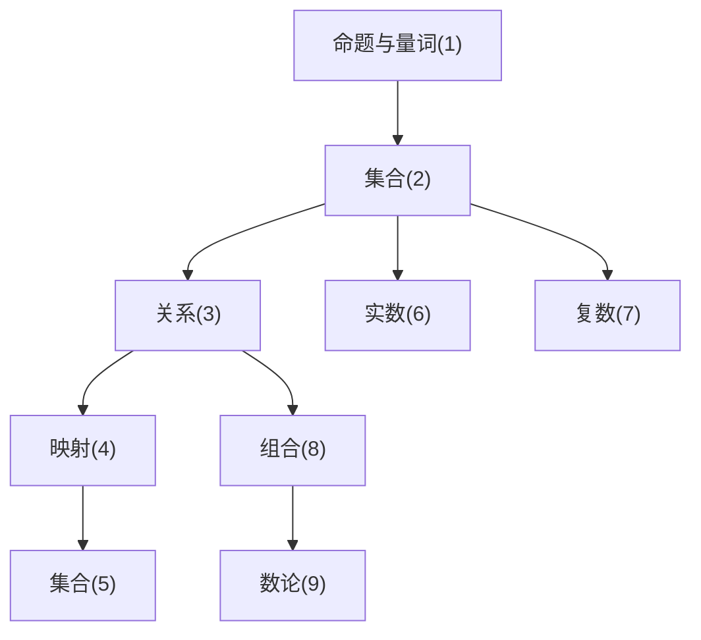

# 基础数学

## 0 写在前面

### 0.1 课程顺序及依赖关系

### 0.2 记号

集合

| 记号 | 定义                                               |
| ---- | -------------------------------------------------- |
| $\N$ | $\set{0, 1, 2, \dots}$                             |
| $\Z$ | $\set{0, \pm1, \pm2, \dots}$                       |
| $\Q$ | $\set{\frac{a}{b}: a, b\in\Z, b\ne0, \gcd(a,b)=1}$ |
| $\R$ | $\set{实数}$                                       |
| $\C$ | $\set{a+bi: a,b\in\R}, i^2 = -1$                   |

逻辑

| 记号              | 名称       | 含义           |
| ----------------- | ---------- | -------------- |
| $\forall$         | 全称量词   | 对于任意的     |
| $\exists$         | 存在量词   | 存在至少一个   |
| $\exists!$        |            | 存在唯一       |
| $\and$            | 与         | 两个同时成立   |
| $\or$             | 或         | 至少有一个成立 |
| $\neg$            | 非         |                |
| $\Rightarrow$     | 蕴含，推出 | 如果……那么……   |
| $\Leftrightarrow$ | 等价       | 真假性相同     |

## 1 命题

### 1.1 命题

> [!NOTE]
>
> **定义**：称有确定真假性的陈述句为**命题**，用 $p,q,r,\dots$ 表示，命题的真假称为命题的**真值**

> [!note]
>
> **定义**：命题的运算
>
> 命题的**非**运算定义如下，记作 ${\neg}p$
>
> | $p$  | ${\neg}p$ |
> | ---- | --------- |
> | $F$  | $T$       |
> | $T$  | $F$       |
>
> 命题的**与**运算定义如下，记作 $p{\and}q$
>
> | $p$  | $q$  | $p{\and}q$ |
> | ---- | ---- | ---------- |
> | $F$  | $F$  | $F$        |
> | $F$  | $T$  | $F$        |
> | $T$  | $F$  | $F$        |
> | $T$  | $T$  | $T$        |
>
> 命题的**或**运算定义如下，记作 $p{\or}q$
>
> | $p$  | $q$  | $p{\or}q$ |
> | ---- | ---- | --------- |
> | $F$  | $F$  | $F$       |
> | $F$  | $T$  | $T$       |
> | $T$  | $F$  | $T$       |
> | $T$  | $T$  | $T$       |

### 1.2 量词

## 2 集合（上）

### 2.1 集合的定义及运算

### 2.2 集族与任意并、交

### 2.3 笛卡尔积

### 2.4 自然数集

## 3 关系

### 3.1 关系及其性质

### 3.2 等价关系

### 3.3 序关系

## 4 映射

### 4.1 映射

### 4.2 单射、满射、双射

### 4.3 保序映射与 C-S-B 定理

## 5 集合（下）

## 6 实数

## 7 复数

## 8 组合

## 9 数论